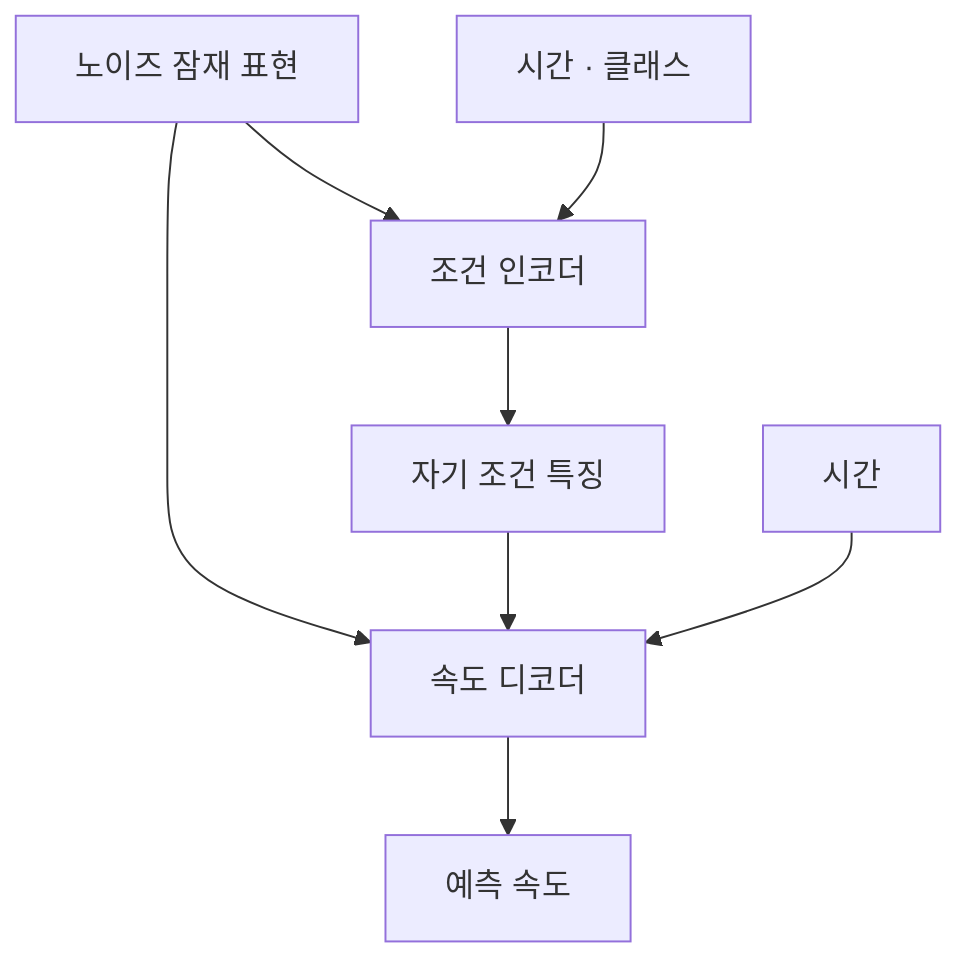

# DDT: Decoupled Diffusion Transformer

**핵심 평가:** 이 논문은 **의미 정보를 추출하는 조건 인코더와 생성 과정의 속도를 예측하는 디코더를 분리하면, ImageNet 이미지 생성의 학습 효율과 품질을 개선할 수 있다**는 실험적 근거를 제시합니다.  
다만, **새로운 데이터셋·도메인·클래스에 대한 일반화 성능 향상을 직접 입증한 연구는 아닙니다.**

**읽는 기준**

- **[저자 보고]**: 논문에 직접 제시된 주장·방법·실험 결과
- **[분석]**: 해당 근거에 대한 제 해석과 비판적 평가
- **[제안]**: 아직 검증되지 않은 후속 연구 방향
- 별도 논문명을 표시하지 않은 페이지·그림·표 번호는 모두 첨부한 DDT 원문을 가리킵니다.
- 관련 연구 비교는 **2026년 10월 27일까지 확인한 원논문·공식 학회 자료**를 기준으로 합니다.

---

## 1. Executive summary — 9문장

1. DDT는 기존 확산 Transformer가 의미 구조를 파악하는 작업과 세부 묘사를 복원하는 작업을 같은 구조 안에서 수행하면서 겪는 최적화의 어려움을 해결하고자 합니다. **[저자 보고: pp. 1–4]**
2. 제안 모델은 노이즈 입력에서 조건 특징을 추출하는 **조건 인코더**와, 그 특징을 이용해 생성 과정의 변화 방향을 예측하는 **속도 디코더**로 구성됩니다. **[저자 보고: p. 1, Fig. 1; p. 4, 식 2·4]**
3. 인코더에는 DINOv2 특징과의 표현 정렬을 적용하고, 디코더에는 선형 flow matching의 속도 회귀 손실을 적용하여 두 모듈을 공동 학습합니다. **[저자 보고: pp. 4–5, 식 3·5]**
4. 실험한 구성에서는 B 모델의 인코더 8층·디코더 4층, L 모델의 20층·4층이 우수했으며, XL 모델에는 22층·6층을 채택했습니다. **[저자 보고: p. 6, Table 2; p. 8, Figs. 7–8]**
5. ImageNet $256\times256$에서 DDT-XL은 256 epochs 학습으로 FID 1.31을, 400 epochs 학습으로 FID 1.26을 보고했습니다. **[저자 보고: p. 6, Table 1]**
6. ImageNet $512\times512$에서는 256 해상도에서 학습한 모델을 초기화로 사용하고 500K steps를 추가 학습하여 FID 1.28을 얻었습니다. **[저자 보고: pp. 6–7, Table 3]**
7. 인접 생성 단계에서 인코더 특징을 재사용하면 Table 4 기준으로 80% 공유에서 FID 1.33과 2.6배 가속을 얻지만, 해당 표에는 설정 표기의 불일치가 있습니다. **[저자 보고·원문 점검: p. 7, Table 4]**
8. 저자의 “약 4배 빠른 학습 수렴” 주장은 학습 epochs 중심의 비교이며, 동일 조건의 실제 GPU 시간 4배 절감이나 작은 성능 차이의 통계적 유의성까지 입증하지는 않습니다. **[분석: pp. 1–2; p. 6, Table 1]**
9. 따라서 확인된 기여는 ImageNet 생성에서의 역할 분리와 계산 재사용이며, 범용 시각 표현·분포 밖 생성·텍스트 조건 생성으로의 일반화는 별도의 평가가 필요한 연구 과제입니다. **[분석: pp. 5–8의 실험 범위]**

> **용어 풀이**
>
> - **Epoch:** 학습 데이터 전체를 한 번 사용하는 단위  
> - **Step:** 한 번의 학습 갱신 또는 생성 계산 단계  
> - **FID:** 생성 이미지와 실제 이미지의 특징 분포 차이로, 낮을수록 좋음  
> - **표현 정렬:** 두 모델이 추출한 특징을 서로 비슷하게 만드는 학습  
> - **Flow matching:** 노이즈를 데이터로 변화시키는 방향과 크기를 학습하는 생성 방법  

---

## 2. 연구 배경, 해결하려는 문제, 목적

### 2.1 연구 배경

**[저자 보고]** DiT·SiT 계열은 높은 생성 품질을 보이지만, 좋은 성능에 도달하기까지 많은 학습 반복이 필요하고 생성 시에도 큰 Transformer를 여러 번 계산해야 합니다. 저자들은 이러한 비효율을 모델 내부의 기능 배분 문제와 연결합니다. **[pp. 1–2]**

논문의 설명에 따르면, 생성 모델은 매 단계에서 두 가지 일을 수행합니다.

1. 노이즈가 있는 입력에서 물체의 형태와 전체 구성을 파악합니다.
2. 경계·무늬·질감 같은 세부 정보를 복원합니다.

저자들은 첫 번째 작업을 주로 **저주파 의미 인코딩**, 두 번째 작업을 **고주파 세부 디코딩**으로 해석합니다. 추상적인 의미를 얻기 위해 세부 정보를 억제하는 과정과, 세부 정보를 정밀하게 복원하는 과정이 같은 표현에 상충하는 요구를 줄 수 있다는 것이 연구의 출발점입니다. **[pp. 3–4, §3]**

> **용어 풀이 — 저주파와 고주파**  
> 저주파는 영상에서 넓고 완만하게 변하는 부분, 고주파는 가는 경계나 질감처럼 빠르게 변하는 부분입니다. 다만 **저주파와 의미, 고주파와 세부 정보가 완전히 같은 개념은 아닙니다.**

### 2.2 해결하려는 구체적인 문제

| 문제 | 저자의 진단 | 제안한 대응 |
|---|---|---|
| 느린 학습 수렴 | 의미 추출과 세부 복원에 동일 구조가 사용됨 | 조건 인코더와 속도 디코더 분리 |
| 의미 표현 학습의 어려움 | 생성 손실만으로 좋은 의미 표현을 얻기 어려움 | DINOv2 표현과 정렬 |
| 반복적인 추론 비용 | 비슷한 의미 특징을 인접 단계에서 계속 다시 계산 | 인코더 특징 재사용 |
| 모델 용량 배분의 불확실성 | 인코더와 디코더에 필요한 용량이 다를 수 있음 | 층 수 비율 실험 |

**[저자 보고: p. 2의 기여 요약; pp. 4–5, §4]**

> **용어 풀이 — 최적화 충돌**  
> 하나의 파라미터나 특징을 여러 목적에 사용할 때, 한 목적을 개선하는 변화가 다른 목적에는 불리할 수 있는 상황입니다. DDT에서는 설계 동기로 제시되지만, 충돌의 크기를 직접 측정한 실험은 없습니다.

### 2.3 목적과 필요성에 대한 평가

**[분석]** 이 연구의 중요한 질문은 **“모델을 얼마나 크게 만들 것인가?”와 함께 “어떤 기능에 용량을 배정할 것인가?”**입니다. 의미 추출과 생성 복원에 서로 다른 계산 예산을 배정하고, 상대적으로 안정적인 특징은 재사용할 수 있게 한다는 점에서 학습과 추론을 함께 다룹니다. **[근거: Fig. 1, Figs. 7–8, Table 4]**

다만 저자들이 제시한 최적화 충돌 설명과 실제 성능 개선 원인이 완전히 일치하는지는 확인되지 않았습니다. 구조 변경의 유효성을 보여 주는 실험과 그 작동 원리를 입증하는 실험은 구분해야 합니다.

---

## 3. 핵심 주장과 근거

| 핵심 주장 | 저자가 제시한 근거 | 분석 및 주의점 | 위치 |
|---|---|---|---|
| 의미 인코딩이 기존 모델의 주요 병목이다 | SiT에서 노이즈가 큰 초기 구간에 계산을 더 배정하면 FID 개선 | 수치 적분 오차 등 다른 원인을 분리한 인과 검증은 아님 | pp. 3–4, Fig. 4 |
| 인코더–디코더 분리가 학습을 개선한다 | 같은 400K steps에서 대응 기준선보다 낮은 FID | 미세 구조 개선·시간 샘플링 효과와 분리해서 읽어야 함 | p. 6, Table 2 |
| 인코더에 더 많은 용량을 배정하는 것이 유리하다 | B에서 8En4De, L에서 20En4De가 우수 | 제한된 구성의 결과이며 모든 규모의 법칙은 아님 | p. 8, Figs. 7–8 |
| 비교적 짧은 학습으로 높은 품질을 얻는다 | 256 epochs에서 FID 1.31 | 실제 GPU 시간의 같은 배수 절감을 의미하지 않음 | p. 6, Table 1 |
| 더 높은 해상도에도 적용할 수 있다 | 512 해상도 추가 학습 후 FID 1.28 | 추가 학습 없는 해상도 일반화는 아님 | pp. 6–7, Table 3 |
| 시간적으로 비슷한 특징을 재사용할 수 있다 | 특징 유사도 행렬과 공유 실험 | 평균적인 유사도가 모든 샘플의 작은 오차를 보장하지는 않음 | p. 7, Fig. 5, Table 4 |
| 통계적 DP가 균일 공유보다 품질 저하를 줄인다 | 동일 공유 비율에서 FID가 0.01–0.03 개선 | 반복 실험·신뢰구간이 없어 작은 차이의 안정성은 미확인 | p. 7, Table 4 |

> **용어 풀이**
>
> - **기준선:** 새 방법의 효과를 비교하기 위한 기존 모델이나 기본 설정  
> - **인과 검증:** 단순한 성능 차이를 넘어, 특정 변화가 개선의 원인인지 확인하는 실험  
> - **DP, 동적 계획법:** 작은 구간의 최적해를 저장하여 전체 문제를 푸는 알고리즘  

---

## 4. 방법론과 모델 구조: 수식 중심 설명

### 4.1 데이터와 실험 설계

**[저자 보고]** 주요 과제는 ImageNet의 **클래스 조건부 이미지 생성**입니다. 모델 크기, 인코더·디코더 비율, 디코더 종류, 특징 공유 전략을 바꾸며 성능을 비교합니다. **[pp. 5–8, §5]**

| 항목 | 원문 내용 | 근거 |
|---|---|---|
| 생성 데이터 | ImageNet $256\times256$, $512\times512$ | pp. 5–7 |
| 조건 입력 | 이미지 클래스 $y$ | p. 4, 식 2 |
| 이미지 압축 모델 | SD-VAE-f8d4-ft-ema | pp. 5, 11 |
| 잠재 표현 | 공간 해상도 8배 축소, 채널 4개 | p. 11, 부록 B |
| 표현 정렬 교사 | DINOv2 | p. 4, 식 3 |
| 배치 크기 | 256 | pp. 5, 11 |
| 학습률 | $10^{-4}$, 일정하게 유지 | pp. 5, 11 |
| 최적화 알고리즘 | 본문: Adam / 부록: AdamW | pp. 5, 11 |
| Weight decay | 0.0 | p. 11 |
| 전처리 | Center crop | p. 11 |
| 기본 생성 방법 | Euler-ODE, 250단계 | pp. 5, 11 |
| 학습 장비 | A100 GPU 8개 또는 16개 | p. 5 |
| 평가 도구 | ADM evaluation suite | p. 11 |

> **용어 풀이**
>
> - **클래스 조건부 생성:** “개”, “새” 같은 클래스 정보를 주고 해당 종류의 이미지를 생성하는 작업  
> - **VAE:** 이미지를 작은 수치 배열로 압축하고 복원하는 모델  
> - **잠재 표현:** 압축된 이미지의 수치 배열  
> - **DINOv2:** 이미지의 시각적 특징을 추출하도록 사전학습된 모델로, 여기서는 학습용 교사 역할  
> - **Weight decay:** 가중치가 지나치게 커지지 않도록 하는 정규화 설정  

**[분석]** DDT는 ImageNet만으로 모든 지식을 처음부터 학습하는 설정이 아닙니다. 기존 VAE와 사전학습된 DINOv2의 표현을 활용합니다. 따라서 전체 학습 자원과 외부 지식의 기여를 평가할 때 이 구성 요소들을 고려해야 합니다. **[근거: p. 4, 식 3; p. 5, §5]**

### 4.2 선형 flow matching

이 논문에서는 시간 방향이 다음과 같습니다.

- $t=0$: 순수 노이즈
- $t=1$: 깨끗한 데이터
- 생성 방향: $0\rightarrow1$

**[p. 3, §3; p. 12, 부록 F]**

부록 식 34와 $\alpha_t=t$, $\sigma_t=1-t$ 설정을 결합하면 다음과 같습니다.

$$
x_t=\alpha_t x_{\text{data}}+\sigma_t\epsilon
=t\,x_{\text{data}}+(1-t)\epsilon.
$$

**기호 설명**

- $x_{\text{data}}$: 깨끗한 이미지의 잠재 표현
- $\epsilon$: 가우시안 노이즈
- $x_t$: 시간 $t$의 노이즈 잠재 표현
- $\alpha_t,\sigma_t$: 데이터와 노이즈에 곱하는 계수
- $t\in[0,1]$: 생성 시간

**[p. 12, 식 34 및 식 36 직전의 설정]**

이 경로를 시간에 대해 미분하면 목표 속도를 얻습니다.

```math
\frac{d x_t}{dt}
=
\dot{\alpha}_t x_{\text{data}}
+
\dot{\sigma}_t\epsilon
=
x_{\text{data}}-\epsilon.
```

점은 시간 미분을 뜻합니다. 이 값은 학습에 사용되는 데이터·노이즈 쌍의 표적이며, 모델은 주어진 $x_t,t,y$로 이를 예측합니다. **[p. 11, 식 13–14]**

> **용어 풀이 — 속도와 벡터장**  
> 여기서 속도는 물체의 움직임이 아니라, 잠재 표현을 어느 방향으로 얼마나 변화시킬지를 나타냅니다. 여러 입력 지점에서 이러한 방향을 지정한 함수가 벡터장입니다.

### 4.3 전체 구조



**[구조 근거: p. 1, Fig. 1; p. 4, 식 2·4]**

생성 시에는 예측 속도로 잠재 표현을 반복 갱신하고, 최종 잠재 표현을 VAE 디코더로 이미지로 복원합니다. **DDT의 속도 디코더와 VAE의 이미지 복원 디코더는 역할이 다릅니다.** **[pp. 4–5; p. 11, 부록 B]**

#### A. 조건 인코더

원문 식 2:

$$
z_t=\text{Encoder}(x_t,t,y).
$$

- $z_t$: 자기 조건 특징
- $y$: 이미지 클래스
- $x_t,t$: 노이즈 잠재 표현과 시간

인코더는 $x_t$를 패치 토큰으로 변환한 뒤 Attention과 FFN 블록을 반복 적용합니다. 시간과 클래스는 AdaLN-Zero로 각 블록에 주입합니다. **[p. 4, §4.1]**

> **용어 풀이**
>
> - **자기 조건:** 모델이 자신의 입력에서 계산하여 다른 모듈에 제공하는 특징  
> - **패치 토큰:** 영상의 작은 영역을 벡터로 바꾼 표현  
> - **Attention:** 서로 다른 위치의 특징 사이에서 정보를 교환하는 연산  
> - **FFN/MLP:** 각 특징을 비선형적으로 변환하는 신경망  
> - **AdaLN-Zero:** 시간·클래스 같은 조건으로 정규화된 특징과 잔차 경로를 조절하는 조건 주입 방식  

개선된 기본 구조에는 SwiGLU, RoPE, RMSNorm을 사용하며, 시간 선택에는 원문이 “lognorm sampling”이라고 부르는 방법을 적용합니다. **[p. 5, §5.1]**

> **용어 풀이**
>
> - **SwiGLU:** 게이트로 FFN의 정보 흐름을 조절하는 구조  
> - **RoPE:** 위치를 회전 변환으로 표현하는 위치 인코딩  
> - **RMSNorm:** 특징의 제곱평균 크기를 이용하는 정규화  
> - **시간 샘플링:** 학습에서 어떤 노이즈 수준을 얼마나 자주 선택할지 정하는 방식  

#### B. 속도 디코더

원문 식 4:

$$
v_t=\text{Decoder}(x_t,t,z_t).
$$

- $v_t$: 예측 속도
- $z_t$: 인코더가 제공하는 자기 조건
- $x_t,t$: 디코더가 직접 받는 현재 잠재 표현과 시간

클래스 $y$는 디코더에 직접 입력하지 않습니다. 저자는 클래스 정보가 $z_t$에 포함된다고 가정하고, $z_t$를 AdaLN-Zero로 디코더에 주입합니다. **[pp. 4–5, §4.2]**

**[분석]** 디코더가 원래의 $x_t$를 직접 받으므로, 세부 정보를 모두 인코더 특징에 통과시킬 필요가 없습니다. 이러한 입력 경로는 의미 추출과 세부 복원의 역할 분담을 뒷받침합니다. 다만 역할 분담의 정도를 직접 측정한 정보량 분석은 제시되지 않았습니다.

**핵심 구분:** DDT에는 주파수 필터로 저주파와 고주파를 명시적으로 분리하는 층이 없습니다. **“저주파 인코더·고주파 디코더”는 기능에 대한 해석이며, 실제 디코더는 전체 속도를 예측합니다.** **[식 2–5]**

#### C. 모델별 구성

| 모델 | 인코더 층 | 디코더 층 | 전체 층 | 은닉 차원 | Attention heads |
|---|---:|---:|---:|---:|---:|
| DDT-B/2 | 8 | 4 | 12 | 768 | 12 |
| DDT-L/2 | 20 | 4 | 24 | 1,024 | 16 |
| DDT-XL/2 | 22 | 6 | 28 | 1,152 | 16 |

**[p. 6, Table 2; p. 11, 부록 A]**

B와 L의 구성은 탐색 결과를 바탕으로 선택했습니다. XL의 22/6은 이 결과에서 동기를 얻어 채택한 구성이며, 모든 가능한 비율 중 최적임을 보여 주는 탐색은 보고되지 않았습니다. **[p. 8, §5.5]**

### 4.4 학습 목적함수

#### A. 인코더 표현 정렬 손실

원문 식 3:

```math
\mathcal{L}_{\text{enc}}
=
1-\text{cos}\left(r_*,h_\phi(h_i)\right).
```

**기호 설명**

- $\mathcal{L}_{\text{enc}}$: 인코더 표현 정렬 손실
- $r_*$: DINOv2가 깨끗한 원 이미지에서 추출한 표현
- $h_i$: 인코더 $i$번째 층의 중간 특징
- $h_\phi$: 특징을 정렬 가능한 공간으로 변환하는 MLP
- $\phi$: 해당 MLP의 파라미터
- $\text{cos}(a,b)$: 두 벡터의 코사인 유사도

**[p. 1, Fig. 1; p. 4, 식 3]**

> **용어 풀이 — 코사인 유사도**  
> 두 벡터의 길이보다 방향이 얼마나 비슷한지를 측정하는 값입니다. 방향이 비슷할수록 위 정렬 손실이 작아집니다.

**[저자 보고]** 이 정렬은 학습 수렴과 인접 시간 특징의 일관성을 돕습니다. 다만 수식 자체는 중간 특징을 교사와 정렬하며, 서로 다른 시간의 $z_t$를 직접 비교하는 손실은 아닙니다. **[pp. 4–5, §4.1·4.3]**

이 표현 정렬 방법은 REPA에서 가져온 것입니다. DDT의 기여는 이를 명시적인 조건 인코더와 결합한 구조에 있습니다. **[p. 4, §4.1]** 

#### B. 속도 회귀 손실

원문 식 5:

```math
\mathcal{L}_{\text{dec}}
=
\mathbb{E}
\left[
\int_0^1
\left\|
(x_{\text{data}}-\epsilon)-v_t
\right\|^2\,dt
\right].
```

**기호 설명**

- $\mathcal{L}_{\text{dec}}$: 디코더의 속도 회귀 손실
- $\mathbb{E}$: 데이터·노이즈 등 학습 변수에 대한 평균
- $x_{\text{data}}-\epsilon$: 목표 속도
- $v_t$: 예측 속도
- $\|\cdot\|^2$: 오차의 제곱 크기
- $dt$: 시간에 대한 적분

**[p. 5, 식 5]**

속도 손실은 디코더뿐 아니라 $z_t$를 생성한 인코더에도 학습 신호를 전달합니다. 따라서 인코더는 교사 표현과의 정렬 및 생성 속도 예측이라는 두 감독 신호를 받습니다. **[p. 4, §4.1 마지막 문단]**

**문서에 없는 사항:** 두 손실을 결합하는 정확한 가중치, DINOv2 변형, 정렬 층 번호, 토큰 집계 방식, lognorm sampling의 세부 파라미터는 명확히 제시되지 않습니다. 원문만으로 이를 임의로 채울 수 없습니다. **[pp. 4–5; p. 11, 부록 A–B]**

### 4.5 생성 과정과 인코더 재사용

#### A. Euler 갱신

원문 식 38:

```math
x_{i+1}
=
x_i+(t_{i+1}-t_i)v_\theta(x_i,t_i).
```

- $i$: 이산 생성 단계
- $x_i$: 해당 단계의 잠재 표현
- $t_i$: 해당 시간
- $v_\theta$: 조건 입력을 생략하여 표기한 속도 예측 함수
- $\theta$: 모델 파라미터

**[p. 12, 부록 E, 식 38]**

> **용어 풀이 — Euler-ODE**  
> 현재 지점에서 예측한 변화 방향으로 작은 한 걸음을 이동하는 수치 계산 방법입니다. 초기 노이즈가 정해진 뒤 결정론적인 경로를 계산합니다.

Fig. 4의 사전 분석에 사용한 2차 Adams-like solver를 DDT의 기본 성능 표에도 사용했다고 해석하면 안 됩니다. 부록 E는 두 설정을 구분합니다.

#### B. 인코더 특징 공유

원문 식 6:

$$
z_t=
\begin{cases}
z_{t-\Delta t}, & t\notin\Phi,\\
\text{Encoder}(x_t,t,y), & t\in\Phi.
\end{cases}
$$

- $\Phi$: 인코더를 새로 계산하는 시간들의 집합
- $N$: 전체 생성 단계 수
- $K=|\Phi|$: 인코더 계산 횟수
- $\Delta t$: 직전 단계와의 시간 차이
- 공유 비율: $1-K/N$

**[p. 5, §4.3, 식 6]**

인코더를 계산하지 않는 단계에서는 마지막으로 얻은 특징을 계속 사용합니다. 디코더는 현재의 $x_t,t$를 받아 매 단계 계산합니다.

> **용어 풀이 — 캐시**  
> 이전 계산 결과를 저장한 뒤 다시 사용하는 방식입니다. DDT에서는 큰 인코더의 반복 계산을 줄이는 데 사용합니다.

#### C. 통계적 동적 계획법

균일 공유는 일정 간격으로 인코더를 다시 계산합니다. 제안한 DP는 시간별 특징의 유사도 행렬 $S$를 이용하여 갱신 위치를 선택합니다.

원문 식 7:

```math
C_i^k
=
\min_{0\le j\le i}
\left\{
C_j^{k-1}
-
\sum_{\ell=j}^{i}S[j,\ell]
\right\}.
```

**기호 설명**

- $S[j,\ell]$: 시점 $j$와 $\ell$의 특징 유사도
- $C_i^k$: 시점 $i$와 $k$번째 선택에 대응하는 누적 비용 상태
- $j$: 이전 분할·갱신 위치 후보
- $\ell$: 구간 내부의 시간 인덱스
- $P_i^k$: 최소 비용을 주는 이전 위치를 저장하는 역추적 배열

**[p. 5, 식 7–8]**

**[분석]** 이 방법의 최적성은 **특징 유사도에 기초한 대리 비용**에 대한 것입니다. FID나 지각 품질 자체의 전역 최적성을 보장하지 않습니다.

> **용어 풀이 — 대리 목적함수**  
> 직접 최적화하기 어려운 최종 목표를 대신하는 계산 가능한 기준입니다. 특징 유사도를 높이는 선택이 실제 생성 품질에도 좋은지는 실험으로 확인해야 합니다.

**원문 표기 문제**

- 식 7의 이전 비용은 $C_j^{k-1}$이지만 식 8에는 $C_i^{k-1}$로 인쇄되어 있습니다.
- 본문은 $S$를 “cosine distance”로 만든다고 쓰지만, 목적함수와 Fig. 5는 유사도 해석에 대응합니다.
- 초기 상태, 끝 경계, 통계 행렬 추정 표본 수가 충분히 설명되지 않습니다. **[p. 5, §4.3; p. 7, Fig. 5]**

### 4.6 주파수 관점의 이론적 동기

원문 식 1:

$$
f_{\max}(t) > \min\left(\left(\frac{t}{1-t}\right)^2,
K_{\text{freq}}
\right).
$$

- $f_{\max}(t)$: 노이즈 입력에서 유지되는 원 데이터의 최대 주파수라고 정의한 값
- $K_{\text{freq}}$: 깨끗한 데이터의 최대 주파수
- $t$: 생성 시간

**[p. 4, Lemma 1; p. 12, 식 36]**

**[저자 보고]** 부록 D는 주파수 성분별 신호·노이즈 크기를 비교한 뒤 데이터 의존 항을 상수 1로 단순화하여 위 식을 제시합니다.

**[분석]** 이를 보편적인 수학적 보증으로 보기에는 다음 문제가 있습니다.

- 데이터의 주파수별 에너지에 강한 단순화가 들어갑니다.
- 노이즈가 신호보다 강하다는 사실은 신호 성분이 문자 그대로 사라진다는 뜻이 아닙니다.
- 원문의 정의상 $f_{\max}(t)\le K_{\text{freq}}$여야 하는데, 우변이 $K_{\text{freq}}$가 되는 구간에서는 인쇄된 엄격 부등호가 이 범위와 충돌합니다.

따라서 이 식은 **저자의 설계 동기와 단순화된 설명으로 다루는 것이 적절하며**, 부등호를 임의로 고쳐 확립된 정리처럼 제시해서는 안 됩니다.

---

## 5. 주요 결과

### 5.1 평가 지표

| 지표 | 의미 | 좋은 방향 |
|---|---|---|
| FID | 생성·실제 이미지의 특징 분포 차이 | 낮음 |
| sFID | 공간 정보가 남는 특징으로 계산한 분포 차이 | 낮음 |
| IS | 생성 이미지의 분류 확신과 클래스 다양성 | 높음 |
| 생성 Precision | 생성물이 실제 데이터의 특징 영역에 얼마나 잘 들어오는지 | 높음 |
| 생성 Recall | 실제 데이터의 다양한 특징 영역을 얼마나 넓게 덮는지 | 높음 |

**[지표 사용 근거: p. 5, §5; Tables 1–5]**

> **용어 풀이 — 생성 Precision·Recall**  
> 분류기의 정답률과 다릅니다. 특히 생성 Recall이 높아졌다는 사실은 새 도메인에서의 일반화 정확도가 높아졌다는 뜻이 아닙니다.

### 5.2 같은 학습 단계에서의 비교

아래는 모두 **400K steps, CFG 없음**인 Table 2의 대응 비교입니다.

| 규모 | Improved-REPA FID | DDT FID | 감소량 |
|---|---:|---:|---:|
| B | 19.10 | **16.32** | 2.78 |
| L | 9.30 | **7.98** | 1.32 |
| XL | 8.14 | **6.62** | 1.52 |

**[p. 6, Table 2; 감소량은 표에서 계산]**

> **용어 풀이 — CFG**  
> 조건부 예측과 조건 없는 예측을 조합하여 조건을 더 강하게 반영하는 생성 기법입니다. 이 논문에서 **CFG가 없어도 클래스 조건은 주어집니다.**

**[분석]** 구조 효과를 보수적으로 읽으려면 단순 기준선 비교도 함께 봐야 합니다.

- 저자 재현 REPA-B/2: **22.2**
- 미세 구조·시간 샘플링 개선을 사용하지 않은 DDT-B/2†: **21.1**

이 비교의 차이는 1.1입니다. 원 REPA의 인용값 24.4에서 최종 DDT 16.32까지의 차이를 전부 구조 분리 효과로 돌리면 추가 개선과 재현 차이를 섞게 됩니다. **[Table 2]**

또한 L 모델의 sFID는 Improved-REPA의 5.44보다 DDT의 5.50이 조금 높습니다. **모든 지표에서 일관되게 우월한 것은 아닙니다.**

### 5.3 ImageNet $256\times256$

| 모델 | 파라미터 | Epochs | CFG 없는 FID | CFG 있는 FID |
|---|---:|---:|---:|---:|
| DiT-XL | 675M | 1,400 | 9.62 | 2.27 |
| SiT-XL | 675M | 1,400 | 8.30 | 2.06 |
| REPA | 675M | 800 | **5.90** | 1.42 |
| DDT-L | 458M | 80 | 7.98 | 1.64 |
| DDT-XL | 675M | 80 | 6.62 | 1.52 |
| DDT-XL | 675M | 256 | 6.30 | **1.31** |
| DDT-XL | 675M | 400 | 6.27 | **1.26** |

**[p. 6, Table 1]**

DDT의 주된 256 해상도 정량 결과는 CFG 2.0과 시간 구간 $[0.3,1]$을 사용합니다. **[p. 6, §5.3; p. 12, 부록 F]**

> **용어 풀이 — Interval guidance**  
> 생성 전체가 아닌 특정 시간 구간에만 guidance를 적용하는 방법입니다.

**[분석]**

- 초록의 **1.31**은 256 epochs 결과이고, 같은 논문의 최저 보고값 **1.26**은 400 epochs 결과입니다.
- 긴 학습에서 CFG를 사용하지 않으면 REPA 5.90이 DDT 6.27보다 낮습니다.
- 표의 대표 학습량 비율은 $800/256=3.125$이지만, 서로 같은 FID 목표에 도달한 시점을 비교한 것도 아닙니다.
- 따라서 “약 4배”는 저자의 수렴 주장으로 소개하고, 정확한 전체 GPU 비용 절감 배수로 바꾸어 표현하지 않는 것이 타당합니다.

### 5.4 ImageNet $512\times512$

| 모델 | FID↓ | sFID↓ | IS↑ | Precision↑ | Recall↑ |
|---|---:|---:|---:|---:|---:|
| DiT-XL/2 | 3.04 | 5.02 | 240.82 | 0.84 | 0.54 |
| SiT-XL/2 | 2.62 | **4.18** | 252.21 | 0.84 | 0.57 |
| REPA-XL/2 | 2.08 | 4.19 | 274.60 | 0.83 | 0.58 |
| DDT-XL/2 | **1.28** | 4.22 | **305.10** | 0.80 | **0.63** |

**[p. 7, Table 3]**

DDT는 **256 해상도에서 1.28M steps, 즉 256 epochs 학습한 모델**에 512 해상도 **500K steps를 추가**했습니다. 최종 guidance 설정은 CFG 3.0, 구간 $[0.3,1]$입니다. **[pp. 6–7, §5.3 및 Table 3 캡션]**

**[분석]** FID·IS·Recall은 개선되지만, sFID·Precision까지 모두 우수하지는 않습니다. 또한 이 결과는 512에서 처음부터 총 500K steps만 학습한 결과도, 추가 학습 없는 해상도 일반화 결과도 아닙니다.

**[원문 불일치]** 본문은 100K 추가 학습의 FID 1.90을 REPA 대비 0.28 개선이라고 쓰지만, Table 3의 REPA 2.08과의 차이는 **0.18**입니다. **[pp. 6–7]**

### 5.5 인코더 공유

| 공유 비율 | 방법 | 보고된 가속 | FID |
|---|---|---:|---:|
| 0% | 공유 없음 | 1.0× | 1.31 |
| 50% | 균일 공유 | 1.6× | 1.31 |
| 75% | 균일 공유 | 2.3× | 1.34 |
| 80% | 균일 공유 | 2.6× | 1.36 |
| 80% | 통계적 DP | 2.6× | **1.33** |
| 87% | 균일 공유 | 3.0× | 1.42 |
| 87% | 통계적 DP | 3.0× | **1.40** |

**[p. 7, Table 4]**

**[분석]** 큰 가속 이득은 공유 자체에서 발생하고, DP는 같은 공유 비율에서 품질 저하를 조금 줄이는 역할입니다.

그러나 Table 4에는 다음 문제가 있습니다.

- 표는 추론 공유 실험인데, 캡션은 “400K training steps, different model sizes, without CFG”라고 적혀 있습니다.
- 공유 없는 행의 FID 1.31·IS 308.1은 Table 1의 결과와 같지만, Recall은 Table 4에서 **0.66**, Table 1에서 **0.62**입니다.

따라서 **표 내부의 비교로 보고하되, 체크포인트·CFG 설정이 완전히 확인된 결과로 단정해서는 안 됩니다.**

### 5.6 디코더 단순화

| 디코더 | FID↓ | sFID↓ | IS↑ |
|---|---:|---:|---:|
| Attention + MLP | **16.32** | **6.63** | **86.0** |
| $3\times3$ Conv + MLP | 16.96 | 7.33 | 85.1 |
| MLP + MLP | 24.13 | 7.89 | 65.0 |

모두 DDT-B/2, 400K steps, CFG 없는 결과입니다. **[p. 8, Table 5]**

> **용어 풀이 — 합성곱, Conv**  
> 가까운 위치들을 함께 처리하여 경계나 질감 같은 공간 패턴을 추출하는 연산입니다.

**[분석]** Conv 디코더가 Attention 디코더에 비교적 가까운 품질을 보인다는 점은 경량화 연구의 단서입니다. 다만 실제 실행 시간·메모리·연산량 비교가 없으므로 속도 개선까지 입증된 결과는 아닙니다.

---

## 6. 가장 중요한 그림과 해석

| 그림 | 관찰 내용 | 해석과 한계 |
|---|---|---|
| **Fig. 1, p. 1** | 조건 인코더, 속도 디코더, 교사 정렬 및 별도 노이즈 입력 | 명시적인 조건 특징이 학습의 역할 분리와 추론의 재사용을 연결함 |
| **Fig. 3, p. 3** | SiT의 생성 과정에서 큰 구조가 먼저, 질감이 나중에 형성됨 | 설계 동기를 보여 주는 정성 예시이며, 모든 이미지에 대한 정량 주파수 분석은 아님 |
| **Fig. 4, p. 3** | 초기의 노이즈 큰 구간에 계산을 더 배정하면 SiT FID 개선 | 의미 형성이 중요하다는 가설을 지지하지만, solver 오차와 인코딩 능력을 분리하지 않음 |
| **Fig. 5, p. 7** | 시간별 인코더 특징의 코사인 유사도가 높음 | 캐시 가능성의 근거이며, 샘플별 오차나 최종 품질의 보장은 아님 |
| **Figs. 7–8, p. 8** | B는 8/4, L은 20/4 배분이 우수 | 인코더 용량이 중요하지만 디코더를 무조건 줄이는 전략은 지지하지 않음 |
| **Fig. 9, p. 13** | guidance 강도·구간에 따라 FID 변화 | 최종 성능이 구조뿐 아니라 샘플링 설정에도 의존함 |

**특히 주의할 그림 간 비교**

- Fig. 4는 **SiT와 2차 Adams-like solver**의 분석이며, DDT 기본 250단계 Euler 결과와 다릅니다. **[p. 12, 부록 E]**
- Fig. 9는 **FID10K**, Figs. 4·7·8은 **FID50K**입니다.
- Fig. 2의 생성 예시는 **CFG 4.0**으로, 주된 정량 결과의 CFG 2.0·3.0과 다릅니다. **[p. 3, Fig. 2 캡션]**

> **용어 풀이 — FID10K와 FID50K**  
> 각각 생성 이미지 1만 장과 5만 장으로 계산한 FID입니다. 표본 수가 다른 값을 같은 조건의 결과로 비교해서는 안 됩니다.

**[분석]** 가장 중요한 그림을 세 묶음으로 고르면 **Fig. 1의 구조**, **Figs. 7–8의 용량 배분 실험**, **Fig. 5와 Table 4의 재사용 근거**입니다. 이들이 DDT의 핵심 기여를 가장 직접적으로 보여 줍니다.

---

## 7. 통계적 취약점과 비교 불가능한 수치

### 7.1 통계적으로 취약한 부분

아래는 모두 **[분석]**입니다.

| 항목 | 원문의 상태 | 판단에 미치는 영향 |
|---|---|---|
| 반복 학습 | seed별 반복 결과·표준편차·신뢰구간 미보고 | 개선의 안정성을 판단하기 어려움 |
| DP 개선폭 | FID 0.01–0.03 차이 | 통계적 우월성 확정 불가 |
| 학습 속도 | 표준화된 GPU-hour 비교 없음 | “4배”를 총비용 절감 배수로 해석할 수 없음 |
| 추론 속도 | 절대 지연시간·배치·측정 범위·분산 설명 부족 | 다른 하드웨어나 실서비스로 동일 배수 이전 불가 |
| 기준선 | 인용값과 재현값 혼합 | 구현 차이와 방법 차이를 분리해야 함 |
| 인과 설명 | 주파수 역할·기울기 충돌의 직접 측정 없음 | 작동 원리에 대한 설명은 부분적으로 가설 |
| 구조 스케일링 | 제한된 B/L 비율 탐색 | 일반적인 최적 배분 법칙으로 확장하기 어려움 |

**[근거: pp. 5–8, Tables 1–5, Figs. 7–8; 부록 A–F]**

> **용어 풀이 — 신뢰구간과 통계적 유의성**  
> 신뢰구간은 측정값의 불확실성을 나타내고, 통계적 유의성은 차이를 우연한 변동만으로 설명하기 어려운지 평가합니다. “보고되지 않음”은 “효과가 없음”과 다릅니다.

### 7.2 조건을 맞추지 않고 비교하면 안 되는 항목

| 비교 항목 | 이유 | 위치 |
|---|---|---|
| CFG 있음 vs 없음 | 샘플링 방식이 달라짐 | Table 1 |
| 256 vs 512 FID | 해상도·표현·평가 분포가 다름 | Tables 1·3 |
| FID10K vs FID50K | 평가 표본 수가 다름 | Figs. 4·7–9 |
| 외부 VAE vs ImageNet으로 학습·미세조정한 VAE | 이미지 표현 및 외부 학습 조건이 다름 | Table 1 캡션 |
| 원 REPA vs Improved-REPA | 미세 구조·시간 샘플링이 다름 | §5.1, Table 2 |
| 512의 추가 500K vs 총 500K | 선행 256 학습 비용이 존재함 | Table 3 캡션 |
| 생성 FID vs 재구성 rFID | 측정하는 작업이 다름 | p. 6, §5.3 |

> **용어 풀이 — rFID**  
> 원본을 VAE로 압축했다가 복원한 이미지의 FID입니다. 새로운 이미지를 생성한 결과의 FID와 구별해야 합니다.

저자는 FID 1.26이 VAE의 rFID 1.20에 가깝다고 설명합니다. 그러나 rFID가 생성 FID의 엄밀한 하한이라는 정리는 제시하지 않습니다. 따라서 **“VAE의 이론적 한계에 도달했다”는 해석은 원문 근거보다 강합니다.** **[분석: p. 6, §5.3]**

---

## 8. 일반화 성능 향상 가능성

### 8.1 원 논문이 직접 검증한 범위

| 질문 | 원 DDT의 근거 | 결론 |
|---|---|---|
| 모델 크기를 바꿔도 개선되는가? | B/L/XL 비교 | 확인됨 |
| 같은 데이터셋의 더 높은 해상도에 적응하는가? | 256→512 추가 학습 | 확인됨 |
| 인접 시간의 특징을 재사용할 수 있는가? | Fig. 5, Table 4 | 제한된 설정에서 확인됨 |
| 추가 학습 없이 새 해상도에서 좋은가? | 별도 실험 없음 | 미검증 |
| 다른 도메인·데이터셋에서 좋은가? | 별도 실험 없음 | 미검증 |
| 미학습 클래스·텍스트 조합으로 일반화하는가? | 별도 실험 없음 | 미검증 |
| 분류·분할에 유용한 표현을 학습하는가? | 별도 실험 없음 | 미검증 |

**[pp. 5–8, §5 전체]**

> **용어 풀이**
>
> - **일반화:** 학습에서 직접 맞춘 사례를 넘어 새로운 사례에서도 성능을 유지하는 능력  
> - **분포 밖 일반화, OOD:** 학습 때와 다른 종류의 데이터 분포에서도 성능을 유지하는 능력  
> - **Zero-shot:** 새 조건에 맞춘 추가 학습 없이 수행하는 설정  
> - **미세조정:** 이미 학습한 모델을 새 데이터나 조건에서 추가 학습하는 과정  

**[분석]** 원 DDT의 512 실험은 **해상도 변경 후 적응**의 증거입니다. 시간적 특징 일관성은 **노이즈 수준 변화에 대한 안정성**의 증거입니다. 둘을 새로운 도메인에 대한 일반화와 동일시해서는 안 됩니다.

### 8.2 일반화 연구로 연결될 수 있는 요소

**첫째, 의미 표현을 학습하는 별도 인코더입니다.**  
**[분석]** 인코더가 명시적으로 분리되어 있어, 생성 품질과 별개로 그 특징의 분류·분할·대응 능력을 평가할 수 있습니다. 다만 이러한 능력은 원 DDT에서 직접 검증하지 않았습니다. **[근거: p. 4, 식 2–3]**

**둘째, 사전학습된 시각 표현의 도입입니다.**  
**[분석]** DINOv2 정렬은 외부 시각 지식을 도입하는 통로입니다. 그러나 교사의 범용 특징이 DDT의 생성 일반화로 그대로 이전된다는 보장은 없습니다. **[DDT p. 4, 식 3; DINOv2 초록]** 

**셋째, 의미 표현과 세부 복원 사이의 분업입니다.**  
**[분석]** 분업은 서로 다른 기능을 개별적으로 조정할 수 있게 합니다. 동시에 의미 추상화를 강화했을 때 특정 과제에 필요한 세부 정보가 약해지는지도 평가해야 합니다. 이는 아직 검증할 질문입니다. **[근거: 식 2–5, Table 5]**

### 8.3 일반화 검증에서 필요한 조건

다음은 **[제안]**입니다.

1. **생성과 표현을 함께 평가:** FID·Recall뿐 아니라 분류·분할·이미지 간 대응 성능을 측정합니다.
2. **정답 조건 누출 방지:** 표현 평가에서 인코더에 정답 클래스 $y$를 입력하지 않도록 합니다.
3. **예산과 외부 지식 통제:** 같은 VAE·교사·학습 데이터·학습 시간으로 비교합니다.
4. **도메인 변화와 새 클래스 적응 구분:** 기존 클래스의 스타일 변화와 새로운 클래스 학습은 다른 평가로 설계합니다.
5. **공유 일정의 이전성 평가:** 한 조건에서 구한 캐시 일정을 다른 조건에도 적용할 수 있는지 측정합니다.
6. **반복 실험 보고:** 학습 seed와 평가 표본을 고정·공개하고 평균 및 불확실성을 함께 제시합니다.

> **용어 풀이 — 정답 조건 누출**  
> 평가하려는 모델에 정답 정보를 입력하여 실제보다 좋은 성능이 나오는 문제입니다. DDT 인코더는 원래 클래스 정보를 받기 때문에 표현 평가에서 특히 주의해야 합니다.

---

## 9. 2020년 이후 관련 연구 비교

### 9.1 주요 선행 연구

| 연구 | 핵심 기여 | DDT와의 관계 |
|---|---|---|
| **DDPM, 2020** | 점진적인 노이즈 제거를 통한 생성 학습 | 반복적 노이즈 제거 생성의 기반 |
| **Latent Diffusion Models, 2021/2022** | 압축된 잠재 공간에서 확산 수행 | DDT의 VAE 기반 생성 공간 |
| **DiT, 2022/2023** | 잠재 패치를 처리하는 Transformer 생성 모델 | DDT의 직접적인 구조적 출발점 |
| **Flow Matching, 2022/2023·SiT, 2024** | 분포 연결 경로·속도장·샘플링 설계 | DDT의 선형 경로와 속도 회귀 기반 |
| **REPA, 2024/2025** | 노이즈 특징과 깨끗한 이미지의 교사 특징 정렬 | DDT가 직접 채택한 학습 기법 |
| **DeepCache, 2023/2024** | 인접 생성 단계의 특징 재사용 | 시간적 중복을 줄인다는 공통 목표 |
| **Interval Guidance, 2024** | 특정 구간에만 guidance 적용 | DDT의 최종 생성 품질에 중요한 샘플링 요소 |

**출처:** DDPM pp. 1–2, 각 연구의 원논문 초록, DDT pp. 2–5의 관련 연구·방법 설명. 

**[분석]** DDT의 새 기여는 표현 정렬이나 특징 캐시 각각의 발명에 있지 않습니다. **조건 인코더의 출력을 별도 인터페이스로 만들고, 그 구조를 용량 배분과 추론 재사용에 연결한 점**이 핵심입니다. **[Fig. 1, 식 2–8]**

### 9.2 2025–2026년의 직접 관련 연구

#### A. Representation Autoencoders — 잠재 공간까지 바꾸는 확장

**[후속 연구 저자 보고]** *Diffusion Transformers with Representation Autoencoders*는 VAE를 사전학습 표현 인코더와 복원기로 대체하고, DDT에서 영감을 받은 얕고 넓은 생성 head를 도입합니다. guidance를 적용한 ImageNet 256·512에서 FID 1.13을 보고합니다. **[RAE §5·5.1, Fig. 5, Table 7]** [arxiv.org](https://arxiv.org/html/2510.11690v1?utm_source=chatgpt.com)

> **용어 풀이 — RAE**  
> 의미 특징을 추출하는 사전학습 인코더와 이미지 복원기를 결합한 구조입니다.

**[분석]** DDT 계열의 분리가 다른 잠재 공간에서도 활용되었다는 근거입니다. 그러나 VAE, 잠재 차원, 학습 설정이 다르므로 원 DDT와의 FID 차이를 분리 구조 하나의 우열로 읽을 수 없습니다.

#### B. DUPA — 외부 교사 없이 조건 특징을 정렬

**[후속 연구 저자 보고]** *Dual-Path Condition Alignment for Diffusion Transformers*는 같은 이미지에 독립적으로 잡음을 가한 여러 경로의 조건 특징을 서로 정렬합니다. 외부 시각 교사 없이 ImageNet 256에서 400 epochs의 FID 1.46을 보고합니다. **[DUPA pp. 5–7, 식 6–8, Table 1]**

그 논문의 “DDT baseline”은 원 DDT 전체가 아니라, 미세 구조 개선과 외부 교사 정렬을 제외하고 **SiT 위에 분리 구조만 재현한 모델**입니다. **[DUPA p. 6, §5.1]** 

> **용어 풀이 — 자기 정렬**  
> 외부 교사 대신 같은 입력의 다른 변형에서 얻은 특징끼리 비슷해지도록 학습하는 방법입니다.

**[분석]** 교사의 사전학습 지식과 구조 자체의 효과를 분리하는 데 유용합니다. 다만 외부 교사와 생성 데이터의 분포 차이를 논의했다는 사실만으로 OOD 일반화 문제가 해결되었다고 주장할 수는 없습니다.

#### C. UniDDT — 이해와 생성의 결합

**[후속 연구 저자 보고]** *UniDDT*는 Noisy ViT와 LLM으로 의미 처리를 공유하고 별도 diffusion decoder를 사용합니다. Table 4의 GenEval은 학습 단계에 따라 **0.52 → 0.60 → 0.72 → 추가 4o 유사 데이터 미세조정 후 0.87**로 변합니다. **[UniDDT §3, Table 4]** [arxiv.org](https://arxiv.org/html/2606.16255v1?utm_source=chatgpt.com)

> **용어 풀이**
>
> - **멀티모달:** 이미지·텍스트처럼 여러 종류의 정보를 함께 처리하는 방식  
> - **GenEval:** 생성 이미지가 물체, 개수, 위치, 속성 등 텍스트 조건을 충족하는지 평가하는 벤치마크  

**[분석]** DDT 아이디어가 다른 과제로 확장된 사례입니다. 최종 성능에는 추가 데이터와 단계별 학습이 함께 기여하므로, 0.87을 분리 구조만의 효과로 설명하면 안 됩니다. UniDDT 자체도 Native 변형의 지시 수행 능력이 제한되어 해당 변형의 이해 성능을 보고하지 않았다고 밝힙니다. **[UniDDT §5]**

#### D. DDT-RFE — 표현의 과제 간 전이를 직접 평가

**[후속 연구 저자 보고]** *Should We Skip Diffusion?*의 DDT-RFE는 인코더의 잔차 연결을 제거하고, 초기화와 여러 깊이의 특징 결합을 함께 바꿉니다. **[DDT-RFE §4, Fig. 1]** [arxiv.org](https://arxiv.org/html/2610.07002v1?utm_source=chatgpt.com)

| 평가 | 비교 | 보고 결과 | 위치 |
|---|---|---|---|
| VOC2012 객체 발견 | DDT-L → DDT-RFE-L | CorLoc **42.5% → 58.4%** | Table 2, p. 7 |
| SPair-71k 의미 대응 | DDT-XL → DDT-RFE-XL | PCK **35.2% → 39.9%** | Table 3, p. 8 | :chatgpt-content-reference{index="7"}


> **용어 풀이**
>
> - **CorLoc:** 물체 위치를 올바르게 찾은 이미지의 비율  
> - **의미 대응:** 다른 이미지에서 같은 의미의 부위나 지점을 연결하는 과제  
> - **PCK:** 허용 오차 안에서 올바르게 대응시킨 점의 비율  
> - **잔차 연결:** 블록의 입력을 출력에 더해 정보와 기울기가 우회할 수 있게 하는 연결  

**비교상 주의:** 이 연구는 REPA를 제외하고 다른 최적화 설정으로 DDT와 DDT-RFE를 다시 학습합니다. 표는 인코더 층과 노이즈 수준을 탐색한 최댓값이며, 정답 클래스 대신 null 조건으로 특징을 추출합니다. **[§5, pp. 5–6]** [arxiv.org](https://arxiv.org/html/2610.07002v1?utm_source=chatgpt.com)

**[분석]** 이는 후속 모델의 **표현 전이** 근거입니다. 원 DDT의 OOD 생성 성능을 소급하여 입증하지는 않습니다.

### 9.3 향후 연구에 대한 종합적인 의미

**[분석]** 후속 연구는 DDT의 분리 아이디어를 네 방향으로 확장하고 있습니다.

- 잠재 공간 자체의 개선: RAE
- 외부 교사 의존 감소: DUPA
- 이해와 생성의 결합: UniDDT
- 표현의 다른 과제 활용: DDT-RFE

따라서 앞으로는 생성 FID만 비교하기보다 **표현 공간, 외부 지식, 과제 범위, 계산 비용을 함께 통제하는 실험**이 중요합니다. 특히 구조 하나를 바꿨을 때의 효과와, 추가 데이터·새 학습 목적·새 최적화 방식의 효과를 구분해야 합니다.

---

## 10. 제한사항과 문서가 답하지 않는 질문

### 10.1 저자가 직접 언급한 한계

원 DDT에는 별도의 **Limitations 절이 없습니다.**

직접적인 제한 설명으로는 512 해상도에서 일부 지표가 낮아진 이유가 충분하지 않은 추가 학습일 수 있다는 언급이 있습니다. 이것도 원인이 검증된 결과가 아니라 저자의 추정입니다. **[p. 7, §5.3]**

결론은 향후 모델 확대와 추론 최적화를 위한 설계 지침을 제시하지만, 새로운 데이터셋·OOD·텍스트·비디오 평가의 구체적인 실행 계획은 적지 않습니다. **[pp. 8–9, §6]**

### 10.2 미해결 질문

| 질문 | 왜 중요한가 |
|---|---|
| 두 손실의 정확한 가중치와 정렬 위치는 무엇인가? | 재현성과 최적화 효과의 분리 |
| DINOv2 없이 구조만 바꿔도 얼마나 개선되는가? | 외부 지식과 구조의 기여 구분 |
| 실제 주파수별 역할 분담이 생기는가? | 저자의 작동 원리 설명 검증 |
| 다른 교사·VAE에서도 최적 층 배분이 유지되는가? | 설계의 적용 범위 판단 |
| 적은 데이터에서도 큰 인코더가 유리한가? | 데이터 효율성과 과적합 평가 |
| DP 통계는 몇 개의 이미지로 추정하는가? | 캐시 일정의 신뢰도와 재현성 |
| 공유 일정이 다른 해상도·guidance에도 적용되는가? | 실제 추론 시스템의 활용성 |
| 생성 개선이 표현 일반화와 함께 나타나는가? | FID 개선과 범용 능력의 관계 |
| 학습 이미지 암기나 복제는 어떻게 달라지는가? | 새로운 샘플 생성 능력 평가 |

**[분석 근거: §4–5 및 부록에서 미보고된 항목]**

---

## 11. 결론 및 우선 검증할 후속 연구

### 11.1 저자의 결론과 시사점

**[저자 보고]**

- 조건 인코더와 속도 디코더의 분리는 학습 효율과 생성 품질을 개선합니다.
- 인코더에 충분한 용량을 배정하는 설계가 중요합니다.
- 인코더 출력 공유는 추론 가속에 활용할 수 있습니다.
- 이러한 결과는 향후 모델 크기 확대와 추론 최적화의 설계 지침이 됩니다. **[pp. 8–9, §6]**

**[분석]** 학술적으로는 **모델의 총크기뿐 아니라 기능별 용량 배분을 연구 대상으로 만든 점**이 중요합니다. 실용적으로는 **인코더 계산 재사용**이 가장 빠르게 검증할 수 있는 부분입니다.

### 11.2 복잡한 구현 전에 검증할 유망한 접근

다음은 모두 **[제안]**입니다.

| 우선순위 | 아이디어 | 최소 검증 방식 | 판단 기준 |
|---|---|---|---|
| 1 | **균일 인코더 공유** | 기존 체크포인트에서 공유 없음과 일정 간격 공유 비교 | 품질 저하 대비 실제 지연시간 절감 |
| 2 | **인코더 중심 용량 배분** | 총 12층을 유지하며 6/6과 8/4 비교 | 동일 예산에서 개선의 재현성 |
| 3 | **Conv 디코더** | Attention+MLP와 Conv+MLP만 교체 | 실제 연산·메모리 이득과 품질의 교환 관계 |
| 4 | **정렬과 캐시의 관계** | 정렬 유무별 특징 유사도·속도 오차·FID 측정 | 높은 유사도가 캐시 품질을 예측하는지 |
| 5 | **표현 일반화 평가** | 인코더 고정 후 작은 분류기나 대응 평가 | 생성 개선이 다른 과제에서도 유지되는지 |

**원문상 출발 근거:** Table 4, Figs. 7–8, Table 5, 식 3, Fig. 5.

> **용어 풀이 — 인코더 고정 평가**  
> 인코더의 가중치를 바꾸지 않고 그 특징 위에 작은 분류기 등을 학습하거나, 특징을 직접 비교하여 표현 자체의 유용성을 확인하는 방법입니다.

### 11.3 일반화를 중심으로 한 연구 우선순위

**[제안]** 가장 먼저 확인할 질문은 다음과 같습니다.

> **“DDT에서 생성 FID를 개선하는 변화가, 정답 클래스 조건 없이 추출한 표현의 다른 과제 성능도 개선하는가?”**

이 질문은 원 논문의 구조적 기여와 일반화 관심을 직접 연결합니다. 작은 특징 평가에서 효과가 확인되면, 이후 다른 도메인의 동일 예산 적응 실험이나 교사 없는 자기 정렬로 확장할 수 있습니다.

원 DDT가 가장 분명하게 보여 준 것은 **ImageNet 생성에서의 학습 효율·품질 개선과 특징 재사용 가능성**입니다. 일반화 향상은 그 결과에서 자동으로 따라오는 결론이 아니며, 표현과 생성의 평가를 분리하고 추가 실험으로 확인해야 합니다.

---

## 참고자료

1. **Wang et al. — *DDT: Decoupled Diffusion Transformer*.** 2025, arXiv:2504.05741v2.  
   [arXiv](https://arxiv.org/abs/2504.05741v2) — 본 보고서의 주 분석 대상.

2. **Ho, Jain, Abbeel — *Denoising Diffusion Probabilistic Models*.** 2020.  
   [arXiv](https://arxiv.org/abs/2006.11239)

3. **Rombach et al. — *High-Resolution Image Synthesis with Latent Diffusion Models*.** 2021 사전공개, CVPR 2022.  
   [arXiv](https://arxiv.org/abs/2112.10752)

4. **Peebles, Xie — *Scalable Diffusion Models with Transformers*.** 2022 사전공개, 2023.  
   [arXiv](https://arxiv.org/abs/2212.09748)

5. **Lipman et al. — *Flow Matching for Generative Modeling*.** 2022 사전공개, 2023.  
   [arXiv](https://arxiv.org/abs/2210.02747)

6. **Ma et al. — *SiT: Exploring Flow and Diffusion-based Generative Models with Scalable Interpolant Transformers*.** 2024.  
   [arXiv](https://arxiv.org/abs/2401.08740)

7. **Yu et al. — *Representation Alignment for Generation: Training Diffusion Transformers Is Easier Than You Think*.** 2024 사전공개, ICLR 2025.  
   [arXiv](https://arxiv.org/abs/2410.06940)

8. **Oquab et al. — *DINOv2: Learning Robust Visual Features without Supervision*.** 2023.  
   [arXiv](https://arxiv.org/abs/2304.07193)

9. **Ma, Fang, Wang — *DeepCache: Accelerating Diffusion Models for Free*.** 2023 사전공개.  
   [arXiv](https://arxiv.org/abs/2312.00858)

10. **Kynkäänniemi et al. — *Applying Guidance in a Limited Interval Improves Sample and Distribution Quality in Diffusion Models*.** 2024.  
    [arXiv](https://arxiv.org/abs/2404.07724)

11. **Zheng et al. — *Diffusion Transformers with Representation Autoencoders*.** 2025.  
    [원문 HTML](https://arxiv.org/html/2510.11690v1)

12. **Peng et al. — *Dual-Path Condition Alignment for Diffusion Transformers*.** ICLR 2026.  
    [학회 원문 PDF](https://proceedings.iclr.cc/paper_files/paper/2026/file/e8bd617e7dd0394ceadf37b4a7773179-Paper-Conference.pdf)

13. **Wang et al. — *UniDDT: Unifying Multimodal Understanding and Generation with Decoupled Diffusion Transformer*.** 2026.  
    [원문 HTML](https://arxiv.org/html/2606.16255v1)

14. **Ji, Martens, Lucey — *Should We Skip Diffusion?*.** 2026년 10월.  
    [원문 HTML](https://arxiv.org/html/2610.07002v1) — 이번 검토에서는 전문과 Tables 2–4까지 확인.
