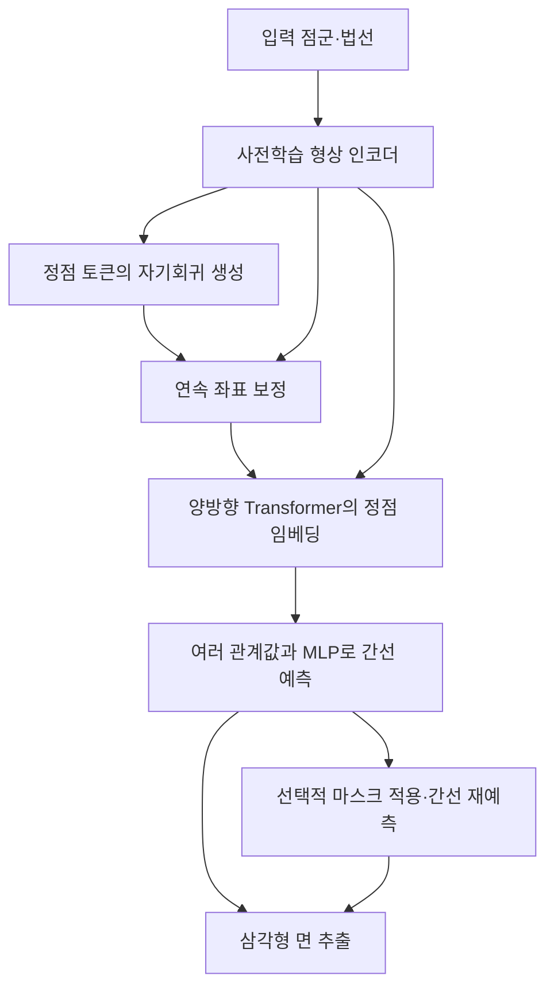

# FastMesh: Efficient Artistic Mesh Generation via Component Decoupling

**핵심 평가:** FastMesh는 정점 생성과 연결 관계 예측을 분리하여, 논문이 평가한 조건에서 생성 시간과 형상 정확도를 함께 개선한 연구입니다.  
다만 **새로운 범주·불완전한 입력에 대한 일반화**, **출력 메시의 위상적 유효성**, **동일한 실행 조건에서의 정확한 속도 향상 배수**는 별도로 검증해야 합니다.  
특히 후처리는 면 수를 크게 줄이지만, 실행 시간과 최대 형상 오차를 증가시키는 절충을 보입니다. **[원문 pp.3–8, Tables 1–4]**

## 분석 범위와 표기

분석 대상은 Jeonghwan Kim 외의 **“FastMesh: Efficient Artistic Mesh Generation via Component Decoupling”**, 첨부된 **arXiv v3, 2026년 1월 15일 판본**입니다. 공식 서지에는 3DV 2026 채택 논문으로 표시되어 있습니다. [arxiv.org](https://arxiv.org/abs/2508.19188v3?utm_source=chatgpt.com)

첨부 원문: 2508.19188v3.pdf

- **페이지 번호**는 첨부 PDF의 첫 페이지를 p.1로 센 번호입니다.
- 첨부 파일은 **본문 8쪽과 참고문헌 3쪽**으로 구성되며, 본문이 언급하는 보충자료는 포함되어 있지 않습니다.
- **[저자 보고]**는 논문에 직접 제시된 내용, **[해석]**은 근거에 대한 분석, **[제안]**은 아직 검증되지 않은 후속 실험입니다.
- 원문에 번호가 붙은 수식은 **식 (1), (2)**입니다. 아래의 추가 수식은 이해를 위한 **해설용 재표기**로 구분했습니다.
- 관련 연구는 **2026년 10월 27일 기준으로 확인한 주요 1차 자료**를 선별했습니다.

---

## 1. Executive summary — 9문장

1. FastMesh는 점군과 법선을 입력받아, 수작업 모델링에 가까운 효율적인 3D 메시를 빠르게 생성하려는 연구입니다. **[pp.1–3, Fig.2]**
2. 핵심은 **정점만 자기회귀적으로 생성한 뒤, 정점 사이의 연결 관계를 병렬로 예측하여 삼각형 면을 구성하는 것**입니다. **[pp.3–4, Fig.2]**
3. 저자는 BPT의 블록 단위 인덱싱을 정점 표현에 적용하여, 순차 생성에 필요한 토큰 수를 BPT의 약 **23% 수준**으로 줄였다고 보고합니다. **[pp.1–2, §3.1]**
4. 좌표 보정기인 Fidelity Enhancer는 7비트로 이산화된 정점을 연속 좌표로 조정하며, 선택적 Prediction Filtering은 불필요한 연결과 면을 줄입니다. **[pp.3–5, Figs.2–4]**
5. 학습에는 ShapeNet·Objaverse·일부 Objaverse-XL에서 필터링한 약 **10만 개 메시**를 사용하고, 주요 평가는 Toys4K의 **2,063개 메시**에서 수행합니다. **[p.5, §§4.1–4.2]**
6. FastMesh-V4K는 Table 1에서 CD **4.05**, HD **10.22**, 평균 추론 시간 **6.60초**를 기록하여, 비교한 방법 중 가장 낮은 평균 형상 오차를 보입니다. **[p.5, Table 1]**
7. Table 1의 평균 시간으로 계산한 BPT 대비 V4K의 속도 비율은 약 **7.46배**이며, 저자가 서술한 “정점당 8배”의 집계 방식은 표만으로 재현할 수 없습니다. **[계산·해석; p.5, Table 1]**
8. Prediction Filtering은 평균 면 수를 **6,799.2개에서 2,811.1개로 감소**시키지만, HD는 **10.22에서 11.02로 증가**하고 추론 시간도 늘어납니다. **[p.7, Table 4]**
9. 따라서 이 연구는 평가된 데이터셋에서의 효율성과 형상 정확도를 뒷받침하지만, 미지 범주·실측 점군에 대한 일반화와 매니폴드 보장까지 입증한 것으로 해석해서는 안 됩니다. **[해석; pp.5–8]**

> **용어 설명**
>
> - **메시(mesh):** 정점과 이들을 연결한 면으로 물체의 표면을 표현한 구조입니다.
> - **정점(vertex)·간선(edge)·면(face):** 각각 공간상의 점, 두 정점 사이의 연결, 여러 정점이 둘러싼 표면 조각입니다.
> - **점군(point cloud):** 물체 표면에서 얻은 3차원 점들의 모음으로, 점 사이의 연결 정보는 포함하지 않을 수 있습니다.
> - **법선(normal):** 표면이 어느 방향을 향하는지 나타내는 벡터입니다.
> - **자기회귀(autoregressive, AR):** 앞에서 생성한 결과를 조건으로 다음 요소를 하나씩 생성하는 방식입니다.
> - **일반화:** 학습에 사용하지 않은 대상이나 조건에서도 성능을 유지하는 능력입니다.

---

## 2. 연구 배경, 목표 및 필요성

### 2.1 해결하려는 문제

**[저자 보고]** 기존 메시 생성기는 삼각형 메시 전체를 긴 토큰열로 바꾸고, 언어 모델처럼 다음 토큰을 순서대로 생성하는 경우가 많습니다.  
그러나 하나의 정점이 여러 면에 공유되므로, 면을 순차적으로 기록하는 과정에서 같은 정점 정보가 반복됩니다.  
이러한 중복은 생성 시간을 늘리고, 복잡한 메시를 다룰 때 시퀀스 길이와 메모리 부담을 키웁니다. **[pp.1–2, §1]**

> **용어 — 토큰·토큰화:** 토큰은 모델이 처리하는 기본 기호이며, 토큰화는 좌표나 연결 구조를 이러한 기호의 열로 바꾸는 과정입니다.

저자들은 토큰 압축만으로는 문제가 완전히 해결되지 않는다고 봅니다.  
BPT처럼 압축률을 높여도 면 정보를 순차적으로 표현하는 한 시퀀스가 계속 길어지고, 좌표를 이산화하는 과정에서는 미세한 형상이 손실될 수 있기 때문입니다. **[pp.3–4, §§2.2–3.1]**

### 2.2 연구 목적

논문의 목적은 다음 세 가지로 정리할 수 있습니다.

| 목적 | 해결하려는 원인 | 제안한 대응 | 근거 |
|---|---|---|---|
| 생성 시간 단축 | 공유 정점의 반복 기록과 긴 순차 생성 | 정점만 순차 생성하고 연결은 병렬 예측 | pp.2–4, Fig.2 |
| 세부 형상 보존 | 좌표 양자화에 따른 위치 이동·정점 병합 | 연속 좌표를 예측하는 Fidelity Enhancer | p.4, Fig.3 |
| 불필요한 면 감소 | 잘못된 연결에서 발생하는 중복·겹침 면 | 인접행렬을 반복적으로 정제하는 Prediction Filtering | pp.4–5, Fig.4 |

> **용어 — 양자화(quantization):** 연속적인 좌표를 정해진 격자 위치로 반올림하는 과정입니다. 서로 가까운 정점이 같은 위치로 합쳐질 수 있습니다.

### 2.3 연구가 필요한 이유

**[저자 보고]** 게임·시각효과·가상현실 분야는 메시를 핵심 표현으로 사용하지만, 고품질 메시를 수작업으로 만드는 과정에는 상당한 시간과 노동이 필요합니다. 또한 다른 3D 표현에서 메시를 추출하는 방식은 지나치게 많은 면, 과도하게 매끈한 표면, 형상 왜곡을 만들 수 있습니다. **[pp.1–2, §§1–2.1]**

**[해석]** 따라서 이 연구의 실용적 의미는 **주어진 형상을 적절한 정점과 연결 구조로 빠르게 표현하는 방법**을 개선하는 데 있습니다.  
다만 “artistic mesh”라는 명칭만으로 실제 제작에 필요한 편집성·애니메이션 적합성까지 검증되었다고 볼 수는 없습니다. 해당 사용성 평가는 본문에 없습니다. **[근거: pp.5–8의 평가 범위]**

---

## 3. 핵심 주장과 근거

| 핵심 주장 | 저자가 제시한 근거 | 분석 및 근거의 범위 | 위치 |
|---|---|---|---|
| 정점·면 생성 분리는 중복을 줄인다 | 정점 전용 자기회귀 생성과 병렬 간선 예측 구조 | 설계상 중복 감소는 설명되지만, 분리만의 효과를 완전히 고립한 대규모 실험은 없음 | pp.2–4, Fig.2 |
| 토큰 수가 BPT의 약 23%다 | 초록·서론의 수치 및 정점 중심 표현 설명 | **23% 감소가 아니라 23%가 남는다는 뜻**이며, 표본별 토큰 길이 분포는 미보고 | pp.1–2, p.4 |
| 기존 방법보다 빠르고 형상 오차가 낮다 | Toys4K 정량 비교 | 보고 평균값은 지지하지만 출력 정점 수·세부 실행 조건이 동일하게 통제되었는지 불명확 | p.5, Table 1 |
| 여러 관계 특징을 결합하면 연결 예측이 개선된다 | Multi-head·MLP·관계 함수 비교 | 실험한 조합 중 spacetime + multi-head + MLP가 가장 좋음 | p.7, Table 2 |
| 비대칭 손실이 희소한 실제 연결 학습에 유리하다 | CD·HD·F1·재현율 비교 | 높은 재현율과 낮은 형상 오차가 함께 관측되지만, 인과관계의 유일한 원인까지 입증하지는 않음 | p.7, Table 3 |
| 좌표 보정기가 세부와 표면을 개선한다 | 보정 전후 시각 비교 | 정성적 근거이며, 보정기만의 정량적 개선 폭은 미보고 | p.4, Fig.3; p.8, Fig.7 |
| 후처리가 불필요한 면을 줄인다 | 면 수가 크게 감소 | HD 악화와 시간 증가가 동반되는 절충 | p.7, Table 4 |
| 다양한 형상에 적용할 수 있다 | 학습에 사용하지 않은 Toys4K 평가와 여러 예시 | 데이터셋 전이의 근거이며, 미지 범주·노이즈·부분 관측 일반화와는 구분 필요 | pp.5–8, Figs.5–8 |

> **용어 설명**
>
> - **Multi-head:** 여러 특징 공간에서 관계를 각각 계산하는 구성입니다.
> - **MLP:** 선형 변환과 비선형 함수를 여러 층으로 쌓은 신경망입니다.
> - **정성 평가:** 시각적 예시를 통해 판단하는 평가입니다.
> - **정량 평가:** 정해진 수치 지표로 비교하는 평가입니다.

---

## 4. 방법론: 데이터, 모델 구조, 핵심 수식

### 4.1 데이터와 실험 설계

| 구분 | 원문에 명시된 내용 | 주의점 | 근거 |
|---|---|---|---|
| 학습 데이터 | ShapeNet, Objaverse, 일부 Objaverse-XL | 소스별 비율과 정확한 중복 제거 방식은 미기재 | p.5, §4.1 |
| 학습 규모 | 정점 수·품질 필터링 후 약 100K 메시 | 필터 알고리즘의 상세 조건은 첨부 본문에 없음 | p.5 |
| FastMesh-V1K | 정점 수 1,000 이하인 부분집합으로 학습 | 최종 학습 표본 수는 미기재 | p.5 |
| FastMesh-V4K | 약 4,000 정점까지의 메시로 학습 | 본문에서 “up to”와 “fewer than” 표현이 혼용되어 경계 포함 여부는 불명확 | p.5 |
| 주 평가 데이터 | Toys4K에서 정점 수 5,000 미만인 2,063개 메시 | Toys4K 전체 4,000개에 대한 평가 결과는 아님 | p.5, §4.2 |
| 평가용 표면 표본 | 스케일 정규화 후 각 메시에서 5,000점을 균일 추출 | 이 5,000점은 **평가지표 계산용**이며, 모델 입력 점 수와 동일하다고 명시되지 않음 | p.5, §4.1 |
| 구조·손실 절제실험 | ShapeNet 학습, Toys4K 평가, 양쪽 정점 수 500 미만 | Tables 2–3의 수치를 Table 1과 직접 비교하면 안 됨 | p.6, §4.3 |

**[저자 보고]** V1K와 V4K는 **동일한 모델 구조**를 사용하며, 학습 데이터의 정점 수 필터가 다릅니다.  
따라서 모델 이름의 1K·4K는 매번 생성되는 정점 수를 뜻하지 않습니다. **[p.5, §4.1]**

> **용어 — 절제실험(ablation study):** 특정 구성 요소를 제거하거나 바꾸어 그 요소의 기여를 살펴보는 실험입니다.

### 4.2 전체 모델 구조

아래는 원문 Fig.2와 Fig.4의 처리 관계를 재구성한 것입니다.



**[저자 보고]** 입력 점군과 법선에서 형상 조건을 추출하는 사전학습 인코더로 참고문헌 [52]를 사용하며, 해당 문헌은 **Michelangelo: Conditional 3D Shape Generation Based on Shape-Image-Text Aligned Latent Representation**입니다. **[p.3, §3; p.11, Ref.52]**

> **용어 설명**
>
> - **형상 조건(shape condition):** 생성할 물체의 형태를 모델에 전달하는 특징입니다.
> - **임베딩(embedding):** 좌표나 구조 정보를 학습에 적합한 숫자 벡터로 바꾼 표현입니다.
> - **양방향 Transformer:** 정점들이 서로의 정보를 함께 참조하며 특징을 계산하는 신경망입니다. 여기서 “양방향”은 다음 토큰만 순차 예측하는 제약과 구별되는 정보 참조 방식입니다.

### 4.3 1단계: 정점 생성과 토큰 압축

#### A. 정점만 자기회귀 생성

**[저자 보고]** 정점 수가 물체마다 달라지는 특성을 처리하기 위해 정점 생성에는 자기회귀 모델을 사용합니다. **[pp.3–4, §3.1]**

이를 확률적으로 풀어 쓰면 다음과 같습니다.

**해설용 재표기 — 원문에 번호가 붙은 수식은 아닙니다.**

```math
p_\theta(T\mid C)
=
\prod_{\ell=1}^{L}
p_\theta(t_\ell\mid t_{<\ell},C)
```

- $T=(t_1,\ldots,t_L)$: 정점을 표현하는 토큰열.
- $L$: 토큰열 길이.
- $t_\ell$: $\ell$번째 토큰.
- $t_{ < \ell}$: 그전에 생성한 토큰들.
- $C$: 입력에서 추출한 형상 조건.
- $\theta$: 자기회귀 모델의 학습 파라미터.

이 식은 “형상 조건과 이전 결과를 보고 다음 정점 표현을 생성한다”는 의미입니다.

#### B. 블록 단위 인덱싱

정점의 XYZ 좌표를 직접 반복해서 기록하는 대신, 공간의 **블록 인덱스**와 블록 내부의 **오프셋 인덱스**로 표현합니다. 같은 블록에 속하는 정점들은 블록 인덱스를 한 번만 공유합니다. **[p.3, Fig.2(b); p.4, §3.1]**

예를 들어 다음과 같은 묶음으로 이해할 수 있습니다.

$$
(B,O_1),(B,O_2),\ldots,(B,O_n)
\quad\longrightarrow\quad
(B,O_1,O_2,\ldots,O_n)
$$

- $B$: 정점들이 속한 공간 블록의 인덱스.
- $O_i$: 해당 블록 안에서 $i$번째 정점의 위치를 나타내는 인덱스.
- $n$: 그 블록에 포함된 정점 수.

> **용어 — 오프셋(offset):** 전체 공간의 절대 위치 대신, 특정 기준점이나 영역 안에서 나타낸 상대적인 위치입니다.

원문은 기본적인 삼각형 좌표 표현의 길이를 다음과 같이 설명합니다.

$$
S=9F\approx18V
$$

- $S$: 기본 표현의 토큰 수.
- $F$: 삼각형 면 수.
- $V$: 정점 수.
- 삼각형 하나에는 정점 3개와 정점당 좌표 3개가 있으므로 $9F$가 됩니다.
- $18V$는 원문에서 사용하는 $F\approx2V$ 근사에 따른 값입니다. **[p.4, §3.1]**

**[해석]** FastMesh는 정점을 중심으로 기록하므로 시퀀스 길이가 대략 정점 수에 대응하도록 줄어듭니다. 다만 블록 인덱스 등의 부가 정보가 있으므로 길이가 정확히 $V$라고 단정할 수 없으며, $F\approx2V$도 모든 메시의 항등식은 아닙니다.

또한 **“BPT의 약 23%”는 순차 토큰 수에 대한 주장**입니다. 전체 연산량·메모리·추론 시간까지 각각 23%가 된다는 의미는 아닙니다. **[pp.1–2, p.4]**

### 4.4 Fidelity Enhancer: 이산 좌표를 연속 좌표로 보정

**[저자 보고]** 7비트 양자화는 정점을 격자 위치로 이동시키고, 가까운 정점들을 병합할 수 있습니다. Fidelity Enhancer는 이산 정점과 형상 조건을 입력받아 좌표 잔차를 예측하는 작은 Transformer입니다. **[p.3, Fig.2(c); p.4, §3.1]**

**해설용 재표기:**

```math
v_i
=
q_i+\Delta_\psi(q_{1:V},C)_i
```

- $q_i$: 양자화된 $i$번째 정점 좌표.
- $q_{1:V}$: 전체 양자화 정점 집합.
- $v_i$: 보정된 연속 좌표.
- $\Delta_\psi(\cdot)_i$: 보정기가 예측한 $i$번째 정점의 좌표 변화량.
- $\psi$: 보정기의 학습 파라미터.
- $C$: 형상 조건.
- $V$: 정점 수.

> **용어 — 잔차(residual):** 현재 값에 더하여 목표 값에 가깝게 만드는 보정량입니다.

Fig.3의 예시는 원래 **7,694개 정점**을 가진 메시가 양자화 후 **3,636개 정점**이 되고, 보정 후에도 동일한 **3,636개 정점**을 사용하는 것을 보여줍니다. **[p.4, Fig.3]**

**[해석]** 이 그림의 핵심은 **남아 있는 정점의 위치를 개선하여 표면을 회복하는 것**입니다. 병합되어 사라진 정점을 다시 생성하거나 원본 정보를 완전히 복구했다는 증거는 아닙니다.

### 4.5 2단계: 정점 관계에서 간선과 면 생성

#### A. Spacetime 관계 함수 — 원문 식 (1)

정점들을 양방향 Transformer로 임베딩한 뒤, 다음 함수로 두 정점 특징의 관계를 계산합니다.

```math
\text{dst}(u,v)
=
\text{dst}([u_1,u_2],[v_1,v_2])
=
\|u_1-v_1\|_2^2
-
\|u_2-v_2\|_2^2
```

- $u,v$: 두 정점의 학습된 특징 벡터.
- $u_1,u_2$: $u$를 절반으로 나눈 두 부분.
- $v_1,v_2$: $v$를 같은 방식으로 나눈 두 부분.
- $\|\cdot\|_2$: 유클리드 노름.
- $\text{dst}$: 두 부분에서 얻은 제곱 거리의 차이. **[p.4, 식 (1)]**

> **용어 — Spacetime distance:** 여기서는 실제 물리적 시공간을 계산하는 것이 아니라, 특징 벡터의 두 부분에서 계산한 거리들을 빼는 관계 함수입니다. 음수도 가능하므로 일반적인 비음수 거리와 구별해야 합니다.

#### B. 여러 관계값을 결합하여 간선 예측

**[저자 보고]** FastMesh는 위 함수를 하나의 최종 출력으로 바로 사용하지 않고, 여러 head에 적용하여 간선 특징을 구성한 뒤 예측 네트워크에 전달합니다. **[p.3, Fig.2(d); p.4, §3.2]**

**해설용 재표기:**

```math
e_{ij}
=
\left[
\text{dst}(h_i^{(1)},h_j^{(1)}),
\ldots,
\text{dst}(h_i^{(H)},h_j^{(H)})
\right]
```

$$
\ell_{ij}=\text{MLP}(e_{ij})
$$

- $i,j$: 정점 인덱스.
- $h_i^{(k)}$: 정점 $i$의 $k$번째 head 특징.
- $H$: head 수.
- $e_{ij}$: 두 정점 사이의 간선 특징 벡터.
- $\ell_{ij}$: 연결 여부를 판단하는 로짓.
- $\text{MLP}$: 관계 특징을 간선 점수로 바꾸는 예측 네트워크.

> **용어 — 로짓(logit):** 연결 존재 여부를 판단하기 위해 사용하는 확률 변환 전의 실수 점수입니다.

저자는 로짓을 **0에서 임계화**하여 연결 여부를 결정하고, 서로 모두 연결된 세 정점을 찾아 삼각형 면을 구성합니다. 정확히 0인 경우의 처리 규칙은 본문에 명시되어 있지 않습니다. **[p.4, §3.2]**

이를 면 집합으로 표현하면 다음과 같습니다.

```math
\mathcal F
=
\left\{
\{i,j,k\}
:
i < j < k,\;
A_{ij}=A_{jk}=A_{ki}=1
\right\}
```

- $\mathcal F$: 예측 삼각형 면의 집합.
- $A$: 정점 사이 연결을 기록한 인접행렬.
- $A_{ij}=1$: 정점 $i,j$가 연결되어 있음을 의미.
- $i<j<k$: 같은 삼각형을 중복해서 기록하지 않기 위한 해설상의 표기입니다.

> **용어 — 인접행렬(adjacency matrix):** 행과 열을 정점에 대응시키고, 두 정점이 연결되어 있으면 1을 기록한 표입니다.

**[해석]** 서로 연결된 세 정점을 찾는 규칙만으로는 면의 겹침, 면 방향, 간선 주변의 올바른 면 배치가 보장되지 않습니다. 이는 저자가 인정하는 매니폴드 미보장 문제와 연결됩니다. **[p.8, §4.4]**

### 4.6 연결의 불균형을 다루는 손실 — 원문 식 (2)

실제 연결된 정점 쌍은 전체 정점 쌍 중 일부이므로, 연결 없음에 해당하는 음성 사례가 많습니다. 저자는 이러한 불균형을 다루기 위해 비대칭 손실을 사용합니다. **[p.4, §3.2]**

원문 표기를 그대로 옮기면 다음과 같습니다.

```math
\text{AsyLoss}(p)
=
\begin{cases}
L_+=(1-p)^{\gamma_+}\log(p),\\
L_-=p^{\gamma_-}\log(1-p),
\end{cases}
\qquad
\gamma_+=0,\quad \gamma_-=3
```

- $p$: 간선 존재에 대한 예측 확률.
- $L_+$: 실제 연결이 있는 양성 사례의 항.
- $L_-$: 실제 연결이 없는 음성 사례의 항.
- $\gamma_+,\gamma_-$: 예측 확신도에 따른 가중을 조절하는 지수. **[p.4, 식 (2)]**

**중요한 표기상 한계:** 원문 식에는 통상적인 최소화 손실에 필요한 **전체 음수 부호**, 정답 라벨에 따른 결합, 표본의 합산·평균 방식이 명시되지 않았습니다. 따라서 위 식을 그대로 최소화한다고 단정할 수 없습니다.

이해를 위한 일반적인 최소화 형태는 다음처럼 쓸 수 있습니다.

**해설용 재표기 — 실제 구현을 확인한 식이 아닙니다.**

```math
\mathcal L(p,y)
=
-\left[
y(1-p)^{\gamma_+}\log p
+
(1-y)p^{\gamma_-}\log(1-p)
\right]
```

- $y\in\{0,1\}$: 정답 간선 라벨.
- $\mathcal L$: 한 정점 쌍에 대한 최소화 형태의 손실.
- 나머지 기호는 원문 식 (2)와 같습니다.

**직관:** 실제로 연결되지 않은 쌍을 이미 잘 구분하여 $p$가 작으면, $p^3$이 그 음성 사례의 기여를 더 줄입니다. 결과적으로 희소한 실제 연결을 학습하는 데 상대적으로 더 많은 비중을 둘 수 있습니다. Table 3에서는 이 설정의 재현율이 높게 보고됩니다. **[p.7, Table 3]**

> **용어 — 클래스 불균형:** 정답 종류별 표본 수가 크게 다른 상황입니다. 여기서는 “연결 없음”이 “연결 있음”보다 훨씬 많다는 의미입니다.

### 4.7 Prediction Filtering: 연결 후보를 줄이며 재예측

**[저자 보고]** 초기 인접행렬에 불필요한 연결이 남을 수 있으므로, 다음 절차로 정제합니다. **[pp.4–5, §3.3; Fig.4]**

1. 초기 연결 그래프를 **너비 우선 탐색(BFS)**으로 재정렬합니다.
2. 전체 대역폭을 제한하는 마스크를 사용하여 **두 번** 재예측합니다.
3. 정점별 연결 후보 범위를 제한하는 마스크를 사용하여 **두 번 더** 재예측합니다.

> **용어 설명**
>
> - **BFS:** 한 정점에서 시작하여 가까운 연결 이웃부터 차례로 탐색하는 방법입니다.
> - **마스크:** 모델이 참조하거나 예측할 후보를 제한하는 장치입니다.
> - **대역폭(bandwidth):** 여기서는 행렬의 대각선에서 연결 원소가 얼마나 멀리 떨어져 있는지를 뜻합니다.

원문의 대역폭 정의와 마스크 조건을 수식으로 정리하면 다음과 같습니다.

```math
\text{bw}(A)
=
\max_{A_{ij}\ne0}|i-j|
```

```math
M^{B}_{ij}
=
\mathbb I[|i-j|\le B],
\qquad
M^{r}_{ij}
=
\mathbb I[|i-j|\le r_i]
```

- $A$: 인접행렬.
- $i,j$: 재정렬된 정점 순서의 인덱스.
- $\text{bw}(A)$: 인접행렬 대역폭.
- $B$: 전체적으로 허용하는 인덱스 차이.
- $r_i$: 정점 $i$에서 허용하는 인덱스 차이.
- $M^B,M^r$: 두 종류의 마스크.
- $\mathbb I[\cdot]$: 조건이 참이면 1, 거짓이면 0인 함수.

여기서 $|i-j|$는 **재정렬된 순서의 차이**입니다. 3차원 공간에서 두 정점 사이의 유클리드 거리를 의미하지 않습니다.

**[확인되지 않은 사항]** $B$와 $r_i$의 구체적인 선택 규칙, 마스크의 대칭화, BFS 시작점, 서로 분리된 연결 성분의 처리 방식은 첨부 본문에 없습니다. **[pp.4–5]**

### 4.8 구조 설명에서 반드시 구분할 점

- **“한 번의 순전파”는 초기 면 생성 단계에 해당합니다.** 정점 생성은 자기회귀적이며, PF를 사용하면 간선 예측도 반복됩니다. **[pp.4–5]**
- 인접행렬은 $V\times V$ 구조입니다. **[해석]** 밀집 행렬을 그대로 다룬다면 저장 공간은 $O(V^2)$이므로, 정점 토큰을 줄였다는 사실만으로 전체 시스템의 확장성이 해결되지는 않습니다.
- 층 수, hidden dimension, head 수, 파라미터 수, optimizer, 학습률, batch size, 구성 요소별 학습 일정은 **첨부 본문에서 확인되지 않습니다**.

> **용어 — $O(V^2)$:** 정점 수가 늘어날 때 비용이 대략 그 제곱에 비례하여 증가하는 관계를 뜻합니다.

---

## 5. 주요 결과: 저자 보고와 해석

### 5.1 주요 비교 결과 — Table 1

**[저자 보고]** 생성 메시와 정답 메시의 크기를 정규화하고 각 표면에서 5,000점을 추출하여 평가합니다. 비교 결과는 **후처리 없이** 얻었습니다. **[p.5, §§4.1–4.2]**

> **평가지표 설명**
>
> - **Chamfer Distance, CD:** 두 표면에서 추출한 점들이 서로 얼마나 가까운지를 평균적인 관점에서 평가합니다.
> - **Hausdorff Distance, HD:** 가장 크게 어긋난 부분의 거리를 평가하므로 국소적 실패에 더 민감합니다.
> - 두 지표 모두 **낮을수록 좋습니다**.
> - 아래의 `%`는 원문 표기를 유지한 것으로, 정확도나 성공률이 아닙니다. 거리의 제곱 여부·대칭화·정규화 상수 등의 정확한 계산 규칙은 첨부에 충분히 제시되지 않았습니다.

| 방법 | CD(%) ↓ | HD(%) ↓ | 보고된 평균 추론 시간(s) ↓ | 평균 정점 수 |
|---|---:|---:|---:|---:|
| MeshAnything | 12.02 | 26.87 | 26.06 | 218.6 |
| MeshAnythingV2 | 10.23 | 24.98 | 31.94 | 533.3 |
| TreeMeshGPT | 5.46 | 13.96 | 27.32 | 706.3 |
| BPT | 5.71 | 12.02 | 49.23 | 525.5 |
| FastMesh-V1K | 4.09 | 10.32 | **3.41** | 467.2 |
| FastMesh-V4K | **4.05** | **10.22** | 6.60 | 1,040.6 |

**출처: 원문 p.5, Table 1.**

**[계산·해석]**

- V4K의 BPT 대비 평균 시간 비율은 $49.23/6.60\approx7.46$입니다.
- V4K의 BPT 대비 CD 상대 감소는 약 **29.1%**, HD 상대 감소는 약 **15.0%**입니다.
- V4K는 V1K보다 평균 정점 수가 약 **2.23배** 많지만, CD 차이는 **0.04**, HD 차이는 **0.10**에 그칩니다.
- 이 작은 차이의 표준편차나 신뢰구간이 없으므로 V4K의 우월성을 통계적으로 확정할 수는 없습니다.
- 저자는 CD·HD가 미세한 세부보다 전체 구조에 민감하기 때문에, 두 변형의 시각적 차이를 충분히 반영하지 못한다고 설명합니다. **[p.8, §4.4; Fig.8]**

### 5.2 간선 예측 구조 — Table 2

| 관계 함수 | Multi-head | MLP | CD(%) ↓ | HD(%) ↓ |
|---|---|---|---:|---:|
| Spacetime | 없음 | 없음 | 7.27 | 25.32 |
| Spacetime | 있음 | 없음 | 5.72 | 21.41 |
| Cosine | 있음 | 있음 | 5.78 | 22.05 |
| Spacetime | 있음 | 있음 | **5.06** | **18.55** |

**출처: 원문 p.7, Table 2.**

> **용어 — Cosine similarity:** 두 특징 벡터가 얼마나 같은 방향을 향하는지 측정하는 유사도입니다.

**[저자 보고]** 실험한 설계 중 **여러 head의 spacetime 관계값을 MLP로 결합하는 방식**이 가장 좋습니다.

**[해석]** 단일 관계값보다 여러 관계 특징을 조합하는 것이 유리하다는 근거입니다.  
다만 파라미터 수와 연산량을 맞췄는지 명시되지 않아, 관계 함수 자체의 효과와 추가 모델 용량의 효과를 완전히 분리하기는 어렵습니다. **[pp.6–7, §4.3]**

### 5.3 손실 함수 — Table 3

| 손실 함수 | CD(%) ↓ | HD(%) ↓ | F1(%) ↑ | Recall(%) ↑ |
|---|---:|---:|---:|---:|
| BCE | 11.62 | 36.27 | 69.45 | 64.07 |
| Dice | 10.88 | 35.68 | 67.60 | 71.20 |
| Asymmetric | **5.06** | **18.55** | **70.58** | **81.32** |

**출처: 원문 p.7, Table 3.**

> **용어 설명**
>
> - **BCE:** 연결 유무와 같은 이진 정답에 대한 확률 예측 오차를 측정하는 손실입니다.
> - **Dice loss:** 예측된 양성 집합과 실제 양성 집합이 얼마나 겹치는지를 이용하는 손실입니다.
> - **Recall, 재현율:** 실제 존재하는 간선 중 모델이 찾아낸 비율입니다.
> - **Precision, 정밀도:** 모델이 존재한다고 예측한 간선 중 실제로 존재하는 비율입니다.
> - **F1:** 정밀도와 재현율을 함께 반영한 지표입니다.

**[계산]** 비대칭 손실은 BCE 대비 재현율이 **17.25%p**, F1은 **1.13%p** 높습니다.

**[해석]** 희소한 실제 연결을 더 많이 찾아내는 것과 형상 오차 감소가 함께 나타납니다. 그러나 재현율 향상이 기하 개선의 유일한 원인이라는 인과적 증명은 아닙니다. 또한 지표의 표본별 평균·전체 합산 방식이 명시되지 않으므로, 표의 F1과 Recall로 Precision을 역산하는 것은 적절하지 않습니다.

### 5.4 후처리 효과 — Table 4

| Prediction Filtering | CD(%) ↓ | HD(%) ↓ | 추론 시간(s) ↓ | 평균 면 수 | 평균 정점 수 |
|---|---:|---:|---:|---:|---:|
| 없음 | 4.05 | **10.22** | **6.77** | 6,799.2 | 1,040.6 |
| 있음 | **4.03** | 11.02 | 12.59 | 2,811.1 | 1,040.1 |

**출처: 원문 p.7, Table 4.**

**[계산]**

- 면 수: 약 **58.7% 감소**.
- 실행 시간: 약 **1.86배 증가**.
- CD: **4.05 → 4.03**으로 소폭 개선.
- HD: **10.22 → 11.02**로 악화.

**[해석]** PF의 효과는 **면 수 감소와 평균적인 표면 오차 유지에 가깝고, 최악의 국소 오차와 실행 시간에서는 비용이 발생하는 것**으로 읽는 것이 타당합니다.

**원문 내부 불일치:** p.8의 설명은 HD가 감소했다고 쓰지만, Table 4에서는 증가합니다.  
이 보고서에서는 **표의 수치를 기준**으로 판단했습니다. 저자도 유효한 면이 제거되어 구멍이 생기는 실패를 인정합니다. **[pp.7–8]**

---

## 6. 가장 중요한 그림과 해석

| 선정 그림 | 직접 확인되는 내용 | 해석 및 한계 |
|---|---|---|
| **Fig.2 — 전체 구조, p.3** | 정점 생성, 좌표 보정, 관계 기반 연결 예측을 분리 | 논문의 설계상 핵심을 가장 잘 보여줌; 전체 파이프라인이 단일 순전파라는 뜻은 아님 |
| **Fig.3 — 양자화와 보정, p.4** | 7,694개 정점이 3,636개로 줄어든 후, 동일한 정점 수에서 좌표를 보정 | 좌표 보정만으로 시각적 형상이 개선될 수 있다는 예시; 사라진 정점이나 원본 정보의 완전 복원 증거는 아님 |
| **Fig.4 — 연결 필터링, p.5** | BFS 재정렬과 두 마스크를 이용한 반복 예측 | 후처리가 후보 연결을 제한하며 모델을 다시 실행한다는 점을 보여줌; 비용과 오삭제를 Table 4와 함께 읽어야 함 |
| **Fig.5 — 기존 방법과 비교, p.6** | 같은 입력 점군에서 일부 기존 결과의 구조 붕괴·세부 손실과 FastMesh 결과를 비교 | 시각적 우수성의 사례이지만, 전체 데이터의 실패율이나 사용자 선호도 통계는 아님 |
| **Fig.7 — 보정기 제거실험, p.8** | 보정기 사용 시 표면과 얼굴 세부가 개선된 예시 | 보정기 기여를 직관적으로 보여주지만 정량적 효과 크기는 제시하지 않음 |
| **Fig.8 — V1K와 V4K, p.8** | V1K는 전체 구조를 유지하고 V4K는 더 조밀하고 정교한 표면을 표현 | 낮은 CD·HD가 세부 품질을 모두 설명하지 못할 수 있다는 저자 해석을 뒷받침 |

**가장 먼저 볼 그림은 Fig.2, Fig.3, Fig.8입니다.** 각각 “무엇을 분리했는가”, “양자화 손실을 어떻게 완화하는가”, “정점 수 증가가 어떤 품질 차이를 만드는가”를 설명합니다.

Fig.6의 여러 시점 예시도 유용하지만, p.5에서는 해당 정성 평가를 Objaverse-XL로 소개하고 Fig.6 캡션에서는 Objaverse로 표기합니다. 두 데이터 모두 학습 소스에 포함되므로, 이 그림을 독립적인 분포 밖 일반화 증거로 사용하기는 어렵습니다. **[pp.5–7, Fig.6]**

---

## 7. 제한사항, 통계적 취약점, 문서가 답하지 않는 질문

### 7.1 저자가 직접 인정한 한계

**[저자 보고]**

1. 정점 생성이 지나치게 세밀해져 **최대 정점 한도를 초과하는 시퀀스**가 발생할 수 있습니다.
2. 면 생성에서 **유효한 면 삭제, 무효한 면 유지, 겹치는 면 생성**이 일어날 수 있습니다.
3. 따라서 출력의 **매니폴드 성질을 보장하지 않습니다**. **[p.8, §4.4]**

> **용어 — 매니폴드(manifold):** 표면의 각 지점 주변이 일관된 2차원 표면처럼 연결되는 성질입니다. 간선 주변 면의 연결이 비정상적으로 겹치면 시뮬레이션·변형·기하 처리에서 문제가 생길 수 있습니다. 구멍 없는 폐곡면 여부와도 구별되는 개념입니다.

### 7.2 통계적으로 취약하거나 비교에 제약이 있는 부분

| 표시 | 항목 | 판단 이유 | 근거 |
|---|---|---|---|
| **통계 근거 제한** | V1K와 V4K의 작은 정확도 차이 | 표준편차·신뢰구간·반복 학습 결과가 없음 | Table 1, p.5 |
| **동일 조건 비교 미확인** | 속도 순위 | GPU, batch size, 정밀도, 구현 최적화의 상세 통제가 본문에 없음 | §§4.1–4.2 |
| **출력 규모 통제 안 됨** | 방법별 시간·품질 | 평균 정점 수가 218.6–1,040.6으로 다름 | Table 1 |
| **집계 방식 불명확** | “정점당 8배” | 계산식과 표본별 집계 방식이 제시되지 않음 | p.5 |
| **직접 비교 불가** | Table 1과 Tables 2–3의 절대 수치 | 학습 데이터와 메시 복잡도 조건이 다름 | pp.5–7 |
| **평가 범위 제한** | Toys4K 전체로의 확대 해석 | 4,000개 중 조건을 만족한 2,063개만 평가 | p.5 |
| **기여 크기 미확인** | Fidelity Enhancer | 정량적 제거실험과 반복 결과 없이 시각 예시 중심 | Figs.3, 7 |
| **지표 범위 제한** | 낮은 CD·HD를 제작 적합성으로 해석 | 겹침·자기 교차·면 방향·편집성을 직접 측정하지 않음 | Tables 1–4; p.8 |
| **측정 정보 부족** | 23% 토큰 길이 | 표본별 토큰 수와 분산, 정확한 산출 집합이 미보고 | pp.1–4 |
| **인과 분리 제한** | 구조 개선의 원인 | 모델 용량·데이터 필터·표현 방식의 기여가 완전히 분리되지 않음 | Tables 1–3 |

**속도 주장에 관한 정확한 판단:** Table 1의 평균 시간 비율이 7.46배라는 사실만으로 저자의 “정점당 8배”가 틀렸다고 단정할 수는 없습니다. 표본별로 정점당 시간을 계산한 뒤 평균한 값과, 평균 시간을 평균 정점 수로 나눈 값은 서로 다를 수 있습니다. 다만 **첨부 자료만으로 그 8배를 재현하기는 어렵습니다**.

또한 Table 1의 PF 없는 V4K 시간은 **6.60초**, Table 4에서는 **6.77초**입니다. 차이의 원인이 설명되지 않으므로 각 표 안에서 비교하는 것이 적절합니다. **[pp.5, 7]**

### 7.3 일반화에 대해 실제로 확인된 범위

**[저자 보고]** 비교한 모델들은 Toys4K를 학습에 사용하지 않았다고 명시되어 있습니다. **[p.5, §4.2]**

**[해석]** 이는 별도 데이터셋으로의 전이를 평가했다는 근거입니다. 하지만 다음 항목까지 입증하지는 않습니다.

- 학습에 없던 **새 범주**에 대한 성능.
- 서로 다른 데이터셋 사이의 **동일·유사 자산 중복 제거**.
- **실측 잡음, 불완전한 점군, 법선 오류**에 대한 강건성.
- 학습 범위를 넘어선 **더 긴 시퀀스와 더 많은 정점**의 생성.
- 새로운 연결 구조나 복잡한 구멍을 가진 형상에 대한 성능.

> **용어 — 분포 밖 입력, OOD:** 학습 데이터와 범주·형태·잡음·관측 조건 등이 다른 입력입니다. 데이터셋 이름이 다르다는 사실과 미지 범주를 엄격하게 분리했다는 사실은 동일하지 않습니다.

### 7.4 문서가 답하지 않는 질문

| 질문 | 왜 중요한가 | 관련 위치 |
|---|---|---|
| 학습 데이터의 소스·범주별 비중과 V1K 최종 규모는 얼마인가? | 데이터 효과와 구조 효과를 구분하기 위해 필요 | p.5 |
| 데이터 품질 필터가 어떤 형상을 제외하는가? | 복잡하거나 비정상적인 입력에 대한 선택 편향을 판단해야 함 | p.5 |
| 정점 생성·보정·면 생성이 각각 전체 오차에 얼마나 기여하는가? | 개선할 모듈을 정하는 데 필요 | Fig.2 |
| 입력 점 수, 점군 누락, 법선 오류에 얼마나 민감한가? | 실제 스캔과 다른 생성기의 출력에 적용할 때 중요 | pp.3–6 |
| 단계별 실행 시간과 최대 메모리는 얼마인가? | 더 큰 메시로 확장할 때의 병목을 파악해야 함 | §§3–4 |
| 동일 정점 수·동일 하드웨어·동일 학습 예산에서도 우위가 유지되는가? | 방법 자체의 효율성을 확인해야 함 | Table 1 |
| 어떤 형상에서 PF가 유효한 면을 제거하는가? | 구멍과 국소 오류의 발생 조건을 알아야 함 | Table 4, p.8 |
| 실제 편집·변형·게임 적용에 필요한 수작업 수정량은 얼마인가? | 거리 지표와 실용성을 연결해야 함 | p.8 |
| 이미지·텍스트에서 시작하는 전체 시스템의 비용과 오류는 어떤가? | 원문은 통합 가능성을 설명하지만 종단 성능은 제시하지 않음 | p.2 |

---

## 8. 2020년 이후 관련 연구 비교

### 8.1 기술적 위치

**[해석]** FastMesh의 차별점은 **정점과 면의 분리 자체보다, 압축된 정점 생성·병렬 연결 예측·연속 좌표 보정의 결합**에 있습니다.  
PolyGen은 이미 2020년에 정점 모델과 면 모델을 분리했고, 둘 모두 자기회귀 방식으로 구성했습니다. **[PolyGen p.2, Fig.2, 식 (1)–(2)]** [proceedings.mlr.press](https://proceedings.mlr.press/v119/nash20a/nash20a.pdf?utm_source=chatgpt.com)

아래 연도는 혼동을 줄이기 위해 **최초 공개 연도**를 기준으로 합니다.

| 연구 | 핵심 접근 | FastMesh와의 차이 및 연구상 의미 | 원문 위치 |
|---|---|---|---|
| **PolyGen, 2020** | 정점 생성 후 정점을 조건으로 면 생성; 두 단계 모두 AR | 성분 분리의 선행 사례이며, FastMesh는 면 연결을 병렬 예측한다는 차이가 있음 | p.2, Fig.2, 식 (1)–(2). [proceedings.mlr.press](https://proceedings.mlr.press/v119/nash20a/nash20a.pdf?utm_source=chatgpt.com) |
| **MeshGPT, 2023** | 학습한 기하학 코드북의 토큰을 AR로 생성하여 삼각형 복원 | 학습된 이산 메시 표현의 대표 사례; FastMesh는 연결 정보를 동일한 순차 토큰열에서 생성하지 않음 | 초록 및 방법 개요. [arxiv.org](https://arxiv.org/abs/2311.15475?utm_source=chatgpt.com) |
| **MeshAnything, 2024** | 점군 조건, VQ-VAE, 조건부 AR Transformer | 다양한 3D 표현을 점군으로 바꾸는 입력 방식이 관련되며, 입력 품질의 도메인 차이도 명시적으로 다룸 | pp.1–4, Figs.1–2. [arxiv.org](https://arxiv.org/pdf/2406.10163v1?utm_source=chatgpt.com) |
| **MeshAnything V2, 2024** | 인접한 삼각형이 공유하는 정점을 재사용하는 AMT | 중복 감소라는 문제의식을 공유하지만 면을 순차적으로 생성하는 구조를 유지 | Fig.2, §3.1. [arxiv.org](https://arxiv.org/html/2408.02555v1?utm_source=chatgpt.com) |
| **SpaceMesh, 2024** | 연속 연결 임베딩과 half-edge의 순환 이웃 관계로 다각형 메시 표현 | FastMesh가 참조한 관계 표현 계열; SpaceMesh의 edge-manifold 보장은 FastMesh에 그대로 적용되지 않음 | 공식 프로젝트의 표현 설명·초록; FastMesh pp.3–4. [research.nvidia.com](https://research.nvidia.com/labs/toronto-ai/space-mesh/?utm_source=chatgpt.com) |
| **BPT, 2024** | 블록 단위 인덱싱과 인접 면의 패치 집계로 압축 | FastMesh가 블록 인덱싱을 직접 채택한 선행 연구; FastMesh는 정점 전용 토큰화로 범위를 바꿈 | Fig.3, §§3.2–3.3. [arxiv.org](https://arxiv.org/html/2411.07025v1?utm_source=chatgpt.com) |
| **TreeMeshGPT, 2025** | 방향성 간선과 동적 트리 순회로 메시를 국소적으로 확장 | 순차 생성의 구조를 개선하는 접근이며, FastMesh의 병렬 면 생성과는 다름 | Fig.2, §3.1. [arxiv.org](https://arxiv.org/html/2503.11629v1?utm_source=chatgpt.com) |
| **MeshCraft, 2025** | 면 단위 연속 VAE 표현과 면 수 조건 Flow-based DiT | 정점 AR도 유지하지 않는 다른 생성 방향; 미학습 면 수와 분포 밖 조건의 한계를 저자가 명시 | Fig.2, §4, §5.4. [arxiv.org](https://arxiv.org/html/2503.23022v1?utm_source=chatgpt.com) |
| **MeshFlow, 2026** | 정점·법선·연결 정보를 MeshVAE로 압축하고 latent rectified flow로 생성 | 연속 잠재 공간에서 기하와 연결을 생성하는 방향; FastMesh를 직접 비교·논의 | Fig.3, §§3.1–3.4, Table 2. [arxiv.org](https://arxiv.org/html/2606.04621v2?utm_source=chatgpt.com) |

> **관련 연구 용어**
>
> - **코드북:** 복잡한 기하학 조각을 대표하는 학습된 코드들의 집합입니다.
> - **VQ-VAE:** 입력을 제한된 종류의 이산 코드로 압축했다가 복원하는 모델입니다.
> - **VAE:** 입력을 확률적인 잠재 표현으로 압축하고 복원하는 모델입니다.
> - **잠재 공간(latent space):** 원래 메시 정보를 더 작은 특징 표현에 담은 공간입니다.
> - **Half-edge:** 간선을 방향별로 나누어 면의 연결과 둘레 순서를 관리하는 자료구조입니다.
> - **Rectified flow:** 잡음에서 데이터로 이동하는 연속 경로의 방향을 학습하는 생성 방식입니다.
> - **DiT:** 확산 또는 관련 생성 과정의 예측기로 Transformer를 사용하는 구조입니다.

### 8.2 압축률과 속도를 직접 순위화하면 안 되는 이유

**첫째, 압축 비율의 기준이 다릅니다.**

- BPT의 약 **75% 감소**는 기본 메시 토큰열 대비 감소율입니다. **[BPT Fig.3, §3]** [arxiv.org](https://arxiv.org/html/2411.07025v1?utm_source=chatgpt.com)
- FastMesh의 약 **23%**는 **BPT 대비 남은 토큰 길이**입니다. **[FastMesh pp.1–2]**
- 연속 잠재 벡터의 개수는 이산 토큰의 개수와 정보량이 같다고 볼 수 없습니다.

**둘째, 정점 수와 면 수는 다른 단위입니다.** 예를 들어 MeshAnything V2의 최대 1,600 **면**과 FastMesh의 1K·4K **정점 학습 범위**는 같은 크기 지표가 아닙니다. **[MeshAnything V2 Fig.1; FastMesh p.5]** [arxiv.org](https://arxiv.org/html/2408.02555v1?utm_source=chatgpt.com)

**셋째, 후속 논문의 비교가 독립 재실행인지 확인해야 합니다.** MeshFlow의 Table 2는 FastMesh와 여러 기존 방법의 값을 FastMesh에서 가져왔다고 표시합니다. 따라서 이를 모든 방법을 동일 환경에서 재실행한 결과로 해석할 수 없습니다. 또한 MeshFlow 저자들은 batch 평균 시간과 단일 객체 지연시간의 차이를 별도로 논의합니다. 이 설명은 **후속 논문의 보고**이며, FastMesh 본문에 직접 명시된 실행 프로토콜과 구별해야 합니다. **[MeshFlow Table 2, Appendix I, Table 4]** [arxiv.org](https://arxiv.org/html/2606.04621v2?utm_source=chatgpt.com)

### 8.3 추가 최신 동향: 확인 범위를 제한한 참고

2026년 9월 공개된 **TaoFlowForge: Progressive Native Mesh Generation via Cascaded Flow Matching**의 초록은 정점 생성과 연결 예측을 분리하고, 정점을 두 단계로 생성하며, 정점 법선으로 면 방향을 다루는 접근을 설명합니다. 다만 이번 분석에서는 전문을 확인하지 못했으므로 **수식·실험 수치의 상세 비교에서는 제외**했습니다. [arxiv.org](https://arxiv.org/abs/2609.37139?utm_source=chatgpt.com)

### 8.4 앞으로의 연구에 주는 의미

**[해석]** 관련 문헌을 종합하면 연구 방향은 다음 세 문제로 나눌 수 있습니다.

1. **순차 생성량을 얼마나 줄일 것인가:** 압축과 성분 분리.
2. **양자화 손실을 어떻게 줄일 것인가:** 연속 좌표 보정과 연속 잠재 표현.
3. **연결을 얼마나 유효하게 만들 것인가:** 위상 제약, 면 방향, 구멍·겹침의 처리.

FastMesh는 첫 번째 문제에서 설득력 있는 실험을 제시하고 두 번째 문제에 간단한 보정기를 도입합니다. 세 번째 문제는 명시적인 한계로 남습니다. **[FastMesh Figs.2–4, Tables 1–4, p.8]**

---

## 9. 일반화 성능 향상 가능성과 빠른 검증 방향

### 9.1 일반화 향상과 연결될 수 있는 요소

아래는 **현재 입증된 일반화 개선 결과가 아니라, 원문의 구조와 비교 문헌에서 도출한 검증 가설**입니다.

| 접근 | 일반화와 관련된 가설 | 반드시 확인할 사항 |
|---|---|---|
| 정점·연결 분리 | 물체 전체를 생성하는 문제와 국소 연결 문제를 나누면, 연결 규칙이 다른 범주로 전이될 수 있음 | 새 범주에서도 간선 정확도와 면 유효성이 유지되는지 |
| 짧은 AR 시퀀스 | 순차 예측 오류가 누적될 기회를 줄일 수 있음 | 정점 수가 증가할 때 실제 실패율이 어떻게 변하는지 |
| 연속 좌표 보정 | 격자 위치에 따른 오차를 줄이는 데 도움이 될 수 있음 | 얇은 구조·날카로운 모서리·입력 잡음에도 효과가 유지되는지 |
| 사전학습 형상 특징 | 여러 형상의 정보를 활용할 여지가 있음 | 인코더 효과와 FastMesh 생성기 효과를 분리할 수 있는지 |
| 입력 품질을 반영한 학습 | 실제 입력과 학습 입력의 차이를 줄일 수 있음 | 잡음·누락·법선 오류에 대한 성능 변화 |

**근거 범위:** 첫 네 항목은 FastMesh의 구조에 대한 해석입니다. **[pp.3–4, Fig.2]** 마지막 항목과 관련하여 MeshAnything은 정밀한 원본 메시에서 얻은 점군과 실제 생성 결과의 점군 사이에 차이가 있음을 지적하고, 학습용 형상을 의도적으로 열화시키는 방법을 사용합니다. 이는 FastMesh에서도 검토할 수 있는 구체적인 선행 접근입니다. **[MeshAnything pp.3–4]** [arxiv.org](https://arxiv.org/pdf/2406.10163v1?utm_source=chatgpt.com)

> **용어 — 도메인 차이(domain gap):** 학습 때 보는 입력과 실제 사용 때 보는 입력의 성질이 다른 현상입니다.

**주의할 점:** 연속 표현이나 비자기회귀 모델로 바꾸는 것만으로 일반화가 해결되지는 않습니다. MeshCraft도 미학습 면 수와 훈련 분포에서 멀어진 이미지·면 수 조건에서의 실패를 명시합니다. **[MeshCraft §5.4]** [arxiv.org](https://arxiv.org/html/2503.23022v1?utm_source=chatgpt.com)

### 9.2 유망한 기술과 작은 검증 실험

**[제안]** 전체 FastMesh를 처음부터 크게 재구현하기 전에 다음 실험을 우선 수행하는 것이 좋습니다.

| 우선순위 | 검증할 아이디어 | 최소 실험 | 확인할 지표 | 판단 기준 |
|---|---|---|---|---|
| **1** | 정점 전용 토큰화 | 동일 메시를 기본 좌표열·BPT·정점 전용 블록 방식으로 표현 | 토큰 수, 중복 기록량, 정점 수별 길이 분포 | 모델 학습 전에 압축 이득이 실제 데이터에서 유지되는지 확인 |
| **2** | Multi-head spacetime + MLP | 정답 정점을 고정하고 소형 연결 예측기의 마지막 관계 구조만 교체 | 간선 정밀도·재현율, CD·HD, 중복 면·비정상 간선 | 정점 생성 오류와 분리하여 연결 모듈의 이득 확인 |
| **3** | 비대칭 손실 | 동일한 연결 모델에서 BCE·Dice·Asymmetric만 변경 | 형상 오차, 정밀도·재현율, 구멍 발생 | 높은 재현율이 실제 메시 개선으로 이어지는지 확인 |
| **4** | Fidelity Enhancer | 같은 이산 정점 집합을 고정하고 보정 전후 비교 | CD·HD, 법선 오차, 얇은 구조·모서리 보존 | 정점 수 증가 없이 좌표 보정만의 효과 확인 |
| **5** | Prediction Filtering | 같은 면 예측 모델에서 후보 범위와 반복 횟수 변경 | 면 수, HD, 구멍, 겹침, 실행 시간 | 면 수 감소와 유효한 표면 보존을 동시에 확인 |

**각 실험의 출발 근거:** 정점 토큰화는 §3.1, 관계 구조는 Table 2, 손실은 Table 3, 보정기는 Figs.3·7, PF는 Table 4입니다.

### 9.3 일반화를 검증하는 평가 설계

**[제안]** 위 실험에는 다음 조건을 공통으로 적용하는 것이 좋습니다.

1. **데이터 출처 분리와 범주 분리를 따로 평가합니다.** 다른 데이터셋으로 옮겨가는 능력과 새 종류의 물체를 처리하는 능력을 구분합니다.
2. **입력 교란을 단계적으로 적용합니다.** 점 수 감소, 좌표 잡음, 부분 누락, 법선 오류를 각각 변화시킵니다.
3. **정점 수 구간별로 결과를 보고합니다.** 평균값 하나에 복잡한 메시의 실패가 가려지지 않도록 합니다.
4. **형상과 연결 품질을 함께 평가합니다.** CD·HD 외에 중복 면, 경계 간선, 자기 교차, 매니폴드 여부를 확인합니다.
5. **동일 출력 복잡도와 동일 실행 환경을 사용합니다.** PF 포함 여부와 단계별 시간도 분리합니다.
6. **표본별 결과와 반복 실험을 보존합니다.** 평균 차이에 대한 신뢰구간과 실패율을 계산할 수 있도록 합니다.

> **용어 설명**
>
> - **자기 교차:** 표면의 서로 다른 부분이 비정상적으로 관통하는 현상입니다.
> - **신뢰구간:** 관측된 성능 차이가 표본 변동을 고려할 때 어느 범위에 있을지 나타내는 통계적 구간입니다.

이 실험들은 일반화 향상을 보장하는 처방이 아니라, **어떤 구성 요소가 어떤 입력 조건에서 실패하는지 확인하기 위한 계획**입니다.

---

## 10. 결론 및 시사점

### 10.1 저자가 제시한 결론과 후속 계획

**[저자 보고]** FastMesh는 메시 전체를 하나의 긴 시퀀스로 생성하는 부담을 줄이고, 정점과 면에 적합한 서로 다른 처리를 적용하여 빠르고 정교한 메시 생성을 달성했다고 결론짓습니다. 좌표 보정과 연결 필터링을 추가해 양자화와 불필요한 면 문제를 완화하려고 합니다. **[p.8, §5]**

저자가 명시한 후속 연구는 다음과 같습니다.

- **상대 위치 인코딩**을 이용한 더 긴 시퀀스 생성.
- **면 생성 아키텍처 개선**.
- **매니폴드를 보장하는 제약 또는 추가 처리 과정 도입**. **[p.8, §4.4]**

> **용어 — 상대 위치 인코딩:** 요소의 절대 순서만이 아니라 요소들 사이의 상대적인 위치 관계를 모델에 전달하는 방법입니다. 더 긴 길이에 대한 적용을 연구할 수 있지만, 그것만으로 길이 일반화가 보장되는 것은 아닙니다.

### 10.2 학술적·실용적 시사점

**[해석] 학술적 의미:** FastMesh는 **생성해야 할 정보를 어떤 순서와 단위로 분해할 것인지**가 모델 효율성에 큰 영향을 준다는 점을 보여줍니다. 특히 압축률, 순차 생성 횟수, 연속 좌표 정확도, 연결 유효성을 각각 별도 문제로 연구할 필요성을 드러냅니다. **[근거: Fig.2, Tables 1–4]**

**[해석] 실용적 의미:** 빠른 형상 재구성과 메시 초안 생성에는 유망합니다. 그러나 실제 제작 과정에 적용하려면 표면 겹침, 구멍, 면 방향, 편집·변형에 필요한 수정량을 추가로 평가해야 합니다. 원문의 낮은 CD·HD와 빠른 평균 시간만으로 이러한 적합성까지 확정할 수는 없습니다. **[근거: p.8의 한계; 평가 지표의 범위]**

### 10.3 일반화 향상을 위한 후속 연구의 우선순위

**[제안]** 가장 먼저 검증할 대상은 **다른 범주와 열화된 점군에서도 정점 보정과 연결 예측의 이득이 유지되는지**입니다. 그다음 동일한 정점 예산에서 기하·위상·실행 시간을 함께 평가하고, 실패가 어느 단계에서 발생하는지 분해하는 것이 좋습니다.

이 검증을 통과한 뒤 더 긴 시퀀스, 연속 잠재 생성, 위상 제약을 확장하면, 단순히 평균 점수를 높이는 연구보다 **어떤 조건에서 신뢰할 수 있는 메시를 생성하는가**를 분명하게 설명할 수 있습니다. FastMesh가 현재 제공하는 가장 확실한 출발점은 **정점 전용 압축 표현과 병렬 연결 예측**, 가장 중요한 미해결 과제는 **일반화 범위와 연결 구조의 유효성**입니다. **[분석 근거: pp.3–8]**

---

## 참고자료 및 출처

### 직접 분석한 논문과 공식 자료

1. **Jeonghwan Kim et al. — FastMesh: Efficient Artistic Mesh Generation via Component Decoupling.** 첨부 arXiv v3, 2026-01-15.  
   [arXiv v3](https://arxiv.org/abs/2508.19188v3) · [공식 프로젝트](https://jhkim0759.github.io/projects/FastMesh/)

2. **Charlie Nash et al. — PolyGen: An Autoregressive Generative Model of 3D Meshes.** ICML 2020.  
   [PMLR 논문 원문](https://proceedings.mlr.press/v119/nash20a/nash20a.pdf)

3. **Yawar Siddiqui et al. — MeshGPT: Generating Triangle Meshes with Decoder-Only Transformers.** 2023 최초 공개, CVPR 2024.  
   [arXiv](https://arxiv.org/abs/2311.15475)

4. **Yiwen Chen et al. — MeshAnything: Artist-Created Mesh Generation with Autoregressive Transformers.** 2024 최초 공개.  
   [분석에 사용한 v1 원문](https://arxiv.org/pdf/2406.10163v1)

5. **Yiwen Chen et al. — MeshAnything V2: Artist-Created Mesh Generation With Adjacent Mesh Tokenization.** 2024 최초 공개.  
   [v1 원문](https://arxiv.org/html/2408.02555v1)

6. **Tianchang Shen et al. — SpaceMesh: A Continuous Representation for Learning Manifold Surface Meshes.** SIGGRAPH Asia 2024.  
   [NVIDIA 공식 프로젝트 및 논문 안내](https://research.nvidia.com/labs/toronto-ai/space-mesh/)

7. **Haohan Weng et al. — Scaling Mesh Generation via Compressive Tokenization.** 2024 최초 공개, CVPR 2025.  
   [v1 원문](https://arxiv.org/html/2411.07025v1)

8. **Stefan Lionar, Jiabin Liang, Gim Hee Lee — TreeMeshGPT: Artistic Mesh Generation with Autoregressive Tree Sequencing.** 2025.  
   [v1 원문](https://arxiv.org/html/2503.11629v1)

9. **Xianglong He et al. — MeshCraft: Exploring Efficient and Controllable Mesh Generation with Flow-based DiTs.** 2025.  
   [v1 원문](https://arxiv.org/html/2503.23022v1)

10. **Weiyu Li et al. — MeshFlow: Efficient Artistic Mesh Generation via MeshVAE and Flow-based Diffusion Transformer.** 2026.  
    [분석에 사용한 v2 원문](https://arxiv.org/html/2606.04621v2)

11. **Xianze Fang et al. — TaoFlowForge: Progressive Native Mesh Generation via Cascaded Flow Matching.** 2026-09-29.  
    [arXiv 서지·초록](https://arxiv.org/abs/2609.37139) — **본 보고서에서는 초록에서 확인한 기술 방향만 사용했습니다.**

### 데이터·기반 방법의 명칭 확인에 사용한 FastMesh 참고문헌

다음 자료의 사용 관계는 **첨부 FastMesh의 본문과 참고문헌을 통해 확인**했습니다.

- **ShapeNet: An Information-Rich 3D Model Repository** — Ref. [3].
- **Objaverse: A Universe of Annotated 3D Objects** — Ref. [10].
- **Objaverse-XL: A Universe of 10M+ 3D Objects** — Ref. [11].
- **Using Shape to Categorize: Low-Shot Learning with an Explicit Shape Bias** — Toys4K 관련 Ref. [37].
- **Michelangelo: Conditional 3D Shape Generation Based on Shape-Image-Text Aligned Latent Representation** — 조건 인코더 관련 Ref. [52].
- **Spacetime Representation Learning** — 관계 함수 관련 Ref. [19].
- **Asymmetric Loss for Multi-Label Classification** — 손실 함수 관련 Ref. [31].
- **RoFormer: Enhanced Transformer with Rotary Position Embedding** — 저자의 후속 계획 관련 Ref. [38].
