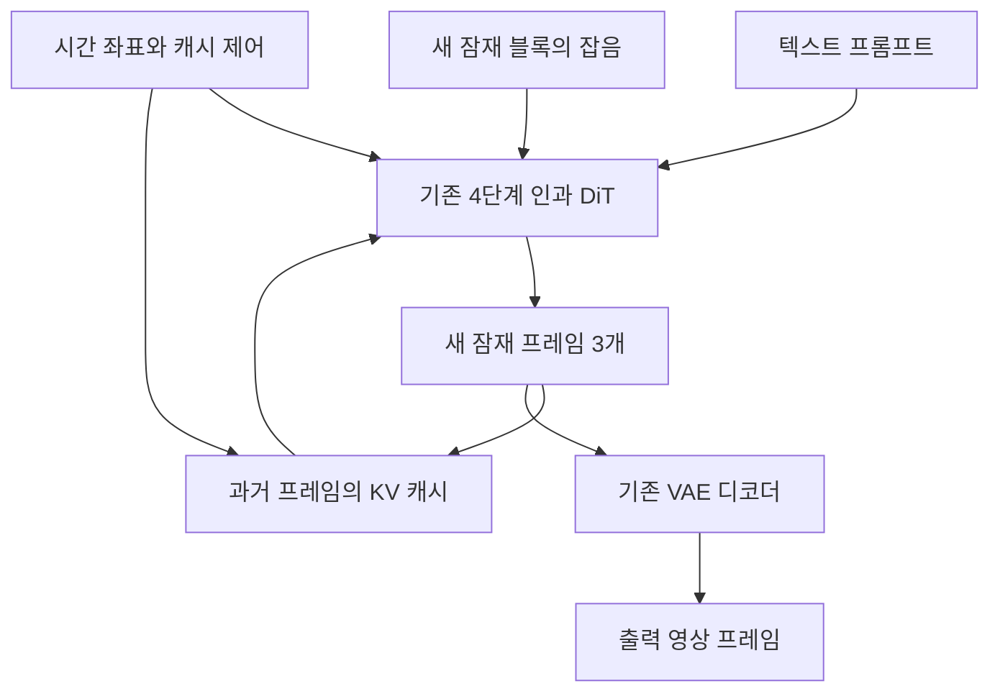

# Infinity-RoPE: Action-Controllable Infinite Video Generation Emerges From Autoregressive Self-Rollout

**핵심 평가:** 이 논문의 가장 설득력 있는 기여는 **추가 학습 없이 기존 영상 생성 모델의 시간 좌표와 캐시 관리 방식을 바꾸어, 학습 길이를 크게 넘는 생성에서 품질 저하를 줄였다는 점**입니다.  
다만 **무한한 길이에서의 품질 보장, 새로운 도메인에 대한 일반화, 오래전 사건을 정확히 기억하는 능력까지 입증한 연구는 아닙니다.**

---

## 1. Executive summary — 9문장

1. **Infinity-RoPE는 이미 학습된 자기회귀 영상 생성 모델에 적용하는 추론 단계의 방법으로, 긴 영상 생성·자연어 행동 제어·장면 전환을 추가 학습 없이 지원하는 것을 목표로 합니다.** [pp.1–2]
2. 핵심 구성요소는 시간 위치를 재배치하는 **Block-Relativistic RoPE**, 프롬프트 변경 시 필요한 과거 정보만 남기는 **KV Flush**, 시간 위치에 불연속적인 점프를 넣는 **RoPE Cut**입니다. [pp.4–6, Figs.3–5]
3. Block-Relativistic RoPE는 새로 생성하는 블록과 과거 캐시의 시간 좌표를 이동하는 기준계 안에서 표현하여, 학습에서 경험한 위치 범위를 계속 활용하도록 설계되었습니다. [p.4, Eq.(2), Fig.3]
4. KV Flush는 전역 참조 역할을 하는 초기 잠재 프레임과 마지막 잠재 프레임을 남겨, 새로운 행동 지시의 반영과 직전 동작의 연속성을 함께 유지하려 합니다. [p.5, Fig.4]
5. RoPE Cut은 블록 내부 일부 시간 좌표를 불연속적으로 변경하여, 같은 생성 흐름 안에서 배경과 장면이 바뀌도록 유도합니다. [pp.5–6, Eq.(4), Fig.5]
6. 저자는 약 5초 영상에 기반한 Self-Forcing 모델에 이 방법을 적용하여, 60·120·240초 평가에서 각각 **0.8298·0.8236·0.8309의 Overall 점수**를 보고했으며, 해당 표의 비교 모델 중 가장 높은 값입니다. [p.7, Tables 1–2]
7. 행동 제어 사용자 평가와 60초 영상 사용자 평가에서도 가장 높은 평균 점수를 얻었지만, 5초 Overall 점수는 원래 Self-Forcing보다 낮습니다. [pp.7–9, Tables 1·3·5]
8. **[분석]** 가장 직접적으로 뒷받침되는 성과는 한 기반 모델에서의 **생성 길이 일반화**이며, 다른 모델 계열·새로운 도메인·물리적 추론·장기 사건 기억에 대한 일반화는 별도 검증이 필요합니다. [pp.6–9]
9. **[분석]** 정량 평가는 최대 240초이고 신뢰구간이나 유의성 검정이 보고되지 않았으므로, 제목의 “Infinite”는 위치 인덱스 제한을 피하는 생성 절차로 이해해야 하며 무한한 시간 동안 품질이 보장된다는 의미로 확대해서는 안 됩니다. [pp.7–9, Fig.13]

---

## 2. 연구 배경·목표·필요성

### 2.1 해결하려는 세 가지 문제

| 문제 | 원문이 설명하는 원인 | 연구 목표 | 위치 |
|---|---|---|---|
| 긴 영상에서 품질과 정체성이 무너짐 | 짧은 학습 범위를 벗어난 시간 위치와 자기회귀 생성 과정의 오류 누적 | 짧게 학습된 모델을 긴 생성에 활용 | pp.2–4, Fig.2 |
| 프롬프트를 바꿔도 행동이 늦게 바뀜 | 이전 프롬프트의 정보가 KV 캐시에 남음 | 새로운 행동 지시를 빠르게 반영하면서 움직임 유지 | p.5, Fig.4 |
| 연속적인 생성 중 영화식 장면 전환이 어려움 | 시간적으로 매끄러운 연결을 유지하는 생성 구조 | 인물의 외관을 유지하면서 장면을 불연속적으로 전환 | pp.5–6, Fig.5 |

> **용어 설명**
>
> - **자기회귀 생성, autoregressive generation**: 이미 만든 프레임을 참고하여 다음 프레임이나 프레임 묶음을 만드는 방식입니다.
> - **자기 롤아웃, self-rollout**: 모델이 자신의 이전 출력을 입력으로 받아 연속해서 생성하는 과정입니다.
> - **정체성 일관성, subject consistency**: 시간이 지나도 인물이나 물체가 같은 대상으로 보이는 정도입니다.
> - **KV 캐시**: 과거 프레임을 참조할 때 필요한 key와 value 계산 결과를 저장하는 메모리입니다.

### 2.2 연구 목적의 핵심

**[원문 보고]** 기존 연구는 긴 자기 롤아웃으로 추가 학습하거나, 증류 방식을 수정하거나, 긴 영상 생성에 맞춰 모델을 조정하는 접근을 사용해 왔습니다. 이 논문은 **“이미 짧은 영상으로 학습한 모델에 긴 생성 능력이 어느 정도 존재하며, 추론 조건을 바꾸어 그 능력을 활용할 수 있는가?”**를 묻습니다. [pp.2–3]

Self-Forcing은 학습 중에도 자신이 생성한 과거 프레임을 사용하여 학습과 추론의 차이를 줄이는 방법입니다. Infinity-RoPE는 이 학습 방식으로 얻은 체크포인트를 활용합니다. 따라서 여기서 **training-free는 Infinity-RoPE를 적용하기 위한 추가 학습이 없다는 뜻**입니다. 기반 모델의 사전 학습과 증류까지 불필요하다는 의미는 아닙니다. [pp.2–3, 6–7] [arxiv.org](https://arxiv.org/abs/2506.08009?utm_source=chatgpt.com)

> **용어 설명**
>
> - **노출 편향, exposure bias**: 학습에서는 좋은 과거 입력을 보지만, 실제 생성에서는 자신의 부정확한 출력을 입력으로 받아 오류가 쌓이는 문제입니다.
> - **증류, distillation**: 큰 모델이나 계산이 많은 모델의 생성 능력을 더 빠른 모델에 옮기는 학습입니다.
> - **체크포인트**: 학습된 모델의 가중치를 저장한 파일입니다.

### 2.3 왜 필요한가?

**[분석]** 긴 영상 생성에서는 매 프레임의 화질뿐 아니라, 생성 시간이 길어졌을 때의 누적 오류와 사용자의 중간 개입에 대한 반응이 중요합니다. 이 논문은 그 문제를 **시간 좌표, 과거 정보의 보존, 장면 경계**라는 세 가지 조작 대상으로 나누었다는 점에서 실용적입니다. 모델을 다시 학습하기 전에 추론 정책만으로 개선 가능한 부분을 확인할 수 있기 때문입니다. [근거: pp.4–6]

다만 긴 생성에는 서로 다른 문제가 섞여 있습니다. **시간 좌표가 유효한 범위에 있는가**, **최근 동작을 자연스럽게 이어 가는가**, **오래전 정보를 기억하는가**, **새로운 행동을 정확히 수행하는가**는 별개의 질문입니다. Infinity-RoPE는 첫 번째와 두 번째에 강한 설계 근거를 제공하고, 세 번째와 네 번째에는 제한적인 실험 근거를 제공합니다. 이 구분이 일반화 성능을 평가하는 출발점입니다. [근거: Tables 1–5, pp.14–15]

---

## 3. 핵심 주장과 근거

| 핵심 주장 | 저자가 제시한 근거 | 근거가 지지하는 범위 | 분석상 주의 |
|---|---|---|---|
| 추가 학습 없이 긴 생성이 가능하다 | 추론 중 시간 좌표와 캐시만 변경 | 기존 Self-Forcing에 적용 가능 | 다른 모델 전체에 대한 보편성은 본문에서 검증하지 않음 |
| 긴 영상의 종합 품질이 개선된다 | 60·120·240초 Overall 최고값 | 논문에 포함된 모델·프롬프트·설정에서의 우위 | 신뢰구간·유의성 검정 없음 |
| 주체와 배경의 일관성이 유지된다 | Tables 1–2의 높은 일관성 점수, Fig.8 | 평가된 길이에서의 시각적 안정성 | 오래전 사건의 정확한 기억과는 구분 필요 |
| 움직임이 정체되지 않는다 | Dynamic Degree, Fig.7 | 일정 수준의 움직임 유지 | 행동 정확성·물리 정확성 지표는 아님 |
| 새 행동 지시에 빠르게 반응한다 | KV Flush 설계, Fig.4, Table 3 | 사용자 평가에서 높은 행동 지시 일치도 | 실제 응답 지연의 ms·프레임 수 미보고 |
| 장면 전환과 인물 유지가 함께 가능하다 | RoPE Cut, Figs.9–10, Table 4 | 선택된 장면 전환 사례와 점수 | 큰 점프에서 전환 경계 아티팩트 발생 |
| 고정 메모리로 계속 생성할 수 있다 | 고정 크기 KV 캐시를 순환 사용 | 고정 캐시 경로의 문맥 메모리 | 무한 증가 캐시 설명에는 그대로 적용되지 않음 |
| attention 구조가 작동 원리를 뒷받침한다 | Fig.6의 대각선·sink·장면별 블록 | 설계와 일치하는 정성적 패턴 | 단독 인과 증명이나 무한 안정성 증명은 아님 |

**근거 위치:** 방법은 pp.4–6, 정량 결과는 pp.7–9, attention 해석은 pp.14–15입니다.

> **용어 설명**
>
> - **Dynamic Degree**: 영상에 어느 정도의 움직임이 나타나는지를 평가하는 지표입니다.
> - **Attention**: 현재 생성 중인 정보가 과거의 어떤 정보를 얼마나 참고할지 정하는 계산입니다.
> - **아티팩트, artifact**: 생성 과정에서 생긴 부자연스러운 경계·형태·색 변화 등입니다.

---

## 4. 방법론·모델 구조·수식 상세

### 4.1 전체 모델 구조

**[원문 보고]** 실험의 기반은 **Self-Forcing의 Wan2.1-T2V-1.3B 기반 인과적 4단계 생성기**입니다. 한 번에 **잠재 프레임 3개**를 생성하며, 원래 약 5초 길이의 영상을 생성하는 설정을 사용합니다. 출력은 832×480 해상도, 16 FPS입니다. [pp.3–4, 6–7]



이 그림은 pp.3–6의 내용을 정리한 **설명용 구조도**입니다. Infinity-RoPE의 추가 요소는 시간 좌표와 캐시 제어이며, 새로운 학습 손실이나 별도의 대형 생성 네트워크를 제안하지 않습니다.

> **용어 설명**
>
> - **DiT, Diffusion Transformer**: 잡음을 영상으로 바꾸는 생성 과정을 Transformer로 수행하는 모델입니다.
> - **인과적, causal**: 미래의 미생성 블록을 참조하지 않고 과거와 현재의 허용된 정보로 생성한다는 뜻입니다.
> - **잠재 프레임, latent frame**: 픽셀 영상이 아니라 압축된 수치 공간에서 표현한 프레임입니다.
> - **VAE**: 영상을 잠재 표현으로 압축하고 다시 영상으로 복원하는 모델입니다.
> - **FPS**: 초당 프레임 수입니다. 영상의 재생 FPS와 생성 처리량 FPS는 구분해야 합니다.

**문서상 주의:** p.3은 14B 교사에서 1.3B로의 증류를 기술하지만, p.6은 Wan2.1-T2V-1.3B에서 증류한 Self-Forcing이라고 설명합니다. 교사 계보의 서술이 일치하지 않으므로, 여기서는 실제 실험 대상으로 반복 제시되는 **Self-Forcing/Wan2.1-T2V-1.3B 기반 생성기**까지만 확정합니다.

### 4.2 잠재 공간과 Rectified Flow

#### 영상 압축

원문 p.3의 차원 관계를 혼동이 없도록 첨자만 바꾸어 쓰면 다음과 같습니다.

$$
V\in\mathbb{R}^{F_v\times H_v\times W_v\times 3},
$$

$$
F_\ell=1+\frac{F_v-1}{4},
\qquad
x_0\in
\mathbb{R}^{F_\ell\times C_\ell\times(H_v/8)\times(W_v/8)}.
$$

- $V$: RGB 입력 영상.
- $F_v,H_v,W_v$: 출력 공간에서의 프레임 수·높이·너비.
- $F_\ell$: 잠재 프레임 수.
- $C_\ell$: 잠재 채널 수.
- $x_0$: 잡음이 없는 잠재 영상.

이는 시간축을 약 4배, 공간축을 각각 8배 압축한다는 관계입니다. 위 식은 원문 표기를 따르며, 프레임 수의 경계 처리나 반올림 규칙을 추가로 가정하지 않았습니다. [p.3, §3.1]

#### 잡음에서 잠재 영상으로의 생성

원문은 다음 Rectified Flow 관계를 사용합니다.

$$
x_t=(1-t)x_0+t\epsilon,
\qquad
\epsilon\sim\mathcal{N}(0,I),
\qquad t\in[0,1],
$$

$$
dx_t=v_\theta(x_t,t)\,dt.
$$

- $x_t$: 깨끗한 잠재 영상과 잡음을 섞은 상태.
- $\epsilon$: 표준 가우시안 잡음.
- $I$: 단위 공분산 행렬.
- $t$: **영상의 프레임 번호가 아니라 생성 과정의 잡음 시간**.
- $v_\theta$: 상태가 변해야 할 방향과 크기를 예측하는 속도장.
- $\theta$: 이미 학습된 모델 가중치.

추론에서는 잡음 상태 $x_1$에서 $x_0$ 방향으로 미분방정식을 풀며, 원문은 Euler 이산화를 사용한다고 설명합니다. [p.3, §3.1]

> **용어 설명**
>
> - **Rectified Flow**: 데이터와 잡음을 연결하는 경로를 학습하여 잡음에서 데이터를 생성하는 방식입니다.
> - **ODE, 상미분방정식**: 현재 상태가 시간에 따라 어떻게 변하는지를 표현하는 식입니다.
> - **Euler 이산화**: 연속적인 변화를 작은 단계의 덧셈으로 근사하는 계산법입니다.

### 4.3 3D-RoPE: 무엇을 바꾸는가?

원문은 특징을 시간·높이·너비 성분으로 나누고, 각 축의 위치 회전을 적용합니다.

```math
\text{RoPE}_{3D}[x_{(f,h,w)}]
=
\left[
\text{RoPE}(x_f)
\parallel
\text{RoPE}(x_h)
\parallel
\text{RoPE}(x_w)
\right].
```

- $(f,h,w)$: 시간·높이·너비 좌표.
- $x_f,x_h,x_w$: 각 축에 배정된 특징 성분.
- $\parallel$: 특징을 이어 붙이는 연산.
- $\text{RoPE}_{3D}$: 세 축에 적용하는 회전 위치 부호화.

Infinity-RoPE는 여기서 **시간축의 위치 지정 방식을 변경**합니다. 원문은 RoPE가 attention의 query와 key에 적용된다고 설명합니다. [p.3, §3.2]

> **용어 설명**
>
> - **RoPE, Rotary Position Embedding**: 위치에 따라 특징 벡터를 회전시켜, attention 계산에 상대적인 위치 관계가 반영되게 하는 방식입니다.
> - **Query / Key / Value**: 각각 “현재 찾는 정보”, “찾을 때 비교하는 표지”, “실제로 가져오는 정보”에 대응하는 attention의 세 표현입니다.

**중요한 범위 구분:** 원문에서 1024는 **Wan에 설정된 위치 범위**입니다. RoPE의 수학적 정의가 모든 모델에서 1024를 넘으면 성립하지 않는다는 뜻은 아닙니다. 실제로 p.4는 학습 범위를 벗어나더라도 RoPE 수식 자체는 유효하다고 설명합니다. [pp.3–4]

### 4.4 Block-Relativistic RoPE — 핵심 길이 확장 방법

#### ① 생성 블록 정의: 원문 식 (1)

$$
\mathbf B_f=\{f-2,f-1,f\}.
$$

- $\mathbf B_f$: 잠재 프레임 3개로 이루어진 블록.
- $f$: 블록의 마지막 시간 인덱스.

논문의 기본 학습 범위는 다음과 같습니다.

$$
f_{\text{limit}}=21.
$$

여기서 $f_{\text{limit}}$는 약 5초에 대응하는 **잠재 프레임 기준 학습 범위**입니다. [p.4]

#### ② 새 블록의 시간 좌표 재배치: 원문 식 (2)

$$
\widetilde{\mathbf B}_i=
\begin{cases}
\{i-2,i-1,i\}, & i\le f_0,\\[3pt]
\{f_0-2,f_0-1,f_0\}, & \text{otherwise}.
\end{cases}
$$

- $i$: 현재 생성 블록의 끝 인덱스.
- $f_0$: 시간 좌표를 재배치할 때 사용하는 기준 인덱스.
- $\widetilde{\mathbf B}_i$: 실제 RoPE에 사용할 블록 좌표.
- $f_0\le f_{\text{limit}}$이며, 실험에서는 $f_0=21$입니다.

따라서 학습 범위를 넘어 생성하더라도 새 블록에는 반복해서 다음 좌표를 부여합니다.

$$
\widetilde{\mathbf B}_i=\{19,20,21\}
\qquad (i > 21).
$$

동시에 캐시에 남은 과거 프레임의 시간 위상을 뒤로 이동시켜, 최근 프레임 사이의 상대적 시간 관계를 유지하려 합니다. 캐시가 차면 오래된 블록을 내보내고 새로운 블록을 추가합니다. [p.4, Fig.3a]

**[분석]** 핵심은 출력 영상의 전체 길이와 현재 계산에 사용하는 시간 좌표 범위를 분리하는 것입니다. 생성된 영상은 계속 길어지지만, 활성 문맥의 위치 표현은 제한된 범위 안에서 운용합니다.

#### ③ 회전의 의미를 이해하기 위한 보충 수식

아래는 Infinity-RoPE의 번호 수식이 아니라, **RoFormer의 회전 성질을 이용한 설명용 수식**입니다. [arxiv.org](https://arxiv.org/html/2104.09864v5?utm_source=chatgpt.com)

```math
R_\omega(p)=
\begin{bmatrix}
\cos(\omega p)&-\sin(\omega p)\\
\sin(\omega p)&\cos(\omega p)
\end{bmatrix}.
```

- $p$: 위치.
- $\omega$: 해당 특징 성분 쌍의 회전 주파수.
- $R_\omega(p)$: 위치 $p$에 따른 회전 행렬.

이미 회전된 key $\widehat{k}_p$를 위치 $p-d$로 옮기는 연산은 다음처럼 표현할 수 있습니다.

```math
\widehat{k}_{p-d}
=
R_\omega(p-d)R_\omega(p)^\top\widehat{k}_p
=
R_\omega(-d)\widehat{k}_p.
```

- $d$: 이동량.
- $\widehat{k}_p$: 위치 $p$의 회전이 적용된 key.
- $\top$: 행렬 전치.

다만 **모든 query와 key에 같은 이동을 적용하면** 다음 내적은 변하지 않습니다.

```math
[R_\omega(p-d)q]^\top[R_\omega(r-d)k]
=
q^\top R_\omega(r-p)k.
```

여기서 $q,k$는 회전 전 query와 key, $p,r$은 각각의 위치입니다.

**[분석]** 따라서 성능 개선을 “모든 위치를 똑같이 옮겼기 때문”이라는 설명만으로 확정할 수는 없습니다. **sink의 위치, 오래된 좌표의 처리, 캐시의 갱신 방식, 상대 거리 변화**를 함께 분리하여 검증해야 합니다. 이는 이 논문의 중요한 후속 기전 분석 과제입니다.

### 4.5 긴 캐시의 semanticization: 원문 식 (3)

캐시를 학습 범위보다 길게 유지하는 경우, 원문은 오래된 프레임의 시간 좌표를 같은 최소값으로 모으는 방법을 설명합니다.

$$
\mathbf B_3=\{1,2,3\}
\longrightarrow
\overline{\mathbf B}_1=\{1,1,1\}.
$$

- $\mathbf B_3$: 가장 이른 세 프레임의 시간 좌표.
- $\overline{\mathbf B}_1$: 모두 시간 위치 1을 사용하도록 바꾼 좌표.

저자는 이를 과거의 정확한 시간 정보가 약해지고 의미적 내용이 남는 **semanticization**에 비유합니다. [pp.4–5, Fig.3b]

> **용어 설명**
>
> **Semanticization**: 특정 사건의 세부적인 시간·장소 정보가 약해지면서 의미 중심의 기억으로 바뀐다는 개념입니다. 이 논문에서는 시간 좌표를 동일화하는 설계를 설명하는 비유로 사용합니다.

**[분석] 반드시 구분할 점:** 이 식은 **시간 좌표를 같게 만드는 연산**입니다. 세 프레임의 K/V를 하나로 평균하거나 압축하는 식은 아닙니다. 따라서 캐시에 과거 프레임을 계속 추가하면 메모리도 증가합니다. **고정 메모리 주장은 고정 크기 캐시 경로에 해당**합니다.

또한 Fig.7의 캐시 실험 범위는 6–21이므로, 학습 범위를 넘어선 무한 증가 캐시의 semanticization 효과를 직접 검증한 실험으로 사용할 수 없습니다. [pp.7–8, Fig.7]

### 4.6 KV Flush: 행동 지시 변경

**[원문 보고]** 새 프롬프트가 들어오면 기존 캐시에서 다음 두 잠재 프레임의 정보를 유지합니다.

1. 전역 참조 역할을 하는 **global sink**.
2. 마지막으로 생성한 **last latent frame**.

원문에는 별도 번호 수식이 없으며, 연산을 설명용으로 쓰면 다음과 같습니다.

```math
\mathcal C
\longrightarrow
\left\{
(K_{\text{sink}},V_{\text{sink}}),
(K_{\text{last}},V_{\text{last}})
\right\}.
```

- $\mathcal C$: 기존 KV 캐시.
- $(K_{\text{sink}},V_{\text{sink}})$: 초기 참조 잠재 프레임의 캐시.
- $(K_{\text{last}},V_{\text{last}})$: 직전 잠재 프레임의 캐시.

sink는 전역적인 안정성을, 마지막 프레임은 직전 움직임과의 연결을 담당한다는 설명입니다. 캐시 전체를 새 프롬프트로 다시 계산하는 대신, 캐시 끝 인덱스를 변경하는 방식으로 구현한다고 기술합니다. [pp.5, 8, 13]

> **용어 설명**
>
> - **Attention sink**: 많은 위치가 반복해서 attention을 보내는 참조 지점입니다.
> - **KV-recache**: 새 조건에 맞춰 기존 캐시 상태를 다시 계산하거나 갱신하는 방식입니다.

**해석상 주의**

- 본문의 핵심 단위는 **잠재 프레임 두 개의 KV**입니다. 이를 일반적인 공간 토큰 두 개로 읽으면 메모리 규모를 잘못 이해할 수 있습니다.
- 행동 제어는 “서 있다 → 뛰다 → 앉다 → 노래하다”와 같은 **자연어 행동 프롬프트 변경**입니다. [Fig.4]
- 저자의 “zero latency”는 캐시 재구축을 피하는 설계 설명이며, 사용자 명령부터 영상의 행동 변화까지가 실제 0ms라는 측정 결과는 아닙니다.
- 부록 p.14는 마지막 “한두 프레임”이라고도 서술하여, 본문의 마지막 한 프레임과 세부 표현이 다릅니다.

### 4.7 RoPE Cut: 장면 전환

원문은 현재 블록의 좌표를 다음과 같이 바꿉니다.

```math
\mathbf B_{f\rightarrow f+\Delta}
=
\{f-2,\ f+\Delta-1,\ f+\Delta\}.
```

그리고 3D-RoPE에 이 좌표를 적용합니다.

$$
\text{RoPE}_{3D}[x_{(\mathbf B_f,h,w)}]
\longrightarrow
\text{RoPE}_{3D}
[x_{(\mathbf B_{f\rightarrow f+\Delta},h,w)}].
$$

- $f$: 기존 블록의 마지막 시간 인덱스.
- $\Delta$: 잠재 시간 좌표의 점프 오프셋.
- $f-2$: 유지하는 첫 번째 위치.
- $f+\Delta-1,\ f+\Delta$: 불연속적으로 이동시키는 두 위치.
- $h,w$: 공간 좌표.

**핵심은 블록 전체를 동일하게 이동시키지 않는다는 점**입니다. 첫 위치를 유지하면서 뒤의 두 위치를 멀리 이동시켜, 연속적인 동작 대신 장면 전환을 유도합니다. $\Delta$는 영상의 초 단위 길이가 아닙니다. [pp.5–6]

Fig.5는 다음 예시를 보여줍니다.

$$
\{4,5,6\}\longrightarrow\{4,20,21\}.
$$

다만 재현에 필요한 표기상 문제가 있습니다.

- 위 정의를 그대로 적용하면 $f=6,\Delta=15$인데, 캡션은 이를 $\mathbf B_{4\rightarrow21}$로 부릅니다.
- 다음 생성 블록을 캡션에서는 $\{4,5,6\}$으로 설명하지만, 실제 도식의 새 블록은 $\{7,8,9\}$입니다.
- Table 4의 $\Delta$가 오프셋인지 목표 위치인지까지 완전히 일관된 규약으로 설명되지는 않습니다.

따라서 **개념적 조작은 명확하지만, 정확한 재색인 절차는 논문 설명만으로 완전히 복원하기 어렵습니다.**

---

## 5. 실험 설계·데이터·주요 결과

### 5.1 연구는 어떻게 수행되었는가?

| 항목 | 원문 보고 |
|---|---|
| 기반 생성기 | Self-Forcing / Wan2.1-T2V-1.3B 계열 |
| 생성 단위 | 잠재 프레임 3개 |
| 생성 단계 | 4단계 |
| 기본 출력 | 832×480, 16 FPS |
| 위치 기준 | $f_0=21$ |
| KV 캐시 설정 | 크기 6; sink 포함 규약은 본문에서 명확하지 않음 |
| CFG scale | 3.0 |
| Timestep shift | 5.0 |
| 평가 입력 | MovieGenBench에서 무작위로 선택한 프롬프트 |
| 평가 길이 | 5·60·120·240초 |
| 자동 평가 영상 수 | 네 길이에 걸쳐 100개 이상이라고 보고 |
| 자동 지표 | VBench의 일곱 품질 지표와 Overall |
| 사람 평가 | 장영상 평가와 행동 제어 평가 |

**출처:** pp.6–9.

> **용어 설명**
>
> - **CFG, classifier-free guidance**: 생성 결과가 텍스트 조건을 얼마나 강하게 따르게 할지 조절하는 방법입니다.
> - **Timestep shift**: 생성 단계에서 사용할 잡음 시간의 배치를 조정하는 설정입니다.
> - **VBench**: 영상 품질을 움직임·일관성·화질 등 여러 측면으로 나누어 평가하는 벤치마크입니다. [vchitect.github.io](https://vchitect.github.io/VBench-project/?utm_source=chatgpt.com)

MovieGenBench는 이 논문에서 **평가용 텍스트 프롬프트의 출처**로 사용됩니다. Infinity-RoPE 자체를 위한 새 영상 학습 데이터는 사용하지 않습니다. [pp.7, 9]

### 5.2 가장 중요한 결과: 긴 영상의 Overall

아래 차이 열은 원문 값의 **단순 뺄셈으로 계산한 분석값**입니다.

| 길이 | Self-Forcing | Rolling-Forcing | Infinity-RoPE | Infinity − Self-Forcing | Infinity − Rolling |
|---:|---:|---:|---:|---:|---:|
| 5초 | 0.8398 | 0.8332 | 0.8377 | −0.0021 | +0.0045 |
| 60초 | 0.7715 | 0.8146 | **0.8298** | +0.0583 | +0.0152 |
| 120초 | 0.7271 | 0.8162 | **0.8236** | +0.0965 | +0.0074 |
| 240초 | 0.6850 | 0.8017 | **0.8309** | +0.1459 | +0.0292 |

**출처:** p.7, Tables 1–2.

**[원문 보고]** 60·120·240초에서는 Infinity-RoPE가 표에 포함된 모델 중 가장 높은 Overall을 기록합니다.

**[분석]** 이 결과는 **길이가 길어질 때 기반 모델의 성능 저하를 줄이는 효과**를 뒷받침합니다. 그러나 5초에서까지 모든 모델보다 우수하다는 결론은 성립하지 않습니다. 5초에서는 Self-Forcing뿐 아니라 LTX-Video의 0.8439도 더 높습니다.

또한 Overall은 **정답률이 아닙니다**. 0.8309를 “정확도 83.09%”로 읽어서는 안 됩니다.

### 5.3 240초에서 무엇이 유지되는가?

| 지표 | Self-Forcing | Rolling-Forcing | Infinity-RoPE |
|---|---:|---:|---:|
| 주체 일관성 | 0.6893 | 0.9080 | **0.9256** |
| 배경 일관성 | 0.7973 | 0.9248 | **0.9361** |
| 동적 정도 | 0.24 | 0.40 | **0.64** |

**출처:** p.7, Table 2.

**[분석]** 주체·배경의 일관성을 유지하면서 움직임도 나타난다는 점이 중요합니다. 정지에 가까운 영상을 생성하여 일관성만 높인 결과와 구분되는 근거입니다. 다만 동적 정도가 높다는 사실만으로 지시한 행동의 정확성이나 물리적 타당성이 확인되지는 않습니다.

### 5.4 행동 제어 사용자 평가

| 모델 | 텍스트 일치도 | 주체 일관성 | 움직임 부드러움 | 영상 품질 |
|---|---:|---:|---:|---:|
| Self-Forcing | 1.88 | 2.00 | 1.81 | 1.64 |
| SkyReels-V2 | 2.21 | 2.12 | 2.14 | 1.81 |
| LongLive | 3.19 | 3.29 | 3.10 | 2.98 |
| Infinity-RoPE | **3.86** | **3.95** | **3.74** | **3.38** |

**출처:** p.8, Table 3. 1–5점 척도는 p.12, Fig.12의 평가 화면에서 확인됩니다.

**[분석]** LongLive 대비 평균 차이는 각각 +0.67·+0.66·+0.64·+0.40점입니다. 다만 행동 제어 평가의 참가자 수는 별도로 명시되지 않았고, 차이의 신뢰구간도 없습니다.

### 5.5 60초 영상 사용자 평가

저자는 Prolific에서 모집한 **50명**이 5점 척도로 평가했다고 보고합니다. [p.9]

| 모델 | 종합 품질 | 시간적 일관성 |
|---|---:|---:|
| Self-Forcing | 2.458 | 2.087 |
| CausVid | 3.113 | 3.131 |
| Rolling-Forcing | 3.554 | 3.423 |
| Infinity-RoPE | **3.911** | **3.708** |

**출처:** p.9, Table 5.

> **용어 설명**
>
> **Likert 척도**: “매우 낮음–매우 높음”처럼 순서가 있는 여러 단계 중 하나를 선택하는 설문 척도입니다.

이 결과는 자동 지표와 함께 긍정적인 지각 품질 근거를 제공합니다. 다만 **50명이라는 숫자를 행동 제어 평가에도 적용하거나, 50개의 독립적인 영상 샘플과 동일하게 취급해서는 안 됩니다.**

### 5.6 장면 전환 크기의 영향

| $\Delta$ | 주체 일관성 | 배경 일관성 | 시간적 부드러움 |
|---:|---:|---:|---:|
| 6 | 90.74 | 88.98 | 0.98 |
| 21 | 90.04 | 87.57 | 0.98 |
| 45 | 88.47 | 84.48 | 0.96 |
| 90 | 87.69 | 82.27 | 0.95 |

**출처:** p.9, Table 4. 40초 영상, 10초마다 장면 전환, 총 20개 영상이라고 보고합니다.

**[원문 보고]** 큰 점프는 더 강한 장면 변화를 만들지만, 학습에서 보지 못한 회전 각도를 사용하면서 전환 경계 아티팩트가 발생합니다. [Fig.10]

**[분석]** 배경 일관성의 감소에는 **의도된 장면 변경**도 포함됩니다. 따라서 이 점수의 감소를 전부 실패로 해석하면 평가 목적과 어긋납니다.

**척도 주의:** 첫 두 열은 원문에 90.xx 형태로, 마지막 열은 0.xx 형태로 제시되어 있습니다. Tables 1–2의 0–1 값과 직접 혼합 비교하지 않았습니다.

---

## 6. 통계적 취약점·비교 불가능한 수치·문서 내부 불일치

### 6.1 통계적으로 어디까지 말할 수 있는가?

| 항목 | 확인된 상태 | 가능한 결론의 한계 |
|---|---|---|
| 점수의 불확실성 | 표준편차·표준오차·신뢰구간 미보고 | 평균값이 높다는 설명까지 가능 |
| 유의성 | 유의성 검정 미보고 | “통계적으로 유의하게 우수”라고 표현 불가 |
| 자동 평가 표본 | 100개 이상이라는 총괄 표현 | 모델·길이·프롬프트별 정확한 표본 수 불명 |
| 무작위성 | seed 수와 조건별 대응 여부 미기재 | 샘플링 변동과 방법 효과를 충분히 분리하기 어려움 |
| 사람 평가 설계 | 평가자 수 일부만 보고 | 영상당 평가자 수·반복 측정·평가 순서 효과 불명 |
| Overall | 본문에 정확한 집계식·가중치 미기재 | 일곱 지표의 단순 평균으로 재구성하면 안 됨 |
| 응답 속도 | “즉시”라는 설명 | 행동 전환까지의 실측 지연은 확인 불가 |
| 처리량 | Table 1의 17.01 FPS | GPU·정밀도·디코딩 포함 범위가 불명확해 외부 FPS와 직접 비교 불가 |

**출처:** pp.6–9, 12.

> **용어 설명**
>
> - **신뢰구간**: 표본의 우연한 변동을 고려했을 때 결과가 어느 범위에 있을지 나타내는 통계적 구간입니다.
> - **Seed**: 생성 과정의 무작위성을 정하는 초기값입니다.
> - **반복 측정**: 같은 사람이 여러 영상을 평가하는 경우처럼 관측치들이 서로 독립적이지 않은 구조입니다.

예를 들어 120초에서 Rolling-Forcing 대비 Overall 차이는 **0.0074**입니다. 이 차이가 반복 실험에서도 안정적으로 유지되는지는 제공된 평균값만으로 판단할 수 없습니다.

### 6.2 직접 비교하면 안 되는 값

1. **VBench 점수와 사람 평가 점수:** 0–1 자동 지표와 1–5 설문 점수는 서로 다른 척도입니다.
2. **Table 4와 Tables 1–2의 일관성 수치:** 표기 범위가 다릅니다.
3. **서로 다른 논문의 Overall:** 프롬프트·평가 스크립트·길이·집계 방식이 같다는 확인이 필요합니다.
4. **서로 다른 논문의 FPS:** GPU·해상도·생성 단계·정밀도·VAE 디코딩 범위가 같아야 합니다.
5. **120초와 240초의 점수 차이:** 동일 프롬프트와 seed가 대응되는지 불명확하므로, 240초 점수가 더 높다는 이유로 길이가 길수록 품질이 좋아진다고 결론 내릴 수 없습니다.
6. **전체 공개 영상의 합산 시간과 단일 생성 길이:** 부록의 “2시간 이상”은 100개 이상 공개 결과의 합계입니다. 단일 2시간 생성의 근거가 아닙니다. [p.12]

### 6.3 수치·그림과 서술이 일치하지 않는 부분

| 위치 | 서술 또는 표기 | 실제 확인 |
|---|---|---|
| Table 2 캡션, p.7 | 모든 지표에서 1위 또는 2위 | 120초 미적 품질은 Infinity-RoPE 0.6199로, Rolling 0.6319와 CausVid 0.6296 다음 **3위** |
| 장영상 Dynamic Degree 우위 서술 | 장영상 전반의 우위를 강조 | 60초는 MAGI-1 0.56이 Infinity-RoPE 0.52보다 높음 |
| Fig.7 캡션 | Overall·Aesthetic·Dynamic·Imaging으로 설명 | 실제 축은 Dynamic·Subject·Imaging·Background |
| Fig.5 캡션 | 후속 새 블록을 $\{4,5,6\}$으로 설명 | 도식에서는 $\{7,8,9\}$ |
| 기반 모델 설명 | p.3과 p.6의 교사 모델 계보 | 14B와 1.3B 설명이 일치하지 않음 |
| KV Flush 앵커 | 본문은 마지막 한 프레임 | 부록은 마지막 한두 프레임으로도 서술 |

이 보고서는 **캡션의 강조 문구보다 실제 표의 숫자와 그림의 축을 우선**했습니다.

### 6.4 Attention 집계식의 정규화 문제

부록 p.14는 프레임 간 attention을 다음처럼 집계합니다.

```math
M_{t,s}
=
\sum_{i\in\text{frame }t}
\sum_{j\in\text{frame }s}
a_{(t,i)\rightarrow(s,j)}.
```

- $M_{t,s}$: 프레임 $t$에서 프레임 $s$로 향하는 attention의 합.
- $i,j$: 각 프레임 내부의 공간 토큰.
- $a$: attention head에 대해 평균한 토큰 간 가중치.
- 여기의 $t,s$는 프레임 번호이며, 앞의 flow 시간 $t$와는 다른 문맥입니다.

원문은 토큰 attention이 행 정규화되어 있으므로 $M$도 자연스럽게 행 정규화된다고 설명합니다. 그러나 모든 key가 집계에 포함된다고 하면,

$$
\sum_s M_{t,s}=N_t,
$$

이며 $N_t$는 프레임 $t$의 query 토큰 수입니다.

**[분석]** 행합을 1로 만들려면 $N_t$로 나누거나 별도 정규화가 필요합니다. 실제 그림 생성 과정에서 그 처리를 했는지는 본문에 명시되지 않았습니다. 따라서 Fig.6의 색상을 엄밀한 프레임별 확률분포로 해석하기 전에 확인이 필요합니다.

---

## 7. 가장 중요한 그림의 선정과 해석

| 그림 | 중요도와 관찰 | 해석 | 한계 |
|---|---|---|---|
| **Fig.3, p.4** | 방법의 중심 도식 | 전체 생성 길이와 활성 문맥의 시간 좌표를 분리함 | 고정 캐시와 무한 증가 캐시는 메모리 성질이 다름 |
| **Fig.4, p.5** | 행동 제어의 핵심 | sink와 마지막 프레임을 유지하면서 오래된 프롬프트의 영향을 줄임 | 선택된 예시이며 응답 시간의 정량 측정은 없음 |
| **Fig.5, p.6** | 컷 생성 연산 | 블록의 첫 좌표는 유지하고 나머지 좌표를 점프시켜 시간적 연결을 바꿈 | 후속 좌표와 캡션 표기에 불일치가 있음 |
| **Fig.6, p.6** | 기전 해석 | 최근 프레임 중심 대각선, 초기 sink 열, 컷 전후 분리된 블록이 나타남 | 한 층·시점 중심 시각화이며 인과 증명은 아님 |
| **Fig.7, p.7** | 설계 선택의 핵심 실험 | 캐시가 커질 때 움직임과 화질이 대체로 낮아지고 주체·배경 일관성은 상대적으로 안정 | 오차막대가 없고, 캡션의 지표명이 실제 축과 다름 |
| **Figs.9–10, p.9** | 장면 제어와 실패 양상 | 큰 점프에서 장면 변화가 강해지는 대신 경계 아티팩트가 증가 | 전환 강도와 안정성의 교환관계를 보여줌 |
| **Fig.13, p.13** | 초장기 생성 사례 | 재학습 없이 긴 롤아웃을 지속하는 시각적 예시 | 시간·프레임 수·성공률이 없어 최대 길이의 정량 근거로 쓰기 어려움 |

### Fig.6을 특히 조심해서 읽어야 하는 이유

**[원문 보고]** Fig.6은 13번째 DiT 층의 attention을 head 평균·공간 합산하여 보여줍니다. [p.6]

**[분석]** 대각선과 sink 열은 설계 의도와 일치하는 단서입니다. 그러나 부록은 RoPE Cut 시 **캐시 flush와 좌표 점프를 동시에 수행**했다고 설명합니다. 따라서 컷 전후 attention 분리가 **좌표 점프만의 효과인지**, 캐시 삭제의 효과인지, 둘의 결합 효과인지 분리되어 있지 않습니다. [pp.14–15]

### Fig.7이 주는 실용적인 시사점

**[분석]** 이 그림은 “더 많은 과거 프레임을 남기면 언제나 더 좋다”는 가정에 의문을 제기합니다. 과거 정보가 늘어나는 것이 새 움직임의 생성에는 불리할 가능성을 보여주기 때문입니다. 다만 실제 곡선은 완전히 단조롭지 않고 불확실성도 제시되지 않아, 최적 캐시 크기가 모든 조건에서 6이라고 일반화할 수는 없습니다. [pp.7–8]

---

## 8. 모델의 일반화 성능: 무엇이 입증되었는가?

### 8.1 가장 강하게 지지되는 것은 길이 일반화

**[원문 보고]** 약 5초 길이의 기반 모델에 추가 학습 없이 방법을 적용하고, 60·120·240초에서 개선된 점수를 보고했습니다. [Tables 1–2]

**[분석]** 출력 시간 기준으로 240초는 5초의 **48배**입니다. 이는 이미 학습된 가중치가 생성 길이 확장에 더 잘 활용될 수 있음을 보여주는 의미 있는 결과입니다.

다만 이것은 새로운 행동 지식이나 물리 법칙을 배웠다는 의미가 아닙니다. **추론 때 사용하는 위치와 과거 정보의 조건을 바꾸어, 기존 능력이 긴 생성에서 덜 무너지도록 한 결과**로 해석하는 것이 가장 직접적입니다.

### 8.2 1024 경계를 넘은 성능은 별개의 질문

논문의 시간 압축률과 재생률을 사용하면 다음과 같이 계산할 수 있습니다.

$$
240\ \text{s}
\times
16\ \frac{\text{output frames}}{\text{s}}
\div 4
\approx
960\ \text{latent frames}.
$$

- $240\ \text{s}$: 가장 긴 정량 평가 길이.
- $16$: 출력 FPS.
- $4$: 시간축 압축률.

경계 프레임 처리까지 고려하면 약 960–961개의 잠재 프레임입니다. 이는 **분석자의 단위 계산**이며, 원문의 Tables 1–2는 1024 잠재 인덱스 경계를 넘는 정량 실험이 아닙니다. [근거: p.3, pp.6–7]

따라서 다음 두 결론을 분리해야 합니다.

- **정량 근거가 있는 결론:** 21 잠재 프레임의 학습 길이를 크게 넘는 생성에서 품질 저하가 줄었습니다.
- **정량 근거가 부족한 결론:** 1024를 넘어 매우 오랫동안 생성해도 품질이 일정하게 유지됩니다.

### 8.3 일반화 유형별 평가

| 일반화 유형 | 첨부 논문의 근거 | 판단 |
|---|---|---|
| 학습 길이 밖 생성 | 60·120·240초 평가 | 가장 직접적으로 지지됨 |
| 프롬프트 변경 대응 | Table 3, Fig.4 | 제한된 평가에서 지지됨 |
| 장면 전환 대응 | Table 4, Figs.9–10 | 전환 가능성과 실패 양상 모두 제시 |
| 다른 기반 모델로의 전이 | 본문 정량 실험은 한 계열 중심 | 본문만으로 범용성 확정 불가 |
| 낯선 도메인·개념·언어 | 별도 평가 없음 | 확인 불가 |
| 오래전 사건의 정확한 기억 | 별도 기억 과제 없음 | 확인 불가 |
| 물리적 일반화 | 기반 모델의 물리 한계 상속 | 개선이 입증되지 않음 |
| 무한 시간의 안정성 | 유한 실험과 정성 예시 | 보장되지 않음 |

> **용어 설명**
>
> **분포 밖 일반화, OOD generalization**: 학습·평가에서 익숙했던 조건과 다른 대상·환경·행동에서도 성능이 유지되는 능력입니다.

### 8.4 일반화 향상의 연구적 의미

**[분석]** 이 논문은 일반화 성능을 모델 가중치의 문제만으로 볼 필요가 없음을 보여줍니다. 같은 가중치라도 **어떤 위치 표현을 제공하고 어떤 과거 정보를 남기느냐**에 따라 긴 생성의 품질이 달라질 수 있습니다. [근거: 방법 전체, Tables 1–2]

그러나 짧은 문맥을 안정적으로 사용하는 능력과 먼 과거를 기억하는 능력은 구분해야 합니다. 작은 캐시와 초기 참조만으로 인물의 외형이 유지되더라도, “처음에 놓아 둔 물건을 몇 분 뒤 다시 집어 든다”와 같은 사건 상태까지 유지되는지는 이 논문이 답하지 않습니다.

후속 연구에서는 **길이 일반화, 내용 일반화, 기억 일반화**를 서로 다른 평가 축으로 설계하는 것이 중요합니다.

---

## 9. 문서가 답하지 않는 질문

### 재현성

1. 각 길이·모델·프롬프트별 영상 수와 seed 수는 얼마인가?
2. 비교 모델 간 프롬프트와 seed를 동일하게 맞추었는가?
3. Overall의 정확한 집계식과 정규화 규칙은 무엇인가?
4. 캐시 크기 6에 sink가 포함되는가?
5. RoPE Cut의 $\Delta$는 구현에서 오프셋인가, 목표 위치인가?
6. 컷 직후 캐시와 새 블록의 좌표를 정확히 어떻게 갱신하는가?

### 성능과 통계

7. 프롬프트가 바뀐 뒤 실제 행동이 바뀌기까지 몇 프레임·몇 ms가 필요한가?
8. 긴 생성에서 실패 확률과 품질 저하 속도는 어떻게 변하는가?
9. 1024 잠재 프레임을 넘은 구간에서도 같은 우위가 유지되는가?
10. 사람 평가에서 영상당 평가자 수·블라인딩·순서 무작위화·제외 기준은 무엇인가?

### 기전과 일반화

11. 좌표 재배치와 sink 유지 중 어느 요소가 얼마나 기여하는가?
12. 장면 전환에서 flush와 jump 각각의 효과는 무엇인가?
13. 시간 좌표를 같게 만든 과거 프레임이 의미 정보를 보존한다는 것을 별도 과제로 확인했는가?
14. 다른 VAE·다른 모델 계열·다른 프레임률에서도 같은 설정이 유효한가?
15. 멀리 떨어진 과거 사건·물체 상태·인물 관계를 재사용할 수 있는가?

이 질문들은 원문의 오류를 단정하기 위한 목록이 아니라, **현재 증거로는 결론을 내릴 수 없는 범위를 명시한 것**입니다.

---

## 10. 2020년 이후 관련 연구 비교와 최신 후속 흐름

아래는 관련성이 높은 대표 문헌입니다. **연도는 최초 공개 시점을 중심으로 표기**했습니다. 외부 논문의 점수를 Infinity-RoPE의 Tables 1–2와 합쳐 순위를 만들지는 않았습니다.

### 10.1 위치 표현·학습 방식의 주요 계보

| 연구·정식 제목 | 핵심 방법 | Infinity-RoPE와의 관계 |
|---|---|---|
| **RoFormer: Enhanced Transformer with Rotary Position Embedding** — 2021 | 회전 위치 부호화로 attention에 상대 위치 관계를 반영 | 위치 회전의 수학적 기반이며, 1024가 RoPE의 보편적 수학 한계가 아님을 이해하는 출발점입니다. [원문](https://arxiv.org/abs/2104.09864) [arxiv.org](https://arxiv.org/abs/2104.09864?utm_source=chatgpt.com) |
| **Efficient Streaming Language Models with Attention Sinks** — 2023 | 초기 토큰의 KV와 최근 문맥을 유지하는 StreamingLLM | 제한된 캐시와 초기 참조점이라는 선행 아이디어입니다. 언어 모델의 sink와 영상의 정체성 기억이 동일하다고 단정할 수는 없습니다. [원문](https://arxiv.org/abs/2309.17453) [arxiv.org](https://arxiv.org/abs/2309.17453?utm_source=chatgpt.com) |
| **Diffusion Forcing: Next-token Prediction Meets Full-Sequence Diffusion** — 2024 | 토큰별로 독립적인 잡음 수준을 사용하여 미래 토큰을 생성 | 시간·잡음 스케줄을 다루는 학습 접근입니다. Infinity-RoPE는 주로 추론 시 위치와 캐시에 개입합니다. [원문](https://arxiv.org/abs/2407.01392) [arxiv.org](https://arxiv.org/abs/2407.01392?utm_source=chatgpt.com) |
| **From Slow Bidirectional to Fast Autoregressive Video Diffusion Models — CausVid** — 2024 / CVPR 2025 | 양방향 교사를 인과적 학생으로 증류하고 생성 단계를 줄임 | 빠른 자기회귀 생성기를 만드는 학습 방법입니다. Infinity-RoPE는 이미 만들어진 생성기의 운용 방식을 변경합니다. [원문](https://arxiv.org/abs/2412.07772) [arxiv.org](https://arxiv.org/abs/2412.07772?utm_source=chatgpt.com) |
| **Self Forcing: Bridging the Train-Test Gap in Autoregressive Video Diffusion** — 2025 | 학습에서도 자신의 생성 결과에 조건화하여 롤아웃 | Infinity-RoPE의 핵심 기반입니다. 자기 생성 문맥에 적응한 모델을 추론 시 다시 활용합니다. [원문](https://arxiv.org/abs/2506.08009) [arxiv.org](https://arxiv.org/abs/2506.08009?utm_source=chatgpt.com) |
| **Self-Forcing++: Towards Minute-Scale High-Quality Video Generation** — 2025 | 길게 생성한 영상에서 짧은 구간을 추출해 교사 지식을 전달 | 긴 롤아웃을 이용하는 추가 학습 접근입니다. 긴 실영상 데이터가 필요 없다는 점과 추가 학습이 없다는 점은 구분해야 합니다. [원문](https://arxiv.org/abs/2510.02283) [arxiv.org](https://arxiv.org/abs/2510.02283?utm_source=chatgpt.com) |
| **Rolling Forcing: Autoregressive Long Video Diffusion in Real Time** — 2025 | 다른 잡음 수준의 여러 프레임을 함께 복원하고 attention sink를 유지 | 노이즈 스케줄·공동 복원·학습을 변경합니다. Infinity-RoPE와는 다른 방식으로 오류 누적을 줄입니다. [원문](https://arxiv.org/abs/2509.25161) [arxiv.org](https://arxiv.org/abs/2509.25161?utm_source=chatgpt.com) |
| **LongLive: Real-time Interactive Long Video Generation** — 2025 | 프레임 수준 자기회귀, KV-recache, 긴 생성에 맞춘 학습 | 프롬프트 변경 시 캐시를 갱신한다는 목표가 겹칩니다. 원래 방법의 recache와 Infinity-RoPE의 flush는 구분해야 합니다. [원문](https://arxiv.org/abs/2509.22622) [arxiv.org](https://arxiv.org/abs/2509.22622?utm_source=chatgpt.com) |

> **용어 설명**
>
> **DMD, Distribution Matching Distillation**: 학생 모델이 생성하는 결과의 분포가 교사 모델의 분포와 가까워지도록 하는 증류 방식입니다. CausVid와 Self-Forcing 계열의 학습 배경에 해당하며, Infinity-RoPE가 새로 제안한 손실은 아닙니다.

### 10.2 2026년의 직접적인 비교·후속 연구

| 연구·정식 제목 | 저자가 보고한 접근 | 비교에서 중요한 점 |
|---|---|---|
| **Causal Forcing: Autoregressive Diffusion Distillation Done Right for High-Quality Real-Time Interactive Video Generation** — 2026.02 | 인과적 교사를 이용해 초기 증류를 수정하고 이후 DMD 적용 | 기반 생성기의 학습 문제를 다룹니다. 추론 좌표를 조정하는 Infinity-RoPE와 결합 가능한 별도 축입니다. [원문](https://arxiv.org/abs/2602.02214) [arxiv.org](https://arxiv.org/abs/2602.02214?utm_source=chatgpt.com) |
| **Train Short, Inference Long: Training-free Horizon Extension for Autoregressive Video Generation — FLEX** — 2026.02 | 저주파 RoPE 보간·고주파 외삽, 잡음 샘플링 조절, 추론용 sink | 가장 직접적인 추론 전용 길이 확장 비교 대상입니다. Infinity-RoPE가 블록 좌표를 조정한다면 FLEX는 주파수별 처리까지 변경합니다. 첨부 논문 p.3에도 언급됩니다. [원문](https://arxiv.org/abs/2602.14027) [arxiv.org](https://arxiv.org/abs/2602.14027?utm_source=chatgpt.com) |
| **MemRoPE: Training-Free Infinite Video Generation via Evolving Memory Tokens** — 2026.03 | 장·단기 EMA 메모리와 회전 전 key를 활용한 온라인 위치 적용 | 고정 초기 참조에서, 시간에 따라 갱신되는 기억으로 비교 범위를 넓힙니다. Infinity-RoPE의 좌표 동일화와 실제 기억 압축은 서로 다른 연산입니다. [원문](https://arxiv.org/abs/2603.12513) [arxiv.org](https://arxiv.org/abs/2603.12513?utm_source=chatgpt.com) |
| **VideoMLA: Low-Rank Latent KV Cache for Minute-Scale Autoregressive Video Diffusion** — 2026.05 | head별 KV 대신 공유 저차원 잠재 표현과 분리된 위치 key 사용 | 토큰당 KV 저장 비용을 줄이는 구조 변경입니다. 추가 학습이 있으며, 부록 D.5는 Infinity-RoPE를 인용한 위치 재색인을 사용합니다. [원문](https://arxiv.org/abs/2605.30351) [arxiv.org](https://arxiv.org/abs/2605.30351?utm_source=chatgpt.com) |
| **LongLive-RAG: A General Retrieval-Augmented Framework for Long Video Generation** — 2026.06 | 과거에 생성한 잠재 표현을 검색하여 최근 문맥 밖의 정보를 제공 | “어떤 과거를 기억해야 하는가?”를 다룹니다. 기반 생성기는 동결하지만 검색용 인코더는 학습하므로 전체 방법을 training-free로 부르면 부정확합니다. [원문](https://arxiv.org/abs/2606.02553) [arxiv.org](https://arxiv.org/abs/2606.02553?utm_source=chatgpt.com) |

> **용어 설명**
>
> - **보간 / 외삽**: 관측 범위 안의 중간값을 다루는 것 / 관측 범위 밖으로 확장하는 것입니다.
> - **EMA, 지수이동평균**: 과거 정보를 점차 약하게 반영하면서 최근 정보로 기억을 갱신하는 방식입니다.
> - **저차원·저랭크 표현**: 큰 수치 배열을 더 작은 표현으로 저장하는 방식입니다.
> - **RAG**: 필요한 과거 정보를 검색해서 현재 생성의 문맥으로 제공하는 방식입니다.
> - **동결**: 모델 가중치를 추가로 학습하지 않는다는 뜻입니다.

### 10.3 실제 연구 영향으로 확인되는 것

**첫째, 다른 구현에 재사용된 기록이 있습니다.** Infinity-RoPE 공식 저장소는 2026년 1월 11일 LongLive의 채택을 기록하고, LongLive 공식 저장소도 같은 날짜에 KV-cache relative RoPE 지원을 기록합니다. Infinity-RoPE 저장소에는 Causal Forcing 체크포인트 적용 기록도 있습니다. [GitHub](https://github.com/yesiltepe-hidir/infinity-rope?utm_source=chatgpt.com)

**둘째, 후속 구조 변경과 결합된 사례가 있습니다.** VideoMLA의 부록 D.5는 회전 전 위치 key를 저장하고 현재 문맥에 상대적인 좌표를 적용하면서 Infinity-RoPE를 명시적으로 인용합니다. 이는 위치 재설정 방식이 다른 캐시 구조에도 재사용된 직접적인 사례입니다. [arxiv.org](https://arxiv.org/html/2605.30351v1?utm_source=chatgpt.com)

**[분석]** 앞으로의 연구는 다음 세 축을 분리해서 비교하는 것이 유용합니다.

- **위치 축:** 어떤 시간 좌표를 사용할 것인가?
- **기억 축:** 어떤 과거 정보를 유지·압축·검색할 것인가?
- **학습 축:** 자기 생성 오류에 어떻게 적응시킬 것인가?

이 구분은 여러 기술을 동시에 결합했을 때, 실제 개선의 원인과 비용을 파악하는 데 필요합니다.

---

## 11. 가장 유망한 기술과 빠르게 검증할 후속 실험 12가지

**우선 검증할 기술은 Block-Relativistic RoPE, KV Flush, RoPE Cut의 세 가지입니다.** 각각 위치 범위, 프롬프트 반응, 장면 전환이라는 다른 문제에 대응하며, 기존 체크포인트에서 제한적인 변경으로 평가할 수 있습니다.

아래는 모두 **후속 연구 제안**입니다. 원문이 이미 입증한 효과로 읽어서는 안 됩니다. 복잡한 새 모델을 먼저 만드는 대신, 각 실험이 한 가지 질문에 답하도록 설계했습니다.

### 1. 동일 조건에서 위치 정책만 바꾸는 재현 실험

동일한 Self-Forcing 체크포인트에서 원래 위치 정책과 Block-Relativistic RoPE를 비교합니다. 프롬프트·seed·캐시 크기·생성 단계·해상도를 맞추고, 긴 영상의 동일한 시간 구간을 평가합니다. 목적은 모델이나 샘플의 차이를 줄인 상태에서 위치 정책의 효과가 재현되는지 확인하는 것입니다. 평균만 제시하지 말고 프롬프트 단위의 신뢰구간을 함께 보고합니다. 개선이 특정 프롬프트에 집중되는지도 기록하면 일반화 범위를 파악할 수 있습니다. [출발 근거: Table 1–2]

> **용어 설명:** **부트스트랩**은 관측된 표본을 반복해서 재추출하여 평균 차이 등의 불확실성을 추정하는 방법입니다.

### 2. 공통 좌표 이동과 실제 상대 거리 변경을 분리하기

작은 attention 계산에서 모든 query와 key를 같은 양만큼 이동했을 때 내적이 유지되는지 먼저 확인합니다. 그다음 sink의 좌표, 오래된 프레임의 좌표 제한, 캐시 교체를 하나씩 추가하여 어떤 조작에서 실제 attention이 달라지는지 봅니다. 이 실험은 고비용 영상 생성 전에 수행할 수 있습니다. 목적은 논문의 효과를 설명하는 최소 연산을 찾는 것입니다. 단순한 좌표 표현 변경과 실제 모델 입력 관계의 변경을 구분하면 재현 코드의 불필요한 요소도 줄일 수 있습니다. [출발 근거: Eq.(2), Fig.3]

### 3. 캐시 크기와 기준 위치를 독립적으로 조절하기

Fig.7은 $f_0=21$을 고정하고 캐시 크기를 바꿉니다. 후속 실험에서는 캐시 크기와 $f_0$를 독립적으로 변화시켜, 저장하는 정보량과 위치 배치의 영향을 구분합니다. 모든 조합을 크게 탐색하기보다 소수의 대표 설정으로 시작합니다. 움직임·주체 일관성·화질·메모리를 함께 기록하고, 어느 한 지표만 높이는 설정을 최적이라고 부르지 않습니다. 이를 통해 “작은 캐시가 유리하다”는 관찰이 위치 정책에도 의존하는지 확인할 수 있습니다. [출발 근거: Fig.7]

### 4. 두 앵커의 역할을 네 조건으로 분해하기

KV Flush에서 sink와 마지막 프레임을 각각 유지하거나 제거하여 네 조건을 비교합니다. 같은 행동 전환 프롬프트를 사용하고, 전환 직전과 직후의 외관 변화·동작 연결·명령 반영을 따로 평가합니다. 이 실험은 전역 참조와 직전 프레임의 역할을 직접 확인할 수 있습니다. 특정 앵커가 항상 필요한지, 행동이나 카메라 움직임에 따라 역할이 달라지는지도 기록합니다. 결과가 확인된 뒤에만 더 많은 앵커나 새로운 기억 모듈을 검토하는 순서가 적절합니다. [출발 근거: Fig.4, §4.2]

### 5. 행동 전환 지연을 실제 시간과 프레임 수로 측정하기

프롬프트를 변경한 시점과 새로운 행동이 처음 분명하게 나타난 시점을 기록합니다. 출력 프레임 기준 지연과 실제 실행 시간 기준 지연을 모두 측정하여, 생성 속도와 행동 반응성을 구분합니다. KV Flush·전체 캐시 유지·KV-recache를 같은 조건에서 비교하고, 빠르게 반응하지만 인물 외관이 크게 바뀌는 사례도 별도로 집계합니다. 이 실험은 “즉시 반응”이라는 설명을 검증 가능한 수치로 바꾸며, 실용적인 인터랙티브 시스템에 필요한 근거를 제공합니다. [출발 근거: Table 3, pp.8·13]

### 6. 장면 전환에서 flush와 jump를 분리하기

flush 유무와 시간 좌표 jump 유무를 조합한 네 조건을 비교합니다. 장면 전환 프롬프트는 동일하게 유지하고, 컷 발생 여부·전환 시점·인물 유지·경계 아티팩트를 평가합니다. Fig.6c는 두 조작을 동시에 적용하므로, 이 실험이 있어야 좌표 점프 자체의 기여를 알 수 있습니다. 추가 네트워크가 필요하지 않고 기존 두 연산의 조합만 바꾸면 됩니다. 성능 차이뿐 아니라 “원하는 컷이 생겼는가”라는 과제 성공률을 중심 결과로 두는 것이 적절합니다. [출발 근거: pp.14–15]

### 7. 장면 전환의 강도와 성공을 분리하는 평가 만들기

$\Delta$를 조절하면서 전환이 얼마나 강한지와 전환이 얼마나 성공적인지를 각각 기록합니다. 장면이 바뀌도록 요청한 경우에는 배경 일관성이 낮아지는 것이 자연스러울 수 있으므로, 요청한 새 배경의 등장 여부와 인물 보존을 따로 확인합니다. 원문과 같은 작은 점프부터 시작하고 큰 점프는 실패 양상 분석에 사용합니다. 이 방식은 높은 일관성 점수를 얻기 위해 장면을 거의 바꾸지 않는 결과와, 의도된 컷을 성공적으로 만든 결과를 구분하는 데 필요합니다. [출발 근거: Table 4, Figs.9–10]

### 8. 1024 잠재 프레임 경계 전후의 품질 곡선 확인하기

정량 평가 길이를 1024 잠재 프레임 경계 이후까지 늘리고, 같은 영상의 앞·중간·뒤 구간을 일정 간격으로 평가합니다. 생성 전체의 평균뿐 아니라 최초 실패 시점, 반복 장면, 주체 변화, 움직임 정체를 기록합니다. 이 실험은 새로운 모델 구조 없이 생성 길이와 평가 구간만 조정하여 시작할 수 있습니다. 목적은 제목의 장기 생성 주장에 직접 대응하는 정량 근거를 확보하는 것입니다. 끝까지 실행되었다는 사실과 끝까지 좋은 품질을 유지했다는 사실을 분리해서 보고해야 합니다. [출발 근거: Tables 1–2, Fig.13]

### 9. Semanticization의 의미 보존 효과를 직접 시험하기

동일한 과거 프레임을 유지한 상태에서 원래 시간 좌표를 사용하는 조건과 오래된 좌표를 동일화하는 조건을 비교합니다. 먼저 짧고 관리 가능한 영상에서 시작하여, 과거의 인물·소품·장면 정보를 얼마나 재사용하는지 확인합니다. 메모리 사용량과 토큰 수를 함께 기록해야 좌표 변경을 압축 효과로 오해하지 않을 수 있습니다. 의미 기억 개선이 확인되지 않는다면 semanticization은 유용한 설명적 비유로 한정하고, 별도의 기억 기능이 생겼다고 주장하지 않는 것이 타당합니다. [출발 근거: Eq.(3), Fig.3b]

### 10. 먼 과거 사건을 다시 요구하는 기억 과제 만들기

초반에 특정 물건을 놓아 두고, 중간에 다른 행동을 수행한 뒤, 마지막에 그 물건과 상태를 다시 요구하는 프롬프트를 설계합니다. 인물의 외형 유지와 사건 상태의 기억을 서로 다른 항목으로 평가합니다. 같은 대상을 계속 화면에 보여 주는 조건과 화면 밖으로 사라졌다가 돌아오는 조건도 나누면 도움이 됩니다. 이 작은 과제는 시각적 일관성 지표가 포착하지 못하는 장기 기억의 한계를 드러낼 수 있습니다. 검색 기억 같은 복잡한 확장은 이 결과를 확인한 뒤 검토할 수 있습니다. [출발 근거: 고정 캐시 설계, Tables 1–2]

### 11. 길이 일반화와 내용 일반화를 별도 평가하기

기존과 비슷한 장면, 낯선 행동 조합, 여러 주체의 상호작용처럼 프롬프트 집합을 구분합니다. 각 집합에서 짧은 생성과 긴 생성을 모두 평가하면, 원래부터 어려운 내용인지 길이가 늘어나면서 어려워지는지 구분할 수 있습니다. 기반 모델이 표현하지 못하는 행동과 Infinity-RoPE의 장기 안정성 실패를 같은 원인으로 묶지 않는 것이 중요합니다. 프롬프트 수가 작더라도 범주와 선정 기준을 공개하면, 전체 평균 하나보다 어떤 조건에서 일반화가 유지되는지 더 분명하게 설명할 수 있습니다. [출발 근거: p.9의 기반 모델 한계]

### 12. 두 번째 기반 모델에서 변경량을 비교하기

Self-Forcing 이외의 공개 자기회귀 생성기 하나를 선택하고, 그 모델의 원래 설정과 Infinity-RoPE를 적용한 설정을 비교합니다. 모델 간 절대 점수만 비교하지 말고 각 모델 내부의 개선량을 확인합니다. 시간 압축률·기본 학습 길이·캐시 규약이 다르면 설정을 명시적으로 기록해야 합니다. LongLive와 Causal Forcing의 채택 기록은 실험 시작점으로 활용할 수 있지만, 같은 계열의 성공을 모든 영상 구조에 대한 일반화로 확대하지 않습니다. 여러 구조에서 개선이 재현되는지 확인한 뒤 더 복잡한 기억·압축 기술의 결합을 진행하는 것이 합리적입니다. [GitHub](https://github.com/yesiltepe-hidir/infinity-rope?utm_source=chatgpt.com)

---

## 12. 결론·시사점·저자가 인정한 한계

### 12.1 저자가 제시한 결론

**[원문 보고]** 저자는 추가 데이터와 모델 업데이트 없이도 간단한 추론 단계의 조작으로 자기회귀 영상 생성의 길이를 확장하고, 사용자의 행동 지시와 영화식 장면 전환을 지원할 수 있다고 결론 내립니다. 이를 사용자 제어가 가능하고 시간적으로 견고한 장영상 모델을 향한 실용적인 진전으로 제시합니다. [p.9, §6]

### 12.2 저자가 직접 언급한 한계

- **기반 모델의 한계 상속:** 대표적으로 불완전한 물리 표현이 남습니다. [p.9, §6]
- **큰 시간 점프의 아티팩트:** 학습 범위를 벗어난 $\Delta=45,90$에서 눈에 띄는 전환 경계가 나타납니다. [p.9, Fig.10, Table 4]
- **후속 계획의 구체성:** 결론은 확장 가능하고 견고한 영상 모델이라는 방향을 제시하지만, 상세한 후속 실험 로드맵이나 일정은 제시하지 않습니다. [p.9]

### 12.3 학문적·실용적 시사점

**[분석]** 학문적으로 중요한 점은 **길이 일반화의 일부가 추론 시 위치 표현과 문맥 관리에 의해 달라질 수 있음**을 보여 준다는 것입니다. 이는 장영상 성능을 개선할 때 추가 학습 전에 검토할 수 있는 연구 축을 제공합니다. [근거: Eqs.(1)–(4), Tables 1–2]

실용적으로는 기존 생성기를 활용하면서 긴 생성, 중간 행동 지시 변경, 장면 전환을 하나의 흐름으로 다룰 수 있다는 장점이 있습니다. 다만 실제 제품 적용을 판단하려면 평균 화질 외에도 **행동 전환 지연, 실패율, 장기 기억, 실제 GPU 메모리와 처리량**이 필요합니다. 현재 논문은 그중 일부만 제공합니다.

**후속 연구에서 우선할 방향은 세 가지입니다.**

1. **효과 분리:** 좌표 재배치·앵커 유지·캐시 삭제·장면 점프의 독립적인 기여를 확인합니다.
2. **일반화 분리:** 길이, 내용, 기억, 기반 모델 전이를 서로 다른 과제로 평가합니다.
3. **비용과 신뢰성 보고:** 평균 점수와 함께 불확실성·실패 시간·응답 지연·메모리 비용을 제시합니다.

**최종 판단:** Infinity-RoPE는 **짧게 학습된 자기회귀 영상 모델의 긴 생성 능력을 추론 단계에서 활용하는 유망한 방법**입니다. 가장 강한 근거는 4분까지의 길이 확장 결과이며, 향후 연구의 핵심은 그 효과를 더 긴 구간과 다른 기반 모델에서 재현하고, 위치 처리의 안정성을 장기 기억과 구분하여 검증하는 데 있습니다.

---

## 13. 참고자료와 출처

### 분석 대상 및 공식 자료

1. **Hidir Yesiltepe et al., “Infinity-RoPE: Action-Controllable Infinite Video Generation Emerges From Autoregressive Self-Rollout.”** 첨부 arXiv:2511.20649v3, 2026-03-19.  
   [공식 arXiv v3](https://arxiv.org/abs/2511.20649v3)

2. **“∞-RoPE: Action-Controllable Infinite Video Generation” — 공식 프로젝트 페이지.**  
   [프로젝트](https://infinity-rope.github.io/)

3. **“Infinity-RoPE” — 저자 공식 코드 저장소.**  
   [yesiltepe-hidir/infinity-rope](https://github.com/yesiltepe-hidir/infinity-rope)

4. **“LongLive” — 공식 코드 저장소.**  
   [NVlabs/LongLive](https://github.com/NVlabs/LongLive)

### 평가·데이터 관련 자료

5. **Ziqi Huang et al., “VBench: Comprehensive Benchmark Suite for Video Generative Models.”**  
   [공식 프로젝트 및 논문 링크](https://vchitect.github.io/VBench-project/)

6. **Adam Polyak et al., “Movie Gen: A Cast of Media Foundation Models.”**  
   [공식 arXiv](https://arxiv.org/abs/2410.13720)

### 관련 연구

**비교에 사용한 13편의 관련 연구는 10절 표에 정식 제목·연도·원문 링크를 모두 기재했습니다.** 수학적 설명은 RoFormer 원문, 최신 기억·검색·캐시 구조 비교는 MemRoPE·VideoMLA·LongLive-RAG 원문과 부록을 근거로 했으며, 외부 연구의 정량 성과를 Infinity-RoPE 자체의 성과로 대체하지 않았습니다.
