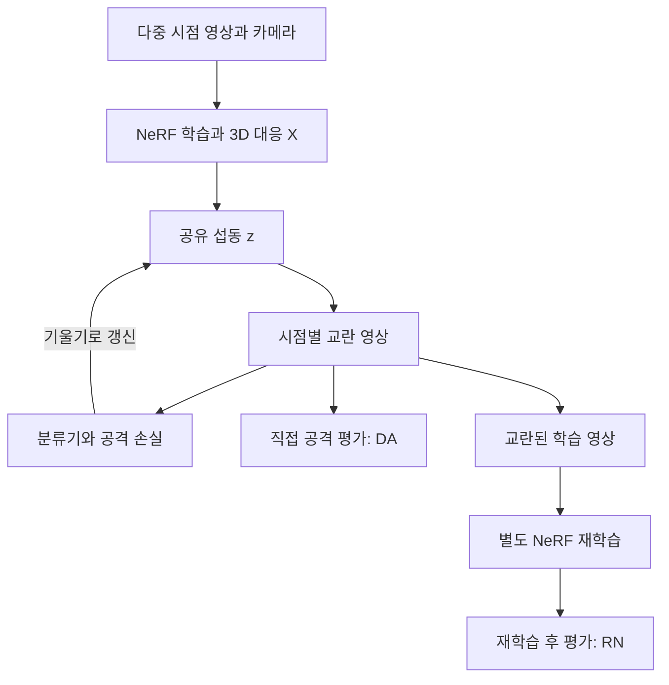

# NeRFail: Neural Radiance Fields-Based Multiview Adversarial Attack

**핵심 판단:** 이 논문은 **3차원 공간 정보를 이용해 만든 영상 교란이, 공격에 직접 사용하지 않은 시점과 새로 학습한 NeRF에서도 오분류를 일으킬 수 있음**을 보여 줍니다.  
다만 **분류 모델의 일반화 성능을 향상시키는 학습법을 검증한 논문은 아닙니다.** 이 구분이 연구의 기여와 후속 연구 가능성을 정확히 이해하는 출발점입니다. [원문 pp.21198, 21201–21203]

**분석 대상:** Wenxiang Jiang 외, *NeRFail: Neural Radiance Fields-Based Multiview Adversarial Attack*, AAAI 2024, pp.21197–21205.

:chatgpt-content-reference{index="18"}

**읽기 기준**

- 아래의 **“원문 p.”는 논문에 인쇄된 페이지 번호**입니다. p.21197은 첨부 PDF의 1쪽, p.21203은 7쪽입니다.
- **저자 보고**, **분석자의 해석**, **추가 검증 제안**을 구분합니다. 제안은 확인된 성과로 서술하지 않습니다.
- 첨부본에 없는 보충자료의 결과는 확정하지 않았습니다. 공식 구현 문서에서 보충한 내용과 다른 논문의 결과에는 별도 출처를 붙였습니다.

---

## 1. Executive summary — 9문장

1. NeRFail은 하나의 3차원 장면에 대해 여러 시점에서 공통으로 작동하는 적대적 섭동을 만들어, 해당 장면의 영상을 인식하는 분류기를 오분류시키는 연구입니다. [원문 pp.21197–21198]
2. 핵심 아이디어는 NeRF를 이용해 2차원 픽셀과 3차원 대표점 사이의 대응을 만들고, 공간적으로 공유되는 섭동을 각 시점의 영상으로 전달하는 것입니다. [원문 pp.21199–21200, 식 (7)–(13)]
3. 저자는 반복적인 기울기 부호 갱신을 사용하는 **NeRFail-S**와, 분류 결정 경계를 넘는 작은 추가 섭동을 추정하는 **NeRFail**을 제안합니다. [원문 p.21200, Algorithm 1, 식 (14)–(17)]
4. 실험은 합성 객체 8개와 여러 영상 분류기를 사용하며, 직접 공격한 시점, 미관측 시점, 오염된 영상으로 다시 학습한 NeRF의 출력으로 평가를 나눕니다. [원문 pp.21201–21202]
5. Table 1에서 Inception v3에 대한 재학습 후 미관측 시점 공격 성공률은 NeRFail 42.4%, NeRFail-S 61.4%, 비교 방법 UAP 2.5%로 보고됩니다. [원문 p.21201, Table 1]
6. 그러나 Table 4에서 섭동 예산이 작을 때 두 제안 방법의 재학습 후 미관측 시점 공격 성공률은 2.0%에 머물러, 높은 성공률이 모든 조건에서 유지되지는 않습니다. [원문 p.21201, Table 4]
7. NeRFail-S는 비교적 높은 공격 성공률을 보이지만, NeRFail보다 큰 섭동과 더 눈에 띄는 영상 변화를 만드는 절충이 있습니다. [원문 p.21202, Figure 3 관련 설명]
8. 주요 표에는 반복 실험의 분산이나 신뢰구간이 없고 일부 수식과 실험 집계 조건도 충분히 명시되지 않아, 관찰된 성능 차이를 통계적 유의성이나 보편적 우월성으로 확대할 수 없습니다. [분석; 원문 pp.21200–21203]
9. 이 연구가 입증한 것은 주로 **공격의 시점 일반화와 재학습 후 지속성**이며, 이를 활용한 방어 학습이 분류기의 일반화 성능을 개선하는지는 별도의 검증 과제입니다. [분석; 원문 Tables 1–7]

> **용어 풀이**
>
> - **NeRF, Neural Radiance Fields:** 여러 사진으로부터 장면의 색과 밀도를 학습해 새로운 시점의 영상을 생성하는 표현 방식
> - **적대적 섭동:** 모델이 잘못 판단하도록 의도적으로 계산한 작은 입력 변화
> - **다중 시점:** 같은 물체나 장면을 여러 위치·방향에서 관측한 영상
> - **렌더링:** 장면 표현과 카메라 조건으로부터 영상을 생성하는 과정
> - **일반화:** 학습이나 최적화에 직접 사용하지 않은 조건에서도 성능이 유지되는 성질
> - **강건성:** 입력에 변화나 교란이 있어도 모델의 기능이 유지되는 성질

---

## 2. 연구 배경, 해결하려는 문제, 목적과 필요성

### 2.1 연구 배경

**저자 보고:** 기존 영상 적대적 공격은 개별 2차원 영상이나 데이터셋에 공통으로 적용되는 교란을 주로 다룹니다. 그러나 현실에서는 카메라와 관찰자가 움직이므로, 같은 물체도 서로 다른 시점에서 관측됩니다. 한 영상에서 성공한 교란이 다른 시점에서도 유지되는지는 별도 문제입니다. [원문 pp.21197–21198]

NeRF는 장면을 여러 시점으로 렌더링할 수 있고 픽셀과 공간 정보를 연결할 수 있어, 이러한 문제를 연구하는 기반으로 선택됩니다. [원문 p.21198]

### 2.2 해결하려는 핵심 문제

논문이 다루는 질문은 두 가지입니다.

1. **시점에 걸친 공격:** 하나의 장면에 대해 만든 교란이, 공격에 직접 사용하지 않은 시점의 영상에서도 분류기를 속일 수 있는가?
2. **재학습을 거친 공격 유지:** 교란을 포함한 영상으로 별도의 NeRF를 학습하면, 그 NeRF도 공격 효과를 재구성하는가?

첫 번째는 영상 입력 단계의 공격을, 두 번째는 장면 모델의 학습자료를 통한 공격을 평가합니다. [원문 pp.21198–21199, 21202]

> **용어 풀이**
>
> - **회피 공격, evasion attack:** 이미 학습된 모델의 입력을 바꾸어 추론을 실패시키는 공격
> - **데이터 오염 공격, poisoning attack:** 학습자료에 개입해 학습된 모델의 동작에 영향을 주는 공격
> - **후단 분류기:** NeRF가 생성한 영상을 받아 객체 종류를 예측하는 다음 단계의 모델

### 2.3 연구 목적과 필요성에 대한 해석

**분석자의 해석:** 이 연구의 의미는 단일 영상의 오분류를 넘어, **동일한 장면을 여러 시점에서 관측하고 다시 학습하는 과정까지 포함한 취약성 평가**를 제시했다는 데 있습니다.

다만 논문에서 자율주행 등 현실 응용을 연구 동기로 제시한 것과, 해당 환경에서 공격을 실증한 것은 구분해야 합니다. 실제 정량 실험의 중심은 합성 객체와 영상 분류입니다. [원문 pp.21197, 21201]

---

## 3. 핵심 주장과 근거

| 핵심 주장 | 저자가 제시한 근거 | 분석 및 적용 범위 |
|---|---|---|
| 2D 픽셀과 3D 정보를 연결하면 시점 간 공유 섭동을 만들 수 있다 | 대표점 추출과 최근접 이웃 가중 변환, 식 (7)–(13), Figure 1; p.21200 | 핵심 방법론이지만, 좌표와 색상·섭동 속성의 수학적 구분에는 불명확한 부분이 있음 |
| 공격에 직접 사용하지 않은 시점에서도 공격이 작동한다 | DA-V 결과, Tables 1–3; p.21201 | 같은 장면의 미관측 시점에 대한 결과이며, 새 객체로의 전이와는 다름 |
| 오염된 영상으로 학습한 별도 NeRF도 공격 효과를 재구성한다 | RN-T·RN-V 결과, Table 1; pp.21201–21202 | 논문의 가장 중요한 실증적 기여이나, 주 실험은 vanilla NeRF에 기반함 |
| NeRFail은 NeRFail-S보다 작은 섭동을 생성한다 | 보고된 $L_0$, $L_2$ 값과 Figure 3 비교; pp.21202–21203 | 측정된 변화량이 더 작다는 근거이며, 인간에게 보이지 않는다는 입증은 아님 |
| 여러 분류기에 적용할 수 있다 | Inception, ViT 및 추가 5개 분류기 실험, Tables 1·3; p.21201 | 각 분류기에 대한 적용 결과이며, 동일한 교란의 분류기 간 전이 성능으로 읽으면 안 됨 |
| 원하는 특정 클래스로의 오분류도 가능하다 | Lego를 drums·hotdog·materials로 유도한 Table 7; p.21203 | 목표 클래스에 따라 성공률이 크게 다르며, materials에서는 매우 낮음 |

> **용어 풀이**
>
> - **전이성, transferability:** 한 모델이나 조건에서 만든 공격을 다른 모델이나 조건에 그대로 적용해도 작동하는 성질
> - **$L_0$:** 값이 바뀐 성분의 개수
> - **$L_2$:** 변화량 전체의 유클리드 크기  
>
> $L_0$와 $L_2$는 영상 변화량을 나타내지만, 사람이 변화를 알아차리는 정도를 직접 측정하지는 않습니다.

---

## 4. 연구 방법, 데이터, 모델 구조

### 4.1 데이터와 기본 설정

**저자 보고:** 주요 설정은 다음과 같습니다. [원문 p.21201, Experiments]

| 항목 | 논문에 보고된 설정 |
|---|---|
| 데이터 | 원 NeRF 논문의 합성 객체 8개 |
| 객체당 영상 수 | 400장 |
| 분할 | 학습 100장, testing 200장, validation 100장 |
| 카메라 분포 | 객체 상반구에서 여러 시점 표본화 |
| 원본 영상 해상도 | $800\times800$ |
| 장면 모델 | vanilla NeRF, PyTorch NeRF 구현 |
| 분류기 | Inception v3, VGG-16, AlexNet, ResNet-50, EfficientNet-B0, MobileNet-v2, ViT-B/16 |
| 분류기 입력 크기 | CNN 계열 $299\times299$, ViT $224\times224$ |
| 대표 시점 수 | 기본값 $p=3$ |
| 주요 공격 설정 | 최대 반복 100회, $m_1=8$, $m_2=100$; IGSM 계열 보폭 $\alpha=2$ |

분류기는 위 합성 객체 클래스의 학습자료로 학습됩니다. 정상 testing 정확도는 Inception v3 99.4%, ViT-B/16 97.7% 등으로 보고됩니다. **이 수치는 일반적인 ImageNet 분류 성능이 아닙니다.** [원문 p.21201]

NeRF 학습량은 본문에 “200,000 epochs”라고 기재되어 있습니다. 이를 근거 없이 “200,000 steps”로 바꾸어 해석하지 않습니다. [원문 p.21201]

> **용어 풀이**
>
> - **vanilla:** 추가적인 변형을 적용하지 않은 기본 모델
> - **CNN:** 작은 공간 영역의 패턴을 반복적으로 추출하는 합성곱 신경망
> - **ViT:** 영상을 패치로 나누어 Transformer로 처리하는 영상 모델
> - **epoch:** 전체 학습자료를 한 번 사용하는 학습 단위; 개별 매개변수 갱신 횟수인 step과 다름

### 4.2 실제 모델 구조

**NeRFail은 새로운 분류 신경망 구조가 아니라, NeRF·공간 대응·섭동 최적화·분류기를 연결한 공격 절차입니다.**

아래 도식은 원문 방법과 평가 흐름을 정리한 것입니다. [원문 pp.21199–21202]



공격 과정에서 명시적으로 최적화하는 변수는 공유 섭동 $z$입니다. 논문은 공격 단계에서 NeRF의 모든 가중치를 직접 조정하는 방식으로 설명하지 않습니다. 이후 교란된 학습자료를 이용해 별도의 NeRF를 학습합니다. [원문 p.21200, Algorithm 1; p.21202]

또한 “공격 과정을 모르는 별도 NeRF”라는 표현은 **분류기에 대한 블랙박스 공격**을 뜻하지 않습니다. 제안 공격은 분류기 기울기를 사용합니다. [원문 p.21200, 식 (16)–(17)]

> **용어 풀이**
>
> - **기울기:** 입력이나 매개변수를 조금 바꿀 때 손실이 어느 방향으로 얼마나 변하는지 나타내는 값
> - **화이트박스 공격:** 모델의 내부 정보나 기울기를 이용하는 공격
> - **블랙박스 공격:** 내부 기울기를 직접 이용하지 못하고 출력·질의 결과 등을 활용하는 공격

### 4.3 네 가지 평가 조건

| 지표 | 평가 영상 | 무엇을 검증하는가 |
|---|---|---|
| **DA-T** | 공격자가 직접 공격한 testing 시점 영상 | 알려진 시점에서의 공격 성공 |
| **DA-V** | 공격자가 접근하지 않은 validation 시점 영상 | 같은 장면의 미관측 시점으로 공격 효과 전달 |
| **RN-T** | 교란된 학습영상으로 학습한 NeRF가 testing 시점에서 생성한 영상 | 재학습 후 공격 유지 |
| **RN-V** | 위 NeRF가 validation 시점에서 생성한 영상 | 재학습과 미관측 시점 생성을 모두 거친 공격 유지 |

출처: 원문 p.21202, *Performance on Synthetic 3D Objects*.

여기서 **T는 NeRF의 training set을 뜻하지 않습니다.** 또한 testing이라는 이름에도 DA-T 영상은 공격 생성 과정에서 직접 다루는 대상입니다.

**중요한 구분:** $p=3$은 **3D 기준점 집합을 구성하는 카메라 수**이며, 공격 알고리즘이 순회하는 시점 집합 전체의 크기와 동일하지 않습니다. 따라서 “세 장만 공격해서 나머지 모든 시점으로 일반화했다”고 요약하면 부정확합니다. [원문 p.21200, 식 (9), Algorithm 1]

---

## 5. 제안 방법의 상세 설명과 수식

아래는 핵심 수식의 의미를 설명한 것입니다. **원문 표기가 불명확한 부분은 임의로 수정해 확정하지 않고 주석으로 표시합니다.**

### 5.1 분류기의 예측과 공격 목표

원문 식 (1)은 분류 결과를 다음과 같이 정의합니다.

$$
\phi(I)=\arg\max_{k\in[c]}f(I)_k.
$$

- $I$: 입력 영상
- $f(I)\in\mathbb R^c$: 분류기의 클래스별 출력 점수
- $c$: 클래스 수
- $[c]=\{1,\ldots,c\}$
- $\phi(I)$: 가장 높은 점수를 가진 예측 클래스
- $l_g$: 정답 클래스

**비표적 공격**은 $\phi(I_{\text{adv}})\ne l_g$, **표적 공격**은 미리 지정한 클래스 $l_t$에 대해 $\phi(I_{\text{adv}})=l_t$를 목표로 합니다. [원문 p.21199]

> **용어 풀이**
>
> - **로짓, logit:** 확률로 변환하기 전의 클래스별 점수
> - **비표적 공격:** 어떤 오답이든 나오면 성공하는 공격
> - **표적 공격:** 사전에 지정한 특정 오답이 나와야 성공하는 공격

### 5.2 NeRF의 표현과 체적 렌더링

NeRF는 다음 함수를 신경망으로 근사합니다.

$$
F:(\mathbf x,\mathbf d)\mapsto(\mathbf c,\tau),
\qquad
\mathbf r(t)=\mathbf o+t\mathbf d.
$$

- $\mathbf x\in\mathbb R^3$: 공간 위치
- $\mathbf d$: 길이가 1인 관측 방향
- $\mathbf c\in[0,1]^3$: RGB 색상
- $\tau\ge0$: 체적 밀도
- $\mathbf o$: 카메라 중심
- $t$: 카메라 광선 위의 깊이

이 함수는 MLP로 구현됩니다. 논문은 NeRFail을 위해 새로운 MLP 층 구조를 제안하지 않습니다. [원문 p.21199]

> **용어 풀이**
>
> - **MLP, 다층 퍼셉트론:** 여러 층의 완전연결 신경망
> - **광선, ray:** 카메라의 한 픽셀이 바라보는 공간 방향
> - **체적 밀도:** 광선이 공간을 통과할 때 얼마나 차단되는지를 결정하는 값

각 픽셀의 색은 광선 위 여러 점의 색을 합성해 계산합니다.

```math
\widehat C(r,F)
=
\sum_{i=1}^{N}
T(t_i)\,
\alpha\!\left(\tau(t_i)\delta_i\right)
\mathbf c(t_i).
```

```math
T(t_i)
=
\exp\left(
-\sum_{j=1}^{i-1}\tau(t_j)\delta_j
\right),
\qquad
\alpha(s)=1-\exp(-s).
```

- $N$: 광선 위에서 표본화한 점의 수
- $t_i$: $i$번째 표본의 깊이
- $\delta_i=t_{i+1}-t_i$: 인접 표본 사이 거리
- $T(t_i)$: 해당 점까지 광선이 차단되지 않고 도달하는 비율
- $\alpha(\tau(t_i)\delta_i)$: 해당 구간의 불투명도
- $\widehat C(r,F)$: 렌더링한 픽셀 색상

학습 손실은 렌더링 픽셀과 정답 픽셀의 차이입니다.

```math
\mathcal L_{\text{rgb}}(\mathcal R,F)
=
\sum_{r\in\mathcal R}
\left\|
\widehat C(r,F)-C(r)
\right\|_2^2.
```

여기서 $\mathcal R$은 학습에 사용하는 광선 집합, $C(r)$는 학습영상의 정답 픽셀입니다. [원문 p.21199, 식 (2)–(4)]

> **용어 풀이**
>
> - **체적 렌더링:** 광선 위 여러 지점의 색을 투과율과 불투명도로 가중합해 픽셀을 만드는 과정
> - **투과율:** 앞쪽 공간에 가려지지 않고 해당 위치까지 도달하는 비율
> - **제곱오차:** 예측과 정답의 차이를 제곱해 합한 값

### 5.3 원래의 공격 문제

저자는 공격 효과를 가진 NeRF $F_{\text{adv}}$를 다음 목표로 표현합니다.

```math
\max\;
\mathbb P_{\forall v}
\left(
\phi\left(I(\widehat C(r,F_{\text{adv}}),v)\right)
\ne l_g
\right),
```

```math
\text{subject to}\quad
\left\|
\widehat C(r,F_{\text{adv}})-C(r)
\right\|_\infty <\epsilon.
```

- $v$: 카메라 시점
- $I(\cdot,v)$: 해당 시점의 픽셀들을 영상으로 구성하는 표기
- $F_{\text{adv}}$: 공격 효과가 반영된 NeRF
- $\epsilon$: 허용하는 최대 변화량
- $\|\cdot\|_\infty$: 성분별 변화 중 가장 큰 값

의도는 **영상 변화는 제한하면서 여러 시점에서 오분류를 많이 일으키는 것**입니다. [원문 p.21199]

**표기상 주의:** 원문의 $\mathbb P_{\forall v}$는 시점의 확률분포를 엄밀하게 정의하지 않습니다. 본문도 “대부분의 시점”에서의 오분류를 설명하므로, 이를 **모든 연속 시점에서 성공한다는 수학적 보장**으로 읽을 수 없습니다.

> **용어 풀이**
>
> **$L_\infty$ 제약:** 어떤 한 성분도 허용 크기보다 크게 바뀌지 않도록 제한하는 조건이며, 영상 전체의 지각적 유사성을 직접 보장하지는 않음

### 5.4 픽셀을 3D 대표점으로 연결하기

저자는 물체가 불투명하다고 가정하고, 한 광선에서 중요한 점 하나를 골라 픽셀을 대표하도록 합니다.

```math
M(\widehat C(r,F))
=
\mathbf o+
\left(\arg\max_{t_i}h(t_i)\right)\mathbf d,
```

```math
h(t_i)
=
T(t_i)\,
\alpha\!\left(\tau(t_i)\delta_i\right)
\mathbf c(t_i).
```

선택한 $p$개 기준 시점에서 대표점을 모읍니다.

$$
X=
\bigcup_{r\in\mathcal R_p}
M(\widehat C(r,F)).
$$

- $M$: 픽셀과 3D 대표 위치를 연결하는 변환
- $h(t_i)$: 원문이 대표점 선택에 사용하는 기여도 표현
- $\mathcal R_p$: 기준 시점 $p$개에 대응하는 광선 집합
- $X$: 기준 3D 점 집합

영상 크기가 $w\times h$일 때 저자는 약 $pwh$개 점으로 객체를 표현한다고 설명합니다. [원문 pp.21199–21200]

**원문 수식의 불명확성:** 설명은 “최대 밀도의 한 점”을 언급하지만, 식 (8)은 밀도뿐 아니라 투과율·불투명도·RGB 색상을 포함합니다. 특히 $\mathbf c(t_i)$가 벡터이므로 $h(t_i)$도 벡터인데, $\arg\max$에 어떤 스칼라 기준을 사용하는지 본문에 명시되어 있지 않습니다. 따라서 이를 임의로 “밀도가 가장 높은 점을 선택하는 정확한 수식”으로 바꾸지 않았습니다.

### 5.5 3D 표현을 각 시점의 픽셀로 전달하기

다른 시점에서 계산한 대표점은 $X$의 점과 정확히 일치하지 않을 수 있습니다. 저자는 가까운 점 여러 개를 거리로 가중합합니다. [원문 p.21200, Figure 1]

원문 식 (10)–(11)은 다음과 같습니다. 분모의 합산용 변수 이름만 $\mathbf u$로 바꾸었습니다.

```math
M'(X,\mathbf x)
=
\sum_{\mathbf x'\in\mathcal N_{\mathbf x}}
\frac{w_{\mathbf x'}}
{\sum_{\mathbf u\in\mathcal N}w_{\mathbf u}}
\mathbf x',
```

```math
w_{\mathbf x'}
=
\frac{1}{\sigma\sqrt{2\pi}}
\exp\left[
-\frac12
\frac{
\left(\|\mathbf x'-\mathbf x\|_2-\mu\right)^2
}{\sigma^2}
\right].
```

- $\mathbf x$: 현재 픽셀에 대응하는 3D 위치
- $\mathcal N_{\mathbf x}$: $X$에서 $\mathbf x$에 가까운 $K$개 이웃
- $w_{\mathbf x'}$: 이웃점의 기여 가중치
- $\|\mathbf x'-\mathbf x\|_2$: 점 사이 거리
- $\mu$: 거리 가중치의 중심값으로, 저자는 $\mu=0$을 사용
- $\sigma$: 식의 통상적 해석에서 가중치가 감소하는 폭을 결정하는 값

> **용어 풀이**
>
> - **최근접 이웃:** 기준점과 거리가 가까운 점
> - **보간:** 주변의 알려진 값들을 조합해 새로운 위치의 값을 추정하는 과정
> - **가우시안 가중치:** 중심에서 멀어질수록 기여도를 부드럽게 줄이는 종 모양 함수

**재현 시 확인해야 할 부분은 세 가지입니다.**

1. 식 (10)은 픽셀 값으로 되돌리는 함수라고 설명되지만, 실제 표기는 **3D 좌표 $\mathbf x'$의 가중합**입니다. 좌표와 그 점에 붙은 색상·섭동 속성의 구분이 불완전합니다.
2. 분자의 이웃 집합은 $\mathcal N_{\mathbf x}$, 분모는 $\mathcal N$으로 기재됩니다.
3. 식 (11) 주변의 $\mu,\sigma$ 설명은 통상적인 가우시안 매개변수 설명과 일치하지 않는 부분이 있습니다.

이는 방법이 작동하지 않는다는 증거가 아니라, **첨부 본문만으로 동일하게 구현하려면 추가 정의가 필요하다**는 의미입니다.

**공식 구현 보충:** 저자 저장소는 최근접 이웃 8개와 가우시안 가중치를 사용한다고 설명합니다. 이는 본문 밖의 구현 정보입니다. [GitHub](https://github.com/jiang-wenxiang/NeRFail?utm_source=chatgpt.com)

### 5.6 공유 3D 섭동으로 문제를 바꾸기

위 대응을 이용해 최적화 변수를 공유 섭동 $z$로 바꿉니다.

$$
\max\;
\mathbb P_{\forall v}
\left(
\phi\left(I(M'(X,z),v)+I_v\right)
\ne l_g
\right),
$$

$$
\text{subject to}\quad
\|M'(X,z)\|_\infty<\epsilon.
$$

- $z$: 3D 표현에 연결된 공유 섭동
- $I_v$: 시점 $v$의 원본 영상
- $I(M'(X,z),v)$: 공유 섭동을 해당 시점으로 전달한 영상 형태의 변화량

**핵심 의미:** 각 영상에 서로 독립적인 교란을 넣는 대신, **공간 대응으로 연결된 하나의 섭동 표현을 여러 시점이 공유**합니다. [원문 p.21200]

### 5.7 NeRFail-S: 단순한 반복 갱신

Algorithm 1을 정리하면 다음과 같습니다. 아래 식은 의사코드의 설명용 재표현이며, 원문에서 생략된 교차엔트로피의 정답 인자 $l_g$를 표시했습니다.

```math
I_v'
=
\text{clip}\left(
I(M'(X,z),v)+I_v,\;0,\;1
\right),
```

```math
\Delta z
=
\text{sign}
\left(
\nabla_z\,\text{CE}(f(I_v'),l_g)
\right),
```

$$
z\leftarrow
\text{clip}\left(
z+\alpha\Delta z,\;-\epsilon,\;\epsilon
\right).
$$

- $\text{CE}$: 교차엔트로피 분류 손실
- $\nabla_z$: 공유 섭동에 대한 기울기
- $\text{sign}$: 각 성분의 부호
- $\alpha$: 갱신 보폭
- $\text{clip}$: 지정 범위를 벗어난 값을 경계값으로 제한하는 연산

여기서 보폭 $\alpha$는 앞의 불투명도 함수 $\alpha(\cdot)$와 다른 용도입니다.

NeRFail-S는 현재 시점이 이미 오분류되었는지와 관계없이 각 시점에서 한 번씩 갱신하고, 이를 반복 누적합니다. [원문 p.21200, Algorithm 1]

> **용어 풀이**
>
> - **IGSM:** 손실을 증가시키는 기울기의 부호 방향으로 입력을 여러 번 갱신하는 공격 방법
> - **교차엔트로피:** 정답 클래스에 낮은 점수를 주면 커지는 대표적인 분류 손실

### 5.8 NeRFail: 결정 경계를 넘는 추가 섭동 추정

NeRFail은 현재 시점이 아직 오분류되지 않았다면, 예측을 바꾸는 작은 추가 섭동을 찾습니다.

```math
\Delta z_i
=
\arg\min_{\zeta}\|\zeta\|_2^2,
```

$$
\text{subject to}\quad
\phi\left(I(M'(X,z),v)+I_v\right)
\ne
\phi\left(I(M'(X,z+\zeta),v)+I_v\right).
$$

- $\zeta$: 후보 추가 섭동
- $\Delta z_i$: 현재 갱신에서 선택하는 추가 섭동

이를 정확히 풀기보다 DeepFool처럼 결정 경계를 국소적으로 선형 근사합니다. [원문 p.21200]

> **용어 풀이**
>
> - **결정 경계:** 입력을 바꿀 때 예측 클래스가 달라지는 경계
> - **국소 선형 근사:** 현재 입력 근처의 복잡한 경계를 평면처럼 취급하는 계산
> - **DeepFool:** 가까운 결정 경계를 추정해 작은 변화로 예측을 바꾸는 공격 방법

원문 식 (16)–(17)은 다음과 같습니다.

$$
l_t=
\arg\min_{\substack{k\in[c]\\k\ne l_g}}
\frac{
|f(I_v)_k-f(I_v)_{l_g}-m_1|
}{
\|\nabla f(I_v)_k-\nabla f(I_v)_{l_g}\|_2
},
$$

$$
\Delta_t=
\nabla f(I_v)_{l_t}-\nabla f(I_v)_{l_g},
$$

$$
\Delta z_i=
\frac{
|f(I_v)_{l_t}-f(I_v)_{l_g}-m_1-m_2|
}{
\|\Delta_t\|_2^2
}
\Delta_t.
$$

- $l_t$: 가까운 결정 경계를 가진 경쟁 클래스
- $\Delta_t$: 경쟁 클래스와 정답 클래스의 로짓 기울기 차이
- $m_1$: 경계를 더 확실히 넘도록 설정하는 여유값
- $m_2$: 저자가 가속 매개변수라고 부르는 추가 갱신량 관련 값

**해석 시 주의할 점**

- 식 (16)의 $l_t$는 비표적 공격에서 선택하는 경쟁 클래스이며, 표적 공격에서 사전에 지정한 클래스와 구분해야 합니다.
- 원문은 이 부분의 $I_v$를 “현재 섭동이 포함된 영상”으로 다시 설명합니다. 앞부분의 깨끗한 영상 표기와 재사용됩니다.
- 식 (16)–(17)은 $\nabla$의 미분 대상을 첨자로 명확히 표시하지 않습니다.
- “최적성을 목표로 한다”는 표현은 **전역 최적성이 증명되었다는 의미가 아닙니다.**

---

## 6. 주요 결과와 데이터 포인트

### 6.1 가장 중요한 결과: 재학습 이후에도 남는 공격

다음은 Table 1의 공격 성공률을 그대로 정리한 것입니다. **단위는 %이며, 높을수록 공격이 강한 것입니다.** [원문 p.21201, Table 1]

| 분류기 | 공격 방법 | DA-T | DA-V | RN-T | RN-V |
|---|---|---:|---:|---:|---:|
| Inception v3 | IGSM | 59.3 | 0.0 | 0.4 | 0.8 |
| Inception v3 | UAP | 46.8 | 28.3 | 2.9 | 2.5 |
| Inception v3 | NeRFail-S | 72.6 | 71.5 | 66.5 | 61.4 |
| Inception v3 | NeRFail | 66.0 | 38.0 | 50.2 | 42.4 |
| ViT-B/16 | IGSM | 99.9 | 0.0 | 2.9 | 2.4 |
| ViT-B/16 | UAP | 100.0 | 97.3 | 2.2 | 1.4 |
| ViT-B/16 | NeRFail-S | 99.0 | 100.0 | 97.2 | 99.0 |
| ViT-B/16 | NeRFail | 98.9 | 77.3 | 80.6 | 77.9 |

> **용어 풀이**
>
> - **ASR, Attack Success Rate:** 평가한 사례 중 공격 목표가 달성된 비율
> - **UAP, Universal Adversarial Perturbation:** 여러 영상에 공통으로 적용하는 2D 교란 패턴

**저자 보고:** IGSM과 UAP보다 제안 방법의 RN-T·RN-V 성공률이 높아, 교란이 NeRF 재학습을 거친 뒤에도 유지됨을 보여 줍니다. [원문 p.21202]

**분석자의 해석:** 가장 설득력 있는 차이는 **직접 입력을 교란했을 때의 성공률보다, 재학습 후 RN-V에서의 차이**입니다. 반면 ViT의 직접 공격에서는 UAP가 NeRFail보다 높은 DA-T·DA-V를 보이므로, “모든 조건에서 제안 방법이 우수하다”는 결론은 성립하지 않습니다.

**[직접 비교 불가]** Table 1은 캡션과 인접 설명에 객체·섭동 예산·집계 방식이 구체적으로 명시되지 않습니다. 따라서 아래 Table 4의 특정 조건 수치와 동일한 실험이라고 간주하면 안 됩니다.

### 6.2 섭동 예산에 대한 민감도

Table 4에서 주요 수치만 추렸습니다. Inception v3, 최대 반복 100회, $p=3$, $m_1=8$, $m_2=100$ 조건입니다. [원문 p.21201, Table 4]

| $\epsilon$ | NeRFail DA-T | NeRFail DA-V | NeRFail RN-V | NeRFail-S RN-V |
|---:|---:|---:|---:|---:|
| 8 | 6.0 | 2.0 | 2.0 | 2.0 |
| 16 | 100.0 | 38.0 | 52.0 | 37.0 |
| 32 | 100.0 | 89.0 | 92.0 | 100.0 |

**저자 보고:** 작은 예산에서는 제안 방법의 성능이 낮고, 예산이 증가하면 성공률이 크게 높아집니다. [원문 pp.21202–21203]

**분석자의 해석:** $\epsilon=16$에서 NeRFail의 DA-T는 100%이지만 DA-V는 38%입니다. 따라서 **공격에 사용한 시점에서 성공했다는 사실만으로 미관측 시점 성공을 예상할 수 없습니다.**

**공식 구현 보충:** 저장소는 $\epsilon$을 0–255 픽셀 척도의 최대 변화량으로 설명합니다. 이 기준에서 32는 정규화하면 $32/255\approx0.1255$입니다. 본문 자체의 $[0,1]$ clipping 표기만으로 이 단위를 추정한 것은 아닙니다. [GitHub](https://github.com/jiang-wenxiang/NeRFail?utm_source=chatgpt.com)

### 6.3 객체와 분류기에 따른 큰 차이

**객체별 결과:** 같은 Inception v3와 $\epsilon=32$ 조건에서도 NeRFail의 RN-V는 hotdog 47%, materials 56%, mic 99%, ship 16%입니다. 특히 ship은 DA-T가 98.5%지만 RN-V는 16%입니다. [원문 p.21201, Table 2]

**분류기별 결과:** Lego에서 NeRFail의 RN-V는 VGG-16 46%, AlexNet 80%, ResNet-50 100%, EfficientNet-B0 86%, MobileNet-v2 23%입니다. MobileNet-v2는 DA-T 97%에 비해 DA-V가 12%입니다. [원문 p.21201, Table 3]

**분석자의 해석:** 방법의 적용 범위는 여러 객체·분류기로 확장되지만, **시점 일반화의 강도는 상당히 불균일**합니다. Table 3은 동일한 섭동을 분류기 사이에 그대로 옮긴 전이 실험으로 해석할 수 없습니다.

### 6.4 공격 성공률과 섭동 크기의 절충

저자가 $\epsilon=32$에서 보고한 변화량은 다음과 같습니다. [원문 p.21202]

| 방법 | $L_0$ | $L_2$ |
|---|---:|---:|
| NeRFail-S | 554,036.0 | 12,566.1 |
| NeRFail | 544,276.6 | 10,395.0 |

**저자 보고:** NeRFail-S는 더 큰 교란을 만들며, NeRFail은 상대적으로 덜 눈에 띄는 결과를 생성합니다.

**분석자의 해석:** 수치는 NeRFail의 변화량이 더 작다는 주장을 지지합니다. 다만 집계 대상·단위·변동성이 충분히 설명되지 않고 인간 대상 지각 실험도 없으므로, **“사람에게 보이지 않음이 검증되었다”는 결론까지 지지하지는 않습니다.**

### 6.5 표적 공격은 목표 클래스에 크게 의존

Lego에서 지정한 클래스로 분류를 바꾸는 결과입니다. [원문 p.21203, Table 7]

| 목표 클래스 | DA-T | DA-V | RN-T | RN-V |
|---|---:|---:|---:|---:|
| drums | 99.0 | 86.0 | 81.0 | 76.0 |
| hotdog | 65.5 | 52.0 | 52.5 | 51.0 |
| materials | 3.5 | 1.0 | 3.0 | 2.0 |

저자는 materials처럼 분포가 먼 클래스가 어렵다고 설명합니다. 그러나 **클래스 간 분포 거리를 직접 측정한 결과는 제시하지 않습니다.** 따라서 “거리 때문에 실패한다”는 것은 저자의 해석이며 검증된 인과관계가 아닙니다.

**[직접 비교 불가]** 표적 공격은 특정 오답에 도달해야 하므로, 어떤 오답이든 허용하는 비표적 공격의 성공률과 같은 난도의 수치로 비교할 수 없습니다.

### 6.6 매개변수 실험에서 확인되는 범위

**절제 실험 결과**는 보편적인 최적값보다 설정 민감도를 보여 줍니다.

- **기준 시점 수 $p$:** NeRFail의 RN-V는 $p=2,3,4$에서 각각 26%, 52%, 48%입니다. 더 많은 시점이 항상 유리하지는 않습니다. [원문 p.21202, Table 5]
- **여유값 $m_1$:** 저자는 8을 좋은 선택으로 제시하지만, RN-V는 $m_1=16$일 때 93%, $m_1=8$일 때 92%입니다. 모든 지표에서 8이 최적은 아닙니다. [원문 p.21202, Table 6]
- **본문과 표의 차이:** 본문은 $\epsilon=32$에서 성공률이 90%를 넘는다고 요약하지만, Table 4의 NeRFail DA-V는 89%입니다. 보고서에서는 구체적인 표 값을 우선해야 합니다. [원문 pp.21201, 21203]

> **용어 풀이**
>
> **절제 실험, ablation study:** 다른 조건을 유지하고 특정 구성요소나 매개변수만 바꾸어 영향을 살피는 실험

---

## 7. 중요한 그림 선정과 해석

### 7.1 Figure 3 — 공격의 지속성을 보여 주는 가장 중요한 그림

**위치:** 원문 p.21203.

Lego 사례를 네 공격 방법과 네 평가 조건으로 비교합니다.

- IGSM은 직접 공격한 영상에서는 오분류를 만들지만, 미관측 시점과 재학습 결과의 예시에서는 다시 Lego로 인식됩니다.
- UAP는 미관측 영상에서도 일부 효과가 있지만, 재학습 후에는 효과가 상당 부분 사라지는 예시를 보여 줍니다.
- NeRFail과 NeRFail-S는 제시된 예시에서 재학습 후 미관측 시점까지 drums로 오분류시킵니다.

**해석:** 이 그림은 Table 1의 RN 결과가 의미하는 현상을 시각적으로 설명합니다. 저자는 제안 방법의 교란이 객체에 더 집중되고, NeRFail-S의 변화가 더 눈에 띈다고 설명합니다. [원문 p.21202]

**주의:** 그림 아래 “drums: 78.2%”와 같은 값은 **개별 영상의 예측 신뢰도**입니다. 공격 성공률이나 전체 데이터의 평균 성능이 아닙니다. 선택된 소수 예시는 전체 표를 대체하지 못합니다.

### 7.2 Figure 1 — 왜 이웃점 보간이 필요한가

**위치:** 원문 p.21200.

서로 다른 카메라에서 같은 표면 부근을 관측해도, NeRF로 계산한 대표점이 정확히 일치하지 않을 수 있음을 보여 줍니다.

**해석:** 한 점만 찾아 값을 복사하면 대응 오차가 커질 수 있어, 여러 가까운 점을 거리로 가중합한다는 설계의 동기를 설명합니다. **변환 오차가 제거되었다는 실험적 증명은 아닙니다.**

### 7.3 Figure 2 — 가속 매개변수의 비단조적 효과

**위치:** 원문 p.21202.

가로축은 $m_2$, 왼쪽 축은 반복 횟수, 오른쪽 축은 시간이며 캡션의 시간 단위는 시간(h)입니다.

**해석:** $m_2=100$ 부근에서는 시간이 낮지만, 200과 400에서는 반복 횟수가 최대 100회에 도달합니다. 따라서 “가속값을 키우면 계속 빨라진다”고 해석하면 안 됩니다.

또한 이 그림은 실행시간과 반복 횟수를 보여 줄 뿐입니다. $m_2$에 따른 공격 성공률 실험은 보충자료에 있다고 하므로, **Figure 2만으로 공격 품질까지 최적이라고 판단할 수 없습니다.** [원문 p.21203]

---

## 8. 통계적 취약점, 비교 불가능한 수치, 연구 한계

### 8.1 통계와 비교 설계에 대한 평가

아래는 **분석자의 평가**입니다.

| 표시 | 문제 | 해석에 미치는 영향 |
|---|---|---|
| **[통계 취약]** | 주요 표에 독립 반복 수·표준편차·신뢰구간이 없음 | 관찰된 우열을 통계적으로 유의하다고 말할 수 없음 |
| **[통계 취약]** | 같은 객체의 여러 시점이 평가 표본을 구성 | 200개 시점 영상을 200개 독립 장면처럼 취급하면 증거량을 과대평가 |
| **[범위 제한]** | 객체 8개, 합성 환경 중심 | 새로운 실제 객체·복잡한 배경·조명 변화로의 일반화를 입증하지 않음 |
| **[직접 비교 불가]** | Table 1의 객체· $\epsilon$ ·집계 범위가 명확하지 않음 | Table 4의 특정 조건 수치와 통합하거나 차이를 성능 개선량으로 해석할 수 없음 |
| **[정의 불명확]** | ASR의 정확한 분모 규칙이 본문에 별도 정의되지 않음 | 원래 오분류한 영상과 공격으로 새로 실패한 영상을 어떻게 처리했는지 확인 필요 |
| **[직접 비교 주의]** | CNN과 ViT의 입력 해상도가 다름 | 성공률 차이를 아키텍처 차이 하나의 인과 효과로 해석하기 어려움 |
| **[측정 한계]** | $L_0/L_2$와 소수 시각화로 비가시성을 평가 | 인간의 지각적 판별 난이도가 직접 검증된 것은 아님 |
| **[기준선 범위]** | 주요 수치 비교가 IGSM과 UAP에 집중 | 다른 3D 공격보다 보편적으로 우수하다는 결론은 지원하지 않음 |

근거: 원문 pp.21200–21203, Tables 1–7 및 Figure 2–3.

> **용어 풀이**
>
> - **신뢰구간:** 반복 표본추출을 가정할 때 추정값의 불확실성을 나타내는 범위
> - **통계적 유의성:** 관찰된 차이를 우연한 변동만으로 설명하기 어려운지 판단하는 개념
> - **독립 표본:** 다른 관측과의 의존성이 작아 별개의 증거로 취급할 수 있는 관측

### 8.2 저자가 직접 언급한 제약

논문에는 독립된 *Limitations* 절이 없지만, 다음 현상과 제약을 직접 논의합니다.

1. 작은 $\epsilon$에서 성능이 낮습니다. [Table 4; pp.21202–21203]
2. 기준 시점을 늘리면 시점 간 충돌이나 변환 부정확성이 생길 수 있다고 설명합니다. [Table 5; p.21203]
3. NeRFail-S는 더 눈에 띄는 섭동을 생성합니다. [p.21202; Figure 3]
4. ViT의 일부 직접 공격 조건에서는 UAP가 NeRFail보다 강합니다. [Table 1; p.21202]
5. 일부 표적 클래스에는 공격 성공률이 매우 낮습니다. [Table 7; p.21203]

또한 방법은 **불투명한 물체와 광선당 하나의 대표점**을 가정합니다. 반사·투명성·복잡한 가림 상황에 대한 충분성은 본문에서 따로 검증하지 않습니다. [원문 pp.21199–21200]

### 8.3 공식 구현 문서가 추가로 밝힌 한계

**논문 본문 밖의 저자 설명:** 공식 저장소는 학습·공격의 무작위성이 완전히 정리되지 않아 논문과 정확히 같은 결과를 얻지 못할 수 있다고 밝힙니다. 또한 해상도를 절반으로 낮추는 설정에서 공격 성공률이 크게 감소한다고 설명하며, 관련 매개변수의 추가 절제 실험을 연구 과제로 제시합니다. [GitHub](https://github.com/jiang-wenxiang/NeRFail?utm_source=chatgpt.com)

이 설명은 재현성 및 해상도 민감도를 확인해야 할 필요성을 뒷받침하지만, 감소량이나 분산 수치까지 제공하지는 않습니다.

---

## 9. 문서가 답하지 않는 질문

| 남아 있는 질문 | 필요한 이유 |
|---|---|
| 대표점 선택에서 RGB 벡터를 어떤 스칼라 기준으로 비교하는가? | 식 (7)–(8)의 정확한 구현을 재현하기 위해 필요 |
| 좌표·색상·섭동 속성을 구분한 $M'$의 엄밀한 정의는 무엇인가? | 공간 대응과 영상 교란의 계산을 명확히 하기 위해 필요 |
| 기준 시점 선택이나 무작위 초기화에 따라 결과가 얼마나 달라지는가? | 특정 실행이나 시점 선택에 의존하는지 판단하기 위해 필요 |
| 미관측 시점이 공격 시점과 얼마나 떨어져 있는가? | 가까운 시점 보간과 먼 시점으로의 일반화를 구분하기 위해 필요 |
| 같은 계산량·같은 배경 제약·같은 지각 품질에서도 우위가 유지되는가? | 공격 공간과 자원 차이가 결과를 설명하는지 확인하기 위해 필요 |
| 다른 NeRF 구조나 렌더러로 재학습해도 교란이 유지되는가? | vanilla NeRF 결과를 넘어서는 적용 범위를 확인하기 위해 필요 |
| 여러 영상을 동시에 결합하는 실제 다중 시점 인식 모델에도 효과가 있는가? | 본문은 주로 각 렌더링 영상을 분류하는 모델을 평가하기 때문 |
| NeRFail 자료로 방어 학습을 하면 정상 정확도와 강건 정확도가 어떻게 변하는가? | 사용자가 관심을 둔 모델 일반화 향상을 직접 검증하기 위해 필요 |

위 질문은 본문의 수식·실험 범위에서 도출한 **미해결 사항**이며, 실패한다고 단정하는 목록이 아닙니다.

---

## 10. 2020년 이후 관련 연구 비교 분석

다음은 2020–2026년에 발표된 관련 연구 중, **장면 표현·시점 공격·방어 학습·최근 3D 표현 확장**을 비교하기 위해 선정한 연구입니다. 서로 다른 문제와 지표를 사용하므로 수치 순위표로 만들지 않았습니다.

### 10.1 방법과 목표의 비교

| 연구 | 핵심 방법·개입 대상 | NeRFail과의 차이 및 근거 |
|---|---|---|
| **NeRF — ECCV 2020** | 위치·관측 방향에서 색과 밀도를 예측하고 새로운 시점을 합성 | NeRFail의 기반 표현이며 공격이나 방어 학습법은 아님; 원논문 p.1, §1. [arxiv.org](https://arxiv.org/pdf/2003.08934?utm_source=chatgpt.com) |
| **Aug-NeRF — CVPR 2022** | 입력 좌표·중간 특징·렌더링 전 출력에 최악 조건의 섭동을 넣어 NeRF 학습을 정규화 | **재구성 모델의 새로운 시점 성능 향상**이 목적이며, 후단 분류 공격인 NeRFail과 다름; 원논문 pp.1–3, Figure 2. [arxiv.org](https://arxiv.org/pdf/2207.01164?utm_source=chatgpt.com) |
| **ViewFool — NeurIPS 2022** | 카메라 위치·회전의 분포를 최적화해 오분류가 발생하는 시점을 찾음 | NeRFail은 공간에 공유되는 섭동을 만들고, ViewFool은 시점 자체를 바꿈; 원논문 p.4, §3.2, Figure 2. [papers.nips.cc](https://papers.nips.cc/paper_files/paper/2022/file/eee7ae5cf0c4356c2aeca400771791aa-Paper-Conference.pdf?utm_source=chatgpt.com) |
| **NeRFool / NeRFool+ — ICML 2023** | 일반화 가능한 NeRF의 입력 영상을 교란해 재구성 품질을 저하시킴; NeRFool+는 여러 목표 시점으로 확장 | 공격 대상이 **재구성 품질**이며 NeRFail의 **분류 결과**와 다름; §5, Table 6 및 §6의 방어 학습 실험. [proceedings.mlr.press](https://proceedings.mlr.press/v202/fu23g/fu23g.pdf?utm_source=chatgpt.com) |
| **VIAT — ICCV 2023** | 어려운 시점의 혼합분포를 찾고, 그 분포에서 생성한 영상으로 분류기를 학습 | **분류기의 시점 강건성 향상**을 직접 검증한다는 점에서 일반화 논의의 핵심 비교 대상; Figure 2, Table 5. [openaccess.thecvf.com](https://openaccess.thecvf.com/content/ICCV2023/papers/Ruan_Towards_Viewpoint-Invariant_Visual_Recognition_via_Adversarial_Training_ICCV_2023_paper.pdf?utm_source=chatgpt.com) |
| **Omniview-Tuning — ECCV 2024** | 동일 객체의 여러 시점 표현을 정렬하고 비전·언어 모델을 효율적으로 미세조정 | 공격 생성보다 **시점 변화에 안정적인 표현 학습**에 초점; Figure 2, Tables 2–3. [ecva.net](https://www.ecva.net/papers/eccv_2024/papers_ECCV/papers/03791.pdf?utm_source=chatgpt.com) |
| **PGA — ICCV 2025** | 3D Gaussian Splatting으로 물리적 위장 공격을 만들고 가림·배경 변화를 다룸 | 차량 탐지와 실제 촬영까지 평가한 인접 연구이며, NeRFail의 직접 계승이라고 단정하지 않음; §5.3, Table 4, Figures 5–6. [openaccess.thecvf.com](https://openaccess.thecvf.com/content/ICCV2025/papers/Lou_3D_Gaussian_Splatting_Driven_Multi-View_Robust_Physical_Adversarial_Camouflage_Generation_ICCV_2025_paper.pdf?utm_source=chatgpt.com) |
| **GSAttack — Pattern Recognition 2026** | 기여도가 큰 Gaussian에서 작은 Gaussian을 분리해 명시적 3D 교란을 만들고 위치·색 손실로 제한 | NeRFail을 직접 논의하는 관련 후속 연구; 공간 교란을 명시적 표현으로 다루는 방향을 제시하지만, 여기서는 전체 결과 표를 확인하지 못해 정량 우월성을 주장하지 않음. [sciencedirect.com](https://www.sciencedirect.com/science/article/pii/S003132032501129X?utm_source=chatgpt.com) |

> **용어 풀이**
>
> - **정규화:** 학습이 지나치게 불안정하거나 특정 자료에 과하게 맞춰지지 않도록 제약하는 방법
> - **적대적 학습:** 모델이 틀리기 쉬운 사례를 만들어 학습에 포함하는 방법
> - **혼합분포:** 여러 확률분포를 합쳐 다양한 유형의 사례를 표현하는 방식
> - **시점 불변성:** 관측 방향이 바뀌어도 같은 객체의 의미나 예측이 유지되는 성질
> - **3D Gaussian Splatting:** 위치·크기·방향·색 등을 가진 다수의 3D 가우시안 요소로 장면을 표현하고 영상을 합성하는 방식
> - **명시적 표현:** 공간 요소가 좌표와 속성으로 직접 드러나는 표현; 신경망 가중치에 장면이 저장되는 암시적 표현과 구분

### 10.2 NeRFool과의 비교에서 반드시 보완할 점

NeRFail 본문은 NeRFool을 특정 목표 시점에 대한 공격으로 설명합니다. 그러나 **NeRFool 원논문의 NeRFool+는 이미 다양한 목표 시점에 대한 공격을 포함합니다.**

따라서 두 논문의 차이는 “다중 시점을 다룰 수 있느냐”보다 다음과 같이 잡는 것이 정확합니다.

- **NeRFool 계열:** 입력 영상 교란을 통해 NeRF의 재구성 품질을 저하
- **NeRFail:** 공간적으로 연결된 교란을 통해 렌더링 영상의 후단 분류를 실패시킴

근거: NeRFool §5, Table 6, PDF pp.7–8. [proceedings.mlr.press](https://proceedings.mlr.press/v202/fu23g/fu23g.pdf?utm_source=chatgpt.com)

### 10.3 일반화 성능 향상을 실제로 보고한 연구

**VIAT의 저자 보고:** ResNet-50의 ImageNet-V 정확도는 표준 학습 28.15%, 무작위 시점 증강 32.83%, VIAT 38.96%입니다. 이는 **같은 평가 데이터에서 학습 방법을 바꾸어 비교한 분류 정확도**입니다. [VIAT, p.4716, Table 5] [openaccess.thecvf.com](https://openaccess.thecvf.com/content/ICCV2023/papers/Ruan_Towards_Viewpoint-Invariant_Visual_Recognition_via_Adversarial_Training_ICCV_2023_paper.pdf?utm_source=chatgpt.com)

**Omniview-Tuning의 저자 보고:** OVT-OpenCLIP ViT-B/32는 ImageNet-V+에서 Top-1 정확도 59.5%로 원모델 대비 22.4%p 향상을 보고합니다. 같은 설정의 ImageNet-1K 정확도는 67.8%로 1.3%p 증가합니다. 다만 다른 데이터·모델 조합에서는 일부 성능 저하도 있으므로 “모든 성능을 유지하면서 향상”이라고 일반화할 수 없습니다. [OVT, PDF pp.11–12, Tables 2–3] [ecva.net](https://www.ecva.net/papers/eccv_2024/papers_ECCV/papers/03791.pdf?utm_source=chatgpt.com)

> **용어 풀이**
>
> - **Top-1 정확도:** 가장 높은 점수를 받은 클래스가 정답인 비율
> - **%p, 퍼센트포인트:** 두 백분율의 산술적 차이
> - **OOD:** 학습 분포와 다른 조건의 데이터; 시점 OOD와 조명·스타일 등의 OOD는 서로 다른 변화

**분석자의 해석:** 이 연구들은 시점 정보를 활용한 학습이 분류 성능을 개선할 수 있다는 관련 근거입니다. 하지만 **NeRFail로 만든 섭동을 사용했을 때도 같은 개선이 발생한다는 증거는 아닙니다.**

### 10.4 논문 간 수치 비교에서 지켜야 할 구분

- NeRFail의 **분류 ASR**
- NeRFool·Aug-NeRF의 **재구성 품질**
- VIAT·OVT의 **분류 정확도**
- PGA의 **객체 탐지 성능**

은 서로 다른 측정 대상입니다.

또한 같은 분류 ASR라도 데이터, 공격 접근권한, 섭동 예산, 표적 여부, 시점 범위, 영상 해상도가 다르면 직접 순위를 매길 수 없습니다. **관련 연구 비교는 먼저 문제 설정을 맞추고, 그다음 성능을 비교해야 합니다.**

---

## 11. 결론, 일반화 성능 향상 가능성, 후속 연구

### 11.1 저자가 제시한 결론과 시사점

저자는 다음 세 가지를 결론으로 제시합니다.

1. 3D 정보와 2D 픽셀을 연결해 여러 시점에서 작동하는 교란을 만들 수 있습니다.
2. 교란된 영상으로 NeRF를 학습하면 공격 효과가 새 모델에 재구성될 수 있습니다.
3. 특정 NeRF나 분류기에 강하게 종속되지 않는 접근이라는 점에서 적용 범위를 기대할 수 있습니다.

[원문 p.21203, Conclusion]

**분석자의 해석:** 첫 번째와 두 번째는 본문 실험이 직접 뒷받침합니다. 세 번째는 방법의 설계상 지향과 여러 분류기 실험에 근거하지만, 다양한 NeRF 구조에 대한 광범위한 검증까지 완료된 것은 아닙니다.

학술적으로는 **시점 변화와 재학습을 포함하는 공격 평가**의 필요성을 보여 줍니다. 실용적으로는 영상 수집, 장면 재구성, 후단 인식이 연결된 시스템을 평가할 때 어느 단계까지 교란이 지속되는지 점검하는 연구 기반을 제공합니다. 이는 본문 결과에서 도출한 시사점이며, 실제 배포 환경의 성능이 검증되었다는 뜻은 아닙니다.

### 11.2 “일반화”를 네 가지로 나누어 판단해야 함

| 일반화의 의미 | NeRFail이 확인한 범위 | 아직 확인되지 않은 부분 |
|---|---|---|
| **미관측 시점** | DA-V에서 평가 | 넓은 시점 범위 전체에 대한 보장 |
| **재학습한 장면 모델** | RN-T·RN-V에서 평가 | 다른 NeRF 구조·렌더러 전반으로의 지속성 |
| **새 분류기·새 객체** | 여러 분류기·객체에 개별 적용 | 동일한 교란의 무수정 전이 |
| **방어 모델의 성능 향상** | 직접 학습·평가하지 않음 | 정상 정확도·시점 강건성·객체 일반화 개선 |

근거: 원문 Tables 1–3, pp.21201–21202.

**모델 일반화 향상을 연구하려면**, NeRFail을 오류 사례 생성기로 사용하는 단계와 그 사례를 이용해 분류기를 학습하는 단계를 추가해야 합니다. 그리고 학습에 사용하지 않은 시점뿐 아니라, **같은 범주 안의 새로운 객체**에서도 성능을 측정해야 합니다. 이 절차는 본논문의 성과가 아니라 추가 검증 설계입니다.

### 11.3 빠르게 검증할 가치가 높은 접근법

아래는 복잡한 새 모델을 즉시 구현하기보다 핵심 아이디어를 분리해 확인하는 **분석자의 제안**입니다. 어느 항목도 성능 향상이 이미 입증되었다는 뜻은 아닙니다.

| 우선 접근법 | 최소 검증 실험 | 확인할 핵심 질문 |
|---|---|---|
| **3D 대응을 통한 섭동 공유** | 기존 NeRF와 분류기를 고정하고, 2D 공통 교란과 3D 공유 교란을 같은 예산으로 비교 | 공간 대응 자체가 DA-V·RN-V 차이를 만드는가? |
| **NeRFail-S 기반의 간단한 실패 사례 수집** | 기존 체크포인트와 미리 계산한 대응을 사용해 시점별 실패 사례를 수집 | 복잡한 경계 추정 없이도 안정적으로 재현되는 취약점을 찾는가? |
| **재학습 후 지속성 분리 검증** | 같은 교란 영상으로 NeRF를 독립적으로 여러 번 학습 | RN-V가 재학습의 무작위성에 얼마나 민감한가? |
| **방어 학습의 소규모 비교** | 원본 학습, 무작위 시점 증강, 2D 교란 증강, 3D 공유 교란 증강을 비교 | NeRFail 기반 자료가 정상 정확도를 유지하면서 미관측 시점 성능을 높이는가? |
| **시점 간 특징 일관성 진단** | 같은 객체의 여러 시점에서 분류 특징과 예측 변화를 먼저 측정 | 실패가 특정 시점의 표현 불안정성과 연결되는가? |

첫 세 접근은 NeRFail의 핵심 주장을 분리해 검증합니다. 뒤의 두 접근은 VIAT와 OVT가 실제로 다룬 학습 방향을 참고한 제안입니다. NeRFail에 대한 효과는 따로 확인해야 합니다. [원문 식 (7)–(17), Tables 1·5; 관련 연구 Figure 2 및 학습 실험] [openaccess.thecvf.com](https://openaccess.thecvf.com/content/ICCV2023/papers/Ruan_Towards_Viewpoint-Invariant_Visual_Recognition_via_Adversarial_Training_ICCV_2023_paper.pdf?utm_source=chatgpt.com)

### 11.4 후속 연구에서 우선 고려할 사항

**첫째, 공격의 일반화와 방어 모델의 일반화를 따로 측정해야 합니다.** 공격 ASR가 높아진 것만으로 좋은 학습자료가 되었다고 판단할 수 없습니다. 방어 학습 후 정상 정확도와 새로운 조건의 정확도를 함께 평가해야 합니다.

**둘째, 시점 단위뿐 아니라 객체 단위로 평가를 분리해야 합니다.** 같은 객체의 새 사진을 맞히는 능력과 새로운 객체를 맞히는 능력은 다른 일반화 문제입니다.

**셋째, 공간 대응의 효과를 공정하게 분리해야 합니다.** 배경 변경 가능 여부, 섭동 크기, 영상 해상도, 반복 예산을 맞추어야 “3D 일관성 때문에 나아졌다”는 설명을 검증할 수 있습니다.

**넷째, 표현 방식의 확장은 동일 조건 비교 이후에 진행하는 것이 적절합니다.** GSAttack은 명시적 Gaussian 교란이라는 후속 방향을 보여 주지만, 그것이 NeRFail보다 항상 우수하거나 방어 일반화에 유리하다는 결론은 현재 확인한 자료로 확정할 수 없습니다. [sciencedirect.com](https://www.sciencedirect.com/science/article/pii/S003132032501129X?utm_source=chatgpt.com)

### 11.5 저자의 후속 계획과 최종 평가

**첨부 논문의 Conclusion에는 구체적인 후속 연구 로드맵이 없습니다.** 공식 저장소에는 해상도 등 추가 매개변수의 절제 실험이 향후 과제로 언급됩니다. [원문 p.21203; 공식 저장소 *Randomness*] [GitHub](https://github.com/jiang-wenxiang/NeRFail?utm_source=chatgpt.com)

이 논문의 가장 유망한 기술적 기여는 **영상 사이의 공통 교란을 3D 대응으로 연결하고, 그 효과가 장면 재학습을 통과하는지 평가하는 접근**입니다. 모델 일반화 향상이라는 목적에서는 이 접근을 **학습법의 완성된 해답보다, 학습과 평가에 사용할 어려운 사례를 만드는 도구**로 보는 것이 원문 증거에 가장 부합합니다.

---

## 12. 참고자료와 원출처

아래는 실제 분석에 사용한 원논문·공식 학회 자료·저자 자료입니다.

1. **Jiang, W., et al. (2024). _NeRFail: Neural Radiance Fields-Based Multiview Adversarial Attack._** AAAI 38(19), 21197–21205.  
   첨부 원문 및 [공식 DOI](https://doi.org/10.1609/aaai.v38i19.30113).

2. **NeRFail 공식 구현 및 README.**  
   최근접 이웃 수, 섭동 척도, 재현성·해상도 민감도 설명에 사용.  
   [저자 GitHub 저장소](https://github.com/jiang-wenxiang/NeRFail).

3. **Mildenhall, B., et al. (2020). _NeRF: Representing Scenes as Neural Radiance Fields for View Synthesis._** ECCV 2020.  
   [원논문](https://arxiv.org/abs/2003.08934) · [저자 공식 프로젝트](https://www.matthewtancik.com/nerf).

4. **Chen, T., et al. (2022). _Aug-NeRF: Training Stronger Neural Radiance Fields with Triple-Level Physically-Grounded Augmentations._** CVPR 2022.  
   [원논문](https://arxiv.org/abs/2207.01164).

5. **Dong, Y., et al. (2022). _ViewFool: Evaluating the Robustness of Visual Recognition to Adversarial Viewpoints._** NeurIPS 2022.  
   [공식 학회 논문 페이지](https://papers.nips.cc/paper_files/paper/2022/hash/eee7ae5cf0c4356c2aeca400771791aa-Abstract-Conference.html).

6. **Fu, Y., et al. (2023). _NeRFool: Uncovering the Vulnerability of Generalizable Neural Radiance Fields against Adversarial Perturbations._** ICML 2023.  
   [공식 학회 논문 페이지](https://proceedings.mlr.press/v202/fu23g.html) · [원문 PDF](https://proceedings.mlr.press/v202/fu23g/fu23g.pdf).

7. **Ruan, S., et al. (2023). _Towards Viewpoint-Invariant Visual Recognition via Adversarial Training._** ICCV 2023.  
   [공식 원문 PDF](https://openaccess.thecvf.com/content/ICCV2023/papers/Ruan_Towards_Viewpoint-Invariant_Visual_Recognition_via_Adversarial_Training_ICCV_2023_paper.pdf).

8. **Ruan, S., et al. (2024). _Omniview-Tuning: Boosting Viewpoint Invariance of Vision-Language Pre-training Models._** ECCV 2024.  
   [공식 원문 PDF](https://www.ecva.net/papers/eccv_2024/papers_ECCV/papers/03791.pdf).

9. **Lou, T., et al. (2025). _3D Gaussian Splatting Driven Multi-View Robust Physical Adversarial Camouflage Generation._** ICCV 2025.  
   [공식 원문 PDF](https://openaccess.thecvf.com/content/ICCV2025/papers/Lou_3D_Gaussian_Splatting_Driven_Multi-View_Robust_Physical_Adversarial_Camouflage_Generation_ICCV_2025_paper.pdf).

10. **Meng, L., et al. (2026). _Gaussian splitting attack: Gaussian splatting-based multi-view 3D adversarial attack._** Pattern Recognition, 172, 112466.  
    [출판사 원출처](https://www.sciencedirect.com/science/article/pii/S003132032501129X) · [공식 DOI](https://doi.org/10.1016/j.patcog.2025.112466).  
    본 보고서는 확인 가능한 초록·본문 미리보기의 방법 설명을 사용했으며, 확인하지 못한 전체 결과 표의 우월성 수치는 인용하지 않았습니다.

11. **GSAttack 공식 구현 및 README.**  
    NeRFail과의 직접적인 관련성과 구현 개요 확인에 사용.  
    [저자 GitHub 저장소](https://github.com/LzhMeng/GSAttack).
